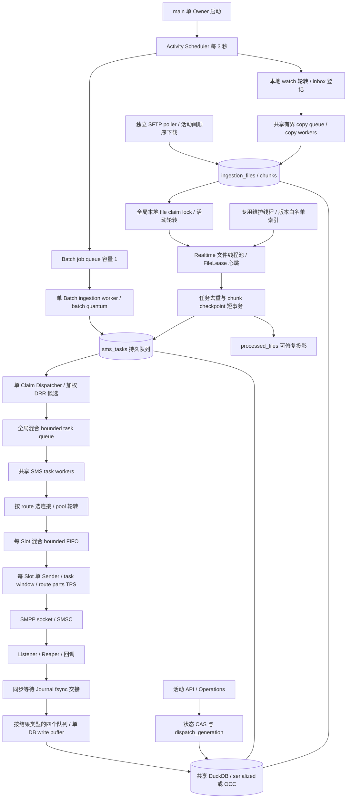
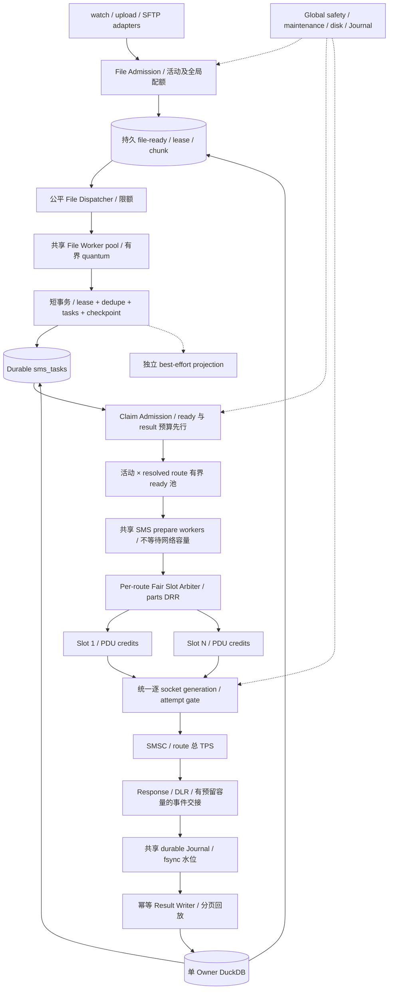
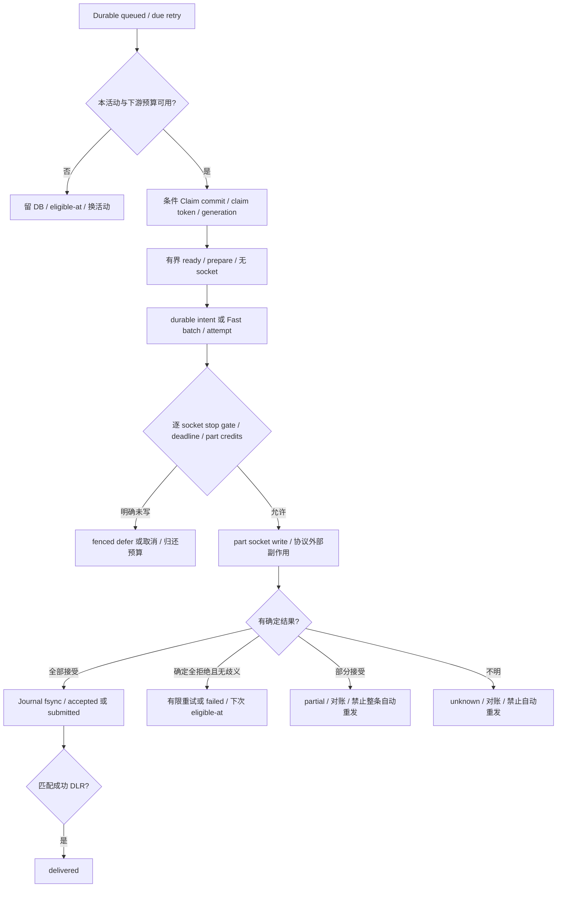

# Marketing Copilot Phase 1：现有架构审查与多 Campaign Worker 扩展设计

版本：1.0；日期：2026-10-15；任务：`MC-SCHED-ISOLATION-SCALABILITY-V1`。

审查源码：`a0b330059052610241ed33efa3c7f359116bbdbc`；本地 `HEAD` 与本地 `origin/main` 引用相同，未联网 fetch。
设计结论：**READY_FOR_IMPLEMENTATION**。这是进入下述分阶段实施的设计结论；现有 OCC Ingestion G3 仍是 **NO_GO / NOT_VERIFIED**，不授予生产切换或扩容验收通过结论。

## 1. 结论、范围与证据口径

当前系统已经具备持久任务、文件租约、Claim/Attempt Token、活动代际栅栏、活动轮转、结果 Journal 和权威状态/展示投影分离。主要缺口是这些机制尚未形成贯穿“文件准入→Claim→共享 Worker→实际 socket→结果持久化”的容量与公平协议，且 DLR 处理仍存在把不确定/部分发送任务改回可重试状态的旁路。单纯增加线程不能解决全局混合 FIFO、Slot FIFO、长文件占用、共享写入及结果回调阻塞。

推荐保留**单服务进程/单 DuckDB RW Owner**，共享文件与 SMS Worker 池；按 `(campaign_type, campaign_id, resolved_route_id)` 建立有界逻辑就绪池，先预留下游容量再 Claim，按实际短信分片成本公平准入 socket。活动拥塞局部暂停，故障路由局部暂停，数据库维护、磁盘不足和 Journal 不健康继续全局 fail-closed。无需为每活动创建进程、线程、数据库或 SMPP 连接，也不新增消息中间件。

本次仅新增本文档。不改业务代码、测试、数据库结构、配置或真实任务数据；不启动服务，不运行发送/修复/压测工具，不提交或推送。仓库已有 `frontend/package-lock.json` 改动、未跟踪测试、数据库和验收产物均保留。任务书内关于实施、commit/push、多份实施报告的要求，服从本次用户明确限定的“只做 Phase 1 设计、只交付指定文档”。

证据标签贯穿全文：

| 标签 | 含义与限制 |
|---|---|
| **S：源码核验** | 在本次工作树中核对实际实现与行号；证明代码存在及控制流，不证明运行验收通过 |
| **H：历史记录** | 仓库总结/报告陈述的历史结果；保留其 SHA、负载及 mock/环境限制，不升级为当前 PASS |
| **I：代码推断** | 可由调用顺序构造的阻塞/竞态/容量风险，本次没有动态复现 |
| **U：未验证** | 缺当前运行证据、现场参数或外部系统合同 |
| **D：推荐设计** | 后续实施合同，尚未实现；本文所有新配额/接口/flag 均属此类 |

本次完成静态源码、测试内容和历史文档核对，以及独立只读语义评审。**未执行当前版本后端测试、Frontend build、G1/G3/G4/G5/G6/G7；不存在本次新增吞吐、扩展效率或故障恢复实测数据。**源码链接采用仓库相对路径和 `#L行号`，均以以上工作树为准。

### 1.1 验收状态不能从历史报告继承

首要依据为 [OCC 专项总结](OCC-Ingestion-State-Consistency-Task-Summary.md)：最终目标测试因 Windows pytest 临时目录 ACL 出现 `3 passed, 23 errors`；最终修复后没有完整全套复测，OCC+Fast 运行曾停顿/不收敛，最后运行中止无成功产物。

| 项目 | 本次采用的状态 |
|---|---|
| 权威状态/镜像分离、完整事务重试及租约 fence | S：已存在；运行闭环未证明 |
| 历史离线 50K/1K/1K Claim/fake socket 隔离 | H：有离线记录；不能证明真实 socket 连续性 |
| P2 故障注入闭环 | NOT_VERIFIED |
| G3 OCC+Fast 1K×3 | NOT_VERIFIED |
| G3 同窗口四组合，每组合三个新进程 | 最终源码 NOT_RUN；不得引用旧 SHA 的 PASS |
| G4/G5、SLES12SP5、REAL_SMSC | NOT_RUN |
| 生产决策 | NO_GO |

历史 [G3 RCA](OCC-Equal-Window-2x2-G3-G4-G5-RCA.md) 和 [验收报告](OCC-Equal-Window-2x2-G3-G4-G5-Acceptance.md) 的 `c9890a7` 失败，是历史因果线索，不代表本次再次复现；其“UNKNOWN 文件错误重试”也不能混同为已证明“unknown SMS 被自动重发”。

## 2. 当前架构与关键源码证据

### 2.1 调用与资源关系（S）



箭头是调用/数据流，不表示每条边已有独立硬配额。系统还存在可选 RabbitMQ 直接发送入口，见 E18；上图主链是 Batch/Realtime。

### 2.2 可追溯证据目录（S，除特别标注）

| ID | 实际实现结论 | 关键位置 |
|---|---|---|
| E01 | 活动状态 `not_started→in_progress↔paused`，可 cancel/complete；首次 start 保留服务层校验，其他动作走 CAS | [p1_service.py:16](../backend/services/p1_service.py#L16)、[campaign_action:30](../backend/services/p1_service.py#L30)；[状态转换:433](../backend/services/sms_task_service.py#L433) |
| E02 | 启动获取实例锁，初始化 DB；scheduler→write buffer→task workers。停止顺序为 scheduler→task workers→result buffer | [main.py:157](../backend/main.py#L157)、[startup:174](../backend/main.py#L174)、[shutdown:211](../backend/main.py#L211)；[实例锁:118](../backend/services/runtime_service.py#L118)；[systemd workers=1:14](../deploy/marketing-copilot.service#L14) |
| E03 | Scheduler 每 3 秒串行执行各 stage，异常分 stage 捕获；Batch worker 独立；SFTP poller 独立，每轮间隔 15 秒 | [activity_scheduler.py:44](../backend/services/activity_scheduler.py#L44)、[Batch worker:80](../backend/services/activity_scheduler.py#L80)、[轮转:124](../backend/services/activity_scheduler.py#L124)、[tick:162](../backend/services/activity_scheduler.py#L162)、[SFTP:207](../backend/services/activity_scheduler.py#L207) |
| E04 | 本地 watch 活动轮转和 discovery quantum；共享 copy FIFO；满时释放 reservation。SFTP 活动轮转但同一 poller 顺序下载；inbox 登记仍逐活动/逐文件扫描 | [watch 配置:52](../backend/services/realtime_campaign_service.py#L52)、[watch:2562](../backend/services/realtime_campaign_service.py#L2562)、[copy put:2713](../backend/services/realtime_campaign_service.py#L2713)、[SFTP:2757](../backend/services/realtime_campaign_service.py#L2757)、[下载:2857](../backend/services/realtime_campaign_service.py#L2857)、[inbox:2907](../backend/services/realtime_campaign_service.py#L2907) |
| E05 | 注册文件身份为 type/id/filename，并比较 hash；Realtime inbox reservation 同事务检查活动/全局文件数、字节、pending task policy。不是每次 task insert 的硬配额 | [ingestion_job_service.py:46](../backend/services/ingestion_job_service.py#L46)、[reservation:142](../backend/services/ingestion_job_service.py#L142)、[pending task 检查:196](../backend/services/ingestion_job_service.py#L196) |
| E06 | Realtime 文件 Worker 默认 4、范围 1–16；`_claim_lock` 内枚举活动并调用 DB claim；解析在锁外。文件认领是条件 UPDATE/RETURNING，附 lease token/expiry | [worker 配置:30](../backend/services/realtime_ingestion_worker.py#L30)、[claim:277](../backend/services/realtime_ingestion_worker.py#L277)、[process_once:306](../backend/services/realtime_ingestion_worker.py#L306)；[DB claim:240](../backend/services/ingestion_job_service.py#L240) |
| E07 | 文件默认租约 600 秒，chunk 通用默认 300 秒；FileLease 单独心跳线程续文件及当前 processing chunk，Realtime chunk 使用 FILE_LEASE_SECONDS；持久边界验证 file/chunk token | [lease 默认:12](../backend/services/ingestion_job_service.py#L12)；[assert_owned:302](../backend/services/realtime_ingestion_state.py#L302)、[FileLease:364](../backend/services/realtime_ingestion_state.py#L364)、[chunk:468](../backend/services/realtime_ingestion_state.py#L468) |
| E08 | CSV/TXT 分 chunk 读取，临时独立 DuckDB 做文件内去重；XLSX/XLS 分支先整表 `pd.read_excel`。Worker 执行整个 receive_file，期间可等全局背压 | [receive_file:1282](../backend/services/realtime_campaign_service.py#L1282)、[读取:1427](../backend/services/realtime_campaign_service.py#L1427)、[CSV:1503](../backend/services/realtime_campaign_service.py#L1503)、[Excel 处理:1627](../backend/services/realtime_campaign_service.py#L1627)、[子批准入:117](../backend/services/realtime_campaign_service.py#L117) |
| E09 | 准备/模板处理在 durable task transaction 之外；task 去重 insert、事件、chunk progress/completion 在完整可重放事务内；之后单独 best-effort 投影 | [enqueue_rows:806](../backend/services/sms_task_service.py#L806)、[persist:945](../backend/services/sms_task_service.py#L945)、[事务与投影:983](../backend/services/sms_task_service.py#L983) |
| E10 | task key 包含活动、源文件身份、task_date、手机号；Realtime lease 路径追加 file hash。数据库 `dedupe_key UNIQUE` | [key:681](../backend/services/sms_task_service.py#L681)、[source hash:835](../backend/services/sms_task_service.py#L835)、[schema:1502](../backend/database.py#L1502) |
| E11 | `processed_files` 非权威，投影失败捕获但仍同步调用；投影有全局线程锁及阻塞文件锁。非法 chunk 文本存在两种处理：prepare 时改 failed 重放；complete 时包含 completed 就按已完成规范化 | [投影锁:25](../backend/services/realtime_ingestion_state.py#L25)、[投影错误:194](../backend/services/realtime_ingestion_state.py#L194)、[prepare:484](../backend/services/realtime_ingestion_state.py#L484)、[complete fence:513](../backend/services/realtime_ingestion_state.py#L513)、[宽松判断:602](../backend/services/ingestion_job_service.py#L602) |
| E12 | SMS Claim 本地锁内短事务；候选按活动/route 分组轮转及 DRR，Claim+事件一起提交；条件 UPDATE 生成 claim token、增 attempts。Fair 候选默认启用，可显式禁用后回到 FIFO | [claim_next_tasks:1092](../backend/services/sms_task_service.py#L1092)、[分组:1113](../backend/services/sms_task_service.py#L1113)、[UPDATE:1195](../backend/services/sms_task_service.py#L1195)、[提交后发布:1237](../backend/services/sms_task_service.py#L1237)；[fair 配置:35](../backend/services/campaign_capacity_service.py#L35)、[select:217](../backend/services/campaign_capacity_service.py#L217) |
| E13 | 单 Dispatcher 先 Claim 再向混合 `_task_queue` put；SMS worker 默认 8、范围 1–32，实际主要做 schedule validate 与 gateway.send_async；supervisor 补死亡线程 | [task_worker.py:96](../backend/services/task_worker.py#L96)、[Dispatcher:140](../backend/services/task_worker.py#L140)、[process:210](../backend/services/task_worker.py#L210)、[supervisor:307](../backend/services/task_worker.py#L307)、[queue:348](../backend/services/task_worker.py#L348) |
| E14 | 每 Slot 一个有界 FIFO、Sender、Listener/Reaper；send_async 的 put 最多等 60 秒。pool 选 Slot 为轮转，不依据空闲 window/队列长度；route TPS 跨同 config 的 Slots 共享，按 part throttle | [Slot:190](../backend/services/smpp_gateway.py#L190)、[Sender:316](../backend/services/smpp_gateway.py#L316)、[TPS:674](../backend/services/smpp_gateway.py#L674)、[put:752](../backend/services/smpp_gateway.py#L752)、[选择:1190](../backend/services/smpp_gateway.py#L1190) |
| E15 | window semaphore 每 task 获取一次、所有分片响应收齐/超时才释放一次，`inflight` 却计 sequence 数；Reliable 授权早于 throttle，Fast 才有逐 socket 的 campaign gate | [window acquire:944](../backend/services/smpp_gateway.py#L944)、[发送循环:1012](../backend/services/smpp_gateway.py#L1012)、[completion:426](../backend/services/smpp_gateway.py#L426)、[status:1138](../backend/services/smpp_gateway.py#L1138)；[socket gate:225](../backend/services/fast_send_service.py#L225)、[durable intent:1724](../backend/services/sms_task_service.py#L1724) |
| E16 | capacity service 提供 DRR/parts 成本；`min_parts_tps`、`max_outstanding_parts` 明确 advisory；max_parts_tps 在候选选择时扣 token，不等同于 socket 时点速率 | [task_parts:65](../backend/services/campaign_capacity_service.py#L65)、[select:217](../backend/services/campaign_capacity_service.py#L217)、[诊断:333](../backend/services/campaign_capacity_service.py#L333) |
| E17 | backpressure 的 task/chunk 深度是全局汇总；ingestion 等全部原因，delivery 只等 writes/disk/results/maintenance，避免 task 积压阻止排空 | [深度:70](../backend/services/backpressure_service.py#L70)、[原因:352](../backend/services/backpressure_service.py#L352)、[ingestion:396](../backend/services/backpressure_service.py#L396)、[delivery:418](../backend/services/backpressure_service.py#L418) |
| E18 | 可选 RabbitMQ consumer 启动后走 sms_sender，直接创建 rabbitmq/sending task、同步 gateway.send，绕过常规 Claim Dispatcher；其去重使用随机 UUID | [main.py:200](../backend/main.py#L200)、[sms_sender.py:14](../backend/services/sms_sender.py#L14)、[external task:2186](../backend/services/sms_task_service.py#L2186)。是否启用属 U，不认定其发送兼容性已通过 |
| E19 | write buffer 有四个类型队列；`wait=False` 仍先同步等 Journal fsync；pending/retry heap 无独立硬上限，瞬态故障持续重试；DB 结果以 event_id 去重 | [队列:19](../backend/services/sms_write_buffer.py#L19)、[submit:166](../backend/services/sms_write_buffer.py#L166)、[事件事务:301](../backend/services/sms_write_buffer.py#L301)、[重试:561](../backend/services/sms_write_buffer.py#L561)；[Journal append:113](../backend/services/result_journal_service.py#L113) |
| E20 | Listener 直接调用 part result/完成回调，可能等待上述持久交接；Journal 单 writer group fsync；load_state 全量建字典，compaction 复用同线程全量加载 | [response:368](../backend/services/smpp_gateway.py#L368)、[record_part_result:1904](../backend/services/sms_task_service.py#L1904)、[load:175](../backend/services/result_journal_service.py#L175)、[writer:252](../backend/services/result_journal_service.py#L252)、[compact:299](../backend/services/result_journal_service.py#L299) |
| E21 | Reliable >5 分钟 stale sending 进入 unknown，不重排；Fast 重启后未确认 durable claims 保守进入 unknown；同 claim 的迟到 submitted 回放仍能修复 unknown | [stale:3216](../backend/services/sms_task_service.py#L3216)、[Fast recovery:1381](../backend/services/sms_task_service.py#L1381)、[late success:2308](../backend/services/sms_task_service.py#L2308) |
| E22 | 默认 serialized 使用全局 RLock；OCC 普通 DML 放开该锁，maintenance 协调所有事务准入；完整事务新连接重试有界，OCC 连接执行 threads 默认 1 | [模式:13](../backend/database.py#L13)、[coordinator:142](../backend/database.py#L142)、[maintenance:205](../backend/database.py#L205)、[retry:596](../backend/database.py#L596)、[threads:891](../backend/database.py#L891)、[版本 pin:14](../backend/requirements.txt#L14) |
| E23 | Batch 当前只有一个处理 Worker；quantum 是批数/批间时间检查，非抢占式；全局 generation/source 锁覆盖读 frame/处理，source 锁还覆盖背压等待 | [Batch queue:17](../backend/services/activity_scheduler.py#L17)、[Worker:80](../backend/services/activity_scheduler.py#L80)、[生成:1089](../backend/services/batch_campaign_service.py#L1089)、[源锁:1435](../backend/services/batch_campaign_service.py#L1435) |
| E24 | 正常提交状态按 DLR mode 分 accepted/submitted，但 optional/disabled 可填写 delivered_at、accepted 也增加 Batch delivered_count；另有手工 mark_delivered。字段/状态不等于真实成功DLR证据 | [disabled:2065](../backend/services/sms_task_service.py#L2065)、[普通提交:2302](../backend/services/sms_task_service.py#L2302)、[Batch计数:2368](../backend/services/sms_task_service.py#L2368)、[手工确认:3126](../backend/services/sms_task_service.py#L3126) |
| E25 | `_apply_receipt` 将 UNKNOWN/UNDELIV/EXPIRED 在 receipt_retry_count<1 时转 retrying，UPDATE 未保护 unknown/partial；正DLR/ENROUTE也可把partial改为submitted；成功part有message binding，重试任务可再次Claim | [DLR map:73](../backend/services/sms_task_service.py#L73)、[part绑定:1988](../backend/services/sms_task_service.py#L1988)、[receipt状态折叠:2724](../backend/services/sms_task_service.py#L2724)、[重试转换:2756](../backend/services/sms_task_service.py#L2756)、[查任务:2841](../backend/services/sms_task_service.py#L2841)、[retrying Claim:1195](../backend/services/sms_task_service.py#L1195)。实际触发及重发数量属U |

### 2.3 生命周期、持久化和幂等边界

活动：E01/E12 的状态和 generation 检查阻止暂停/旧代际任务继续被正常领取；E15 的 Reliable 授权检查当前活动、日期、每日窗口及 claim。但**已授权并不等于已经写 socket**。目前 Reliable 在授权后还可能等 throttle，Fast 才在每次 socket 前检查本地控制栅栏；这两种时序不能统称为已证明“停止后零新发”。

文件：watch/upload/SFTP→reservation→原子发布与注册→pending/retrying→条件 claim/processing→解析/白名单/模板→任务+chunk 同事务→completed 或 retry/quarantine。FileLease 心跳不依赖解析线程（E04–E09）。完成 checkpoint 允许重新读取时跳过已完成业务提交；文件归档与 DB 提交不是同一个事务，归档失败/重启仍需依赖 hash、lease、checkpoint、dedupe 恢复。展示投影丢失不得触发重新发送（E11）。

任务：`queued/retrying→sending(claim_token)→attempt authorized/intent→实际 submit_sm→accepted/submitted / definite failed / unknown / partial→有效 DLR delivered`。中间的 authorized 属于 attempt 状态，不应未经迁移就新增为 UI task status。claim 已增加 attempts，故容量不足反复 Claim/失败会消耗尝试预算（E12–E15）。正常 task worker 使用异步入口，另有同步兼容入口（E18）。

幂等性：E10 的稳定 key 与 UNIQUE 可抑制**同一业务键的重复 task 插入**；其身份包含源文件，重命名或新 hash 不应被误称“同活动同日同号码绝对只发送一次”。E19 的 event_id 与 Claim/Attempt fence 用于结果重放及迟到回调防覆盖。它们均不能让 DuckDB 事务与外部 SMSC socket 事务原子提交。写出后响应丢失/落 Journal 前崩溃时，SMSC 可能已经接收。发送失败、stale/Fast恢复及普通手工重试主路径有保守保护，但 **E25 的 DLR 旁路仍可能使 unknown/partial 回到 retrying，因此不能宣称当前系统已全面保证“不确定/部分发送绝不自动重发”**；这是静态风险，尚未本次动态复现。目标必须关闭此旁路，保留人工/供应商对账。**不承诺端到端 exactly-once，也不承诺故障下所有未知短信最终必达。**任务不丢失是账本可追踪，包括仍需对账的 unknown，不是把 unknown 计为发送成功。

### 2.4 当前队列与 Worker 绑定

| 资源 | 当前范围/容量 | 消费者与传播边界 |
|---|---|---|
| Batch job queue | 全局容量 1 | 单 Batch worker；大单批不能靠量子强制抢占，见 E23 |
| Watch copy queue | 全局默认 32，上限 256；copy 默认 2，范围 1–8 | 共享 copy workers；已有 discovery quantum，不代表慢 copy 已隔离，见 E04 |
| 文件 ready | DB 持久队列，无内存 Queue；inbox 有 reservation 限额 | RT 默认 4，范围 1–16；本地 claim 串行，解析并行，见 E05/E06 |
| SMS task dispatch queue | `max(100,min(1000,task_workers*4))`；当前 Worker 上限 32，故实际最大 128 | 单 Dispatcher→所有 SMS task workers，混合活动/route，见 E13 |
| Claim 事务局部 batch | 默认 `max(claim_batch,min(200,workers*2))`，另有显式 override | 容量未从下游 reservation 扣除，batch 局部列表也是已领未派工作，见 [fetch size:121](../backend/services/task_worker.py#L121) |
| Slot send queue | 每 Slot 默认 `max(100,window_size*4)`，显式 env 范围 1–5000 | 每 Slot 单 sender；满时共享 task worker 最多等待 60 秒，见 E14 |
| SMPP window | 每 Slot 配置 1–100，当前单位 task，非 PDU | completion/reaper 释放；multipart 可放大实际在途 PDU，见 E15 |
| Result buffer | 4 个类型队列，每个默认 100000；另有 pending/retry heap | 单结果 DB writer，类型间轮转，无活动级结果配额，见 E19 |
| Journal append queue | 默认 100000 请求，group fsync 单 writer | 全局共享；load/replay/compact 无固定内存硬界，见 E20 |

G3 legacy 参数 `send_queue_capacity=2000` 是**每 Slot**容量；pool=4 时仅该层即允许 8000 条缓存，再加 claim batch、task queue、workers/inflight/result。不能把它与目标架构“总预算 2000”当成等价。内存条数有界也不等于 payload 字节有界；Journal pending/重试、整表 Excel、磁盘任务与诊断缓存还要单独核算。

### 2.5 锁、数据库竞争、IPC 与恢复现状

| 位置 | 当前串行/竞争关系 | 判断 |
|---|---|---|
| DB `_write_lock` / maintenance coordinator | serialized 全局写互斥；OCC 同一 Owner 的连接竞争；maintenance 阻止新准入并排空在途事务（E22） | S：真实全局资源；不能为隔离活动而绕过 |
| file `_claim_lock` | 活动枚举、逐活动 DB claim、DB retry 在临界区；解析锁外（E06） | I：claim 等待/活动数增大可能压低扩展收益 |
| `_TASK_CLAIM_LOCK` | DRR 候选查询、parts 估算、claim/event 提交及重试串行（E12/E16） | I：复杂聚合、编码、DB 重试会放大临界区；不是所有 SMS socket 的全局锁 |
| Batch global generation/source lock | 锁内读取、处理、DB 和部分背压等待（E23） | S：增加 Batch 线程不能直接并行这些范围 |
| projection guard | 全局线程锁→文件锁→投影事务（E11） | I：虽然不回滚 authority，阻塞获取锁仍可能占住 ingestion worker；异常捕获不是超时控制 |
| Fast campaign barrier / Slot send lock | 已有控制 barrier→DB；Claim 提交后才发布本地 fence；短 socket 受本活动 fence+Slot write lock（E12/E15） | S：须保留既有消除 DB→fence 反序的约束；Reliable 缺同等 gate |
| result `_pending_condition` | submit 在该锁内执行有超时 put（E19） | I：满队列时锁等待和 callback 等待可放大；不能笼统声称已证死锁 |
| route TPS shared lock | 只保护预约，sleep 在锁外（E14） | S：没有“持该锁 sleep”问题；预约债务及共享容量仍需测量 |

主生产链为同一进程内线程、Queue、Event、Condition 和函数回调，**没有多进程任务总线/跨进程 Claim 协议**（E02/E13）。独立白名单索引、临时去重 DuckDB 文件不等于主库分片；Send Store PoC 文件也不能视为上线存储路径。

实例锁与 `--workers 1` 限制多个完整服务进程同时占用主库。`MC_ALLOW_MULTI_INSTANCE` 是绕过防护，不是扩展方案，Fast 还拒绝该配置（[freeze_mode:54](../backend/services/fast_send_service.py#L54)）。后续 CPU 子进程只能纯解析，不得打开主库；若未来需要多个主库写进程，须另立客户端/服务端存储架构和迁移项目。官方说明支持原生进程内读写由一个进程管理并允许其多线程 MVCC/OCC；此处仅交叉核对边界，项目固定的 DuckDB 1.2.0 仍须独立验证，不能拿新版能力作替代证明。[DuckDB 官方并发文档](https://duckdb.org/docs/current/connect/concurrency)

文件处理失败按分类/next_retry_at 恢复，正常文件错误有限重试，WAITING_DEPENDENCY/RESOURCE_LIMIT 可继续等待（[worker:397](../backend/services/realtime_ingestion_worker.py#L397)、[retry policy:21](../backend/services/realtime_ingestion_retry_service.py#L21)）。Lease expiry 后重领、旧 owner 回调被 fence（E07/E21）。SMS supervisor 只补线程，不代表线程持有工作立即归还；Reliable stale sending 保守转 unknown，Fast durable claim 跨重启也转 unknown。启动 buffer 会加载并排队回放，**没有等待所有结果回放落库的启动屏障**；同 claim 的迟到成功可以修复 unknown，所以不能断言当前顺序必然丢结果（E02/E19/E21）。停止路径有 join 期限，但文件阻塞调用未必随 Event 中断；同进程 stop/start 后旧线程是否完全退出属 U，需专门验证。

## 3. 多 Campaign 隔离问题的直接回答

1. **A 的发送队列拥塞可能影响 B/C（I）。** 同 Slot FIFO 存在队头等待；满队列 put 占住共享 task workers 后，其他 route 也可能缺可用 Worker。Claim DRR 只能改善入口顺序，不能消除该路径（E12–E15）。不同健康 route 的网络连接有独立 Slot，但共享 Worker、DB、Journal，尚无当前 E2E 隔离证明。
2. **慢任务/故障可能阻塞其他工作（I）。** RT 单次 receive_file 持有整个 file worker，A 可在 B 到来前占满池；Batch 源全局锁与非抢占单批、SFTP 顺序下载、同步 projection/Journaling 都是候选传播点（E04/E08/E11/E19/E23）。单 stage 异常捕获能隔离异常退出，不能隔离长时间阻塞。
3. **公平与背压必须按活动、route、global 分层（D）。** 缺本活动 ready/file/parts credit 时跳过该活动；缺 route credit 时跳过该 route；仅 DB/Journaling/磁盘等共同安全失败全局暂停。全局 task/chunk 聚合水位目前仍会暂停所有 ingestion；应在低于全局硬安全阈值前先执行局部配额（E17）。
4. **不能让 A 长期占满全部 Worker（D）。** 活动运行时间片、inflight file/prepare 配额、ready 任务及 bytes 配额、socket parts outstanding 上限同时约束。空闲份额可借用，但未发出的借用额度在新活动到达时立即撤回；已发网络请求不可抢占，等待上界必须包含 ACK/timeout。单 Worker 时使用 chunk/批次安全让出，无法终止的 I/O/Excel 不宣称具备硬实时公平。
5. **共享与隔离见下表（D）。** 逻辑隔离不要求独立 OS 进程；共同硬件故障和同 route 物理饱和不可能完全无影响。

| 资源 | 所有权与隔离方案 |
|---|---|
| 原始文件、manifest、白名单版本、checkpoint、retry/deadline、generation | 按活动/文件隔离；输入快照/hash 固定，防止任务和重试串线 |
| discovery/copy/file-ready/prepare/ready、等待时间与软背压 | 活动级配额及公平选择，总量受全局硬限额约束 |
| SMS 公平实体 | 活动总账+活动×已解析 route 子队列；多 route 不重复获得完整活动份额 |
| route TPS/健康/cooldown | 按实际 route/config 共享；若多个 config 共用 SMSC 账号额度，归入同一 account budget |
| Slot、socket write lock、sequence/connection generation、PDU window | 按连接隔离；共享 route arbiter；不能让暂停 A 清空 B 的队列或断开全池 |
| Worker 池、主 DuckDB、Journal、result writer、磁盘 | 共享且有总量上限；按阶段/活动公平，关键安全失败全局保护 |
| API/控制命令、心跳和结果排空 | 保留调度机会，不能被数据生产与观察查询耗尽；API 仍走既有鉴权 |

## 4. 架构问题与风险清单

优先级：P0=正确性/安全门禁阻断；P1=隔离、可扩展性与可恢复性必要改造；P2=测量后优化。风险等级不是本次已复现的生产故障等级。

| ID / 级别 | 事实、风险与证据等级 | 后续处置 / 验收 |
|---|---|---|
| R01 / P0 | G3 未关闭；历史 OCC+Fast 不收敛，最终运行无产物（H/U，§1.1） | S0 当前源码复现/最小修复；T01–T03；不沿用历史 PASS |
| R02 / P0 | 包含 completed 的非法状态可在完成路径跳过正常 chunk 状态/token 分支并规范化，file lease 仍检查；prepare 路径却重放（S：E11；实际损坏/丢任务 U） | 保存原始非法值和权威 task/chunk 证据；无证据 fail-closed/quarantine；T01/T02，不凭注释认定 DuckDB 缺陷已确诊 |
| R03 / P0 | Reliable authorize→throttle→socket 存在暂停/取消/窗口结束竞态；非 Fast gate 是 no-op（S：E15；越栅栏 I） | 统一两模式逐 socket stop fence；因任务书要求停止后无新发，作为发布阻断；T06 |
| R17 / P0 | DLR状态更新未保护unknown/partial，可由负DLR转retrying并再次Claim；正DLR/ENROUTE可把partial改为submitted，抹去部分发送分类（S：E25；实际重复外部发送I/U） | S0确定性复现，S1统一receipt/attempt/part状态机；负DLR只记事实，不自动整条重发已发/不确定任务；T02/T07/T11含完整DLR×状态矩阵 |
| R04 / P1 | 全局 dispatch FIFO+Slot FIFO+阻塞入队可传播 A 拥塞至 B/C，甚至其他 route（S/I：E13/E14） | S1/S2 下游 credit、逻辑 ready、空闲 Slot 拉取；T04/T05 |
| R05 / P1 | window 单位 task、inflight 单位 part；multipart 无已证 PDU 硬上限（S/U：E15） | S2 明示单位并实现逐 PDU credit；T05/T07；迁移前不能按两者相除报告利用率 |
| R06 / P1 | max_outstanding_parts/min_parts_tps advisory；max_pending_tasks 仅 RT 新文件 reservation 检查，已入文件可继续大量产出，Batch 无等价硬执行（S/I：E05/E16） | task insert 前局部配额事务检查，保留无容量文件 checkpoint；不承诺硬保底 TPS；T04/T08 |
| R07 / P1 | 文件按 claim 轮转但整个 file 占 Worker；claim 锁含多次 DB 调用，扩容可能耗于锁/DB；XLSX 整表 RSS 增长（S/I：E06/E08） | S3 有界 chunk 工作单元、每活动 inflight、受控 Excel；T08 |
| R08 / P1 | Batch 单 worker+全局 generation/source 锁覆盖 I/O、处理和等待；quantum 非硬时限；SFTP 活动间同步下载（S/I：E03/E04/E23） | S3 按 source/manifest 维护单 owner 和有界批次；SFTP 有界共享 I/O pool；T04/T08 |
| R09 / P1 | 主库全局 serialized gate/OCC 热行、候选聚合/parts 编码和进度/心跳竞争（S/I：E07/E12/E16/E22） | 缩短事务/减少查询与无效并发，测量后调 batch；T02/T09。不能把所有停顿归因于 DuckDB |
| R10 / P1 | 结果 wait=False 仍同步 fsync，Listener 可停在全局 Journal；pending/heap、回放及 compact 无硬内存界（S/I：E19/E20） | S1 先预算，S4 分页回放/有界结果交接；结果不得丢弃，DB 不健康暂停准入；T10/T11 |
| R11 / P1 | 无完整 replay-before-claim 屏障；crash 后未实际发送的 reliable sending 也可进 unknown，安全但降低自动恢复能力（S/I：E02/E21） | 新合同区分可证明未发、已发/不明；启动屏障与 token 对账；T10/T12 |
| R12 / P1 | 投影不回滚 authority 但同步 guard 可阻塞；线程停止后未退出前重新启动可能存在旧调用（S/I/U：E06/E11/E13） | 投影 deadline/合并修复、旧 Worker epoch、完整 shutdown；T10/T12 |
| R13 / P1 | optional/disabled 的 accepted 写 delivered_at、增加Batch delivered_count，另有人工delivered；旧计数混合业务完成/真实送达（S：E24） | 区分SMSC accepted、业务终结、成功DLR、人工确认；后续兼容修正字段语义，不能清理历史真实数据；T07/T11 |
| R14 / P1（依启用情况） | 可选 RabbitMQ 同步直发绕过常规 dispatcher；其 type/授权/去重合同不同（S：E18，是否启用 U） | S0 盘点，S1 兼容适配或明确独立受控边界；不能未经验证接入新 fairness 后宣称全入口覆盖；T13 |
| R15 / P2 | 活跃组枚举/窗口查询、目录排序、指标 campaign label 生命周期可能随历史规模增大（S/I：E04/E12；无当前性能证据） | EXPLAIN/计时、活跃集合缓存/回收、指标 TTL；需要证据才加索引/摘要或独立写调度器；T09/T14 |
| R16 / P2 | 旧设计说明与现代码的去重/恢复/路由语义不一致（H vs S：E10/E14/E21/E24） | 后续更新运维文档；本文明确以源码为准，不将旧说明当约束放宽重试 |

## 5. 推荐目标架构（D，尚未实施）

### 5.1 组件职责和接口



| 元素 | 职责与拟议接口（非现有 API） | 复用/调整位置 |
|---|---|---|
| ELM01 File Admission/Dispatcher | discovery 只发现与登记；`try_reserve_file(campaign,bytes)`；挑可执行活动、预留 file/parse slot，再 DB lease；不给缺白名单/满配额活动占池 | realtime_campaign_service、ingestion_job_service、realtime_ingestion_worker；Batch 源适配 |
| ELM02 Task Claim Admission | `reserve_ready(group,cost)`→`claim_for_groups(groups,limits,deadline)`→commit→publish；失败有 token 对账；一个 dispatcher 控制 Claim 竞争 | task_worker、sms_task_service、campaign_capacity_service |
| ELM03 Bounded Ready/Prepare | ready 描述符保存 task/claim/generation/route revision/deadline；任务 payload/编码缓存有 bytes 上限；prepare 完成回 ready 池，不把 Slot 队列等待占在通用 Worker | task_worker；可抽出小型进程内调度模块 |
| ELM04 Route Fair Slot Arbiter | 空闲且健康 Slot 主动拉取活动；按实际 parts 成本 DRR，检查活动总账+route/Slot/result credits；路由连接重试在所属 I/O 路径，不占用通用 SMS worker | smpp_gateway、campaign_capacity_service |
| ELM05 Send Fence/Result | 两模式共用 stop gate；保持 durable intent/fast batch、attempt/part 身份、Journal event_id；聚合结果不能提前标 accepted/delivered | fast_send_service、sms_task_service、smpp_gateway、sms_write_buffer、result_journal_service |
| ELM06 Safety/Observability | 活动/route/global 原因和 credits 一致账；DB/Journal 不健康停止新副作用，排空已收结果；受控 API 提供快照 | backpressure_service、metrics_service、既有内部诊断入口 |

Queue 只是 DB 权威任务的有界缓存。缺内存容量时让未领取任务留在 DB，缺文件容量时保留原始文件或 durable pending，不把“尚未准入”转成失败风暴。队列空、缓存丢失、进程重启均不能造成业务 task 消失。

### 5.2 公平算法、路由身份与等待边界

保留现有 DRR 与候选组轮转思想，但**领取选择仅是预取公平，最终计费/公平事实在 socket**。候选阶段使用 parts 估算以控制预取，prepare 使用原 gateway 编码得到实际 parts，超预算则归还差额或等待追加预算；编码失败不使用乐观低估发出。调度 deficit 不能在 Claim 失败/取消后永久扣费；socket 消耗后的实际 parts 才进入最终服务账。

每个 route 轮转本 route 活跃且可准入的活动；活动内 oldest-due FIFO。空活动移除，deficit/借用突发有上限，route down 的组挂到可中断 eligible-at，不占 Worker sleep。超过 active candidate window 的新活动通过轮转游标进入，不能每轮只扫描最老 A。活动跨多个 route 以总账限额，避免按 route 数重复分配份额。

逻辑 route 必须在持有硬 route credit 前确定为真实 `config_id + config_revision`；当前“未指定 route=0”只是候选占位，不是物理容量池。允许有限元数据预取，不能让 route=0 绕过真实下游预算。配置变更/fallback 时，只迁移**可证明尚未发出**的描述符，并转移/释放旧 credit；已发或未知 attempt 不换 route 自动重发。多 config 是否共享一个 SMSC 账号限额作为配置前置核对，先沿用既有 route 共享 TPS，不乘 pool_size。

MVP 使用固定配额、等权或已有 weight，work-conserving 借用空闲份额；不先做 PID/复杂自动调参。`min_parts_tps` 不改写为硬 SLA；没有实测容量和可满足的总预算，不作保底承诺。`max_outstanding_parts` 从 advisory 转强制时必须发布诊断、配置校验及兼容变更。

最大等待不是无条件常量。对持续有 backlog 且有资源的组 i，在冻结配置下记录 DRR quantum `q_i`、任务 parts 上限 `P_i`、活跃组数、每轮最大 parts、最低可用服务速率和最大非抢占时长；`k_i=ceil(P_i/q_i)` 给出累计 deficit 所需轮数，等待预算至少包含 k_i 个有界调度轮、已发借用请求的最大剩余 ACK/timeout、控制/DB/调度耗时。`P_i`、I/O 时限或最低可用服务能力无法界定时，只报实测等待分布，不伪称有限 SLA。新活动到来时撤回未使用借用额度，已在途 PDU 等其响应/timeout 后再归还。

每 Slot 保持一个 socket writer，Slot 本地只保留至多一个待交接描述符或等价小预算，避免再堆深 FIFO。初版 multipart 固定同 Slot/connection generation，保持 UDH、编码和 Flash DCS；每个 PDU 发前获取一个 window permit，收到对应 response 或确认该连接已关闭后恰好释放一次。**超时不是远端请求已结束的证据**：超时先禁止该 connection generation 新写入，隔离并关闭旧连接，再结清该代际本地 permits，保留未确认 parts 为 unknown/partial；不能在旧连接仍发送时仅因本地 timeout 就复用 permit。迟到 response 只按原代际去重/修复，不再释放新连接额度。window 硬约束指每个活跃连接上已写且未响应的 PDU 数，不承诺不可观测的 SMSC 内部处理队列或跨代际账号工作量上限。**不得一次申请整个 multipart 所有 window permits**。parts 超过 window 的消息必须也可完成。单 multipart 循环不可无界占住 Sender：先规定可接受最大 parts 和提交 deadline，按实测求非抢占上界；达不到 G4 等待预算时，该轮实现不能验收，须支持同 Slot 的有界 continuation/yield，再验证分片交替，不把 multipart 分散到不同连接来掩盖问题。

### 5.3 容量账与所有权

容量至少同时按条数、parts 和 bytes 记录。下面的容量值由 S0/S3 测量后冻结，不是本次给出的性能数字。

| Credit / 单位 | 获取与持有阶段 | 释放/恢复规则 |
|---|---|---|
| `file_processing` / 文件+估算解析 bytes | claim 前按活动及全局预留 | quantum checkpoint 后释放；未开始则 token-safe 放回；lease lost/crash 由新 owner 重建 |
| `claim_ready` / task+parts+payload bytes | DB claim 前，覆盖 claim 局部 batch、内存 ready、prepare 与交接中全部引用 | 只转移所有权、不为同任务重复计费；socket 接手或 fenced defer/取消后释放 |
| `prepare_active` / Worker 槽+编码 bytes | 有界 prepare 开始 | 编码完成/异常/取消即释放；不等 socket/route 容量 |
| `campaign_outstanding` / parts | socket 准入前按本活动总账预留 | 对应 part response 或所属连接代际隔离并关闭后释放 live permit；超时不能单独退款；结果未落库仍占 result debt，unknown 有独立欠账上限且不恢复发送资格 |
| `route_rate` / parts token | 确定健康 Slot 即将发送时 | 成功 socket admission 消耗；确定未发可撤销 reservation；已发/不明确不得退款为可重发；预约不形成无界未来债务 |
| `slot_window` / 未响应 PDU | 每个 part 写前逐个获取 | 对 response 或已确认连接关闭，按 attempt+part+connection generation 的一次性完成记录释放；timeout 先冻结并关闭旧代际，late response 不释放新代际 permit |
| `result_pending` / 事件数+最坏 bytes | **发 socket 前**按 mode、part 数、终态事件及可能 DLR 预留 | 内存交接额度到 durable Journal fsync 后可转为 durable debt；DB commit+Journal terminal 后结清。不能 ACK Queue.put 就视为持久 |
| `projection` / 合并记录数+bytes | authority commit 后 best-effort 预留 | 过载合并同 file 最新 state_version 或留 drift 待修复，不能阻塞权威业务 |

同一 task 的容量阶段必须互斥转移：`reserved→claimed→ready/prepare→handed_to_slot→resolved`。每个 reservation 有唯一 id、owner epoch、task/claim/generation、deadline、释放标记。cancel、timeout、异常、late callback 使用同一 CAS/状态机释放，重复通知不得重复释放。Claim commit 后、publish 前进程死亡，由 DB 账恢复；不能靠内存去掉一项就把 durable sending 当 queued。

总量不变量：`used(stage) <= configured_global_limit(stage)`；活动/route 子账总和等于 global 已占用账（不重复计算共享引用）；`acquired - released = live reservations`。当 pool/route 数增加，window 总量和结果最坏债务一并受 global 限制，不能给每 route 重复分配整机预算。全局 result/磁盘安全限额有意可以影响所有活动。

结果回调先交有**预留额度**的有界内存事件队列，由专用 Journal writer group fsync；listener 不等 DB。交接失败或 fsync 不健康立刻停止新 socket，不丢事实。把 listener 等 fsync 改为异步后会改变响应到持久化的故障窗口，必须披露；崩溃导致“响应到达但未持久”仍以 intent→unknown 处理，不增加自动重发。DLR 重传可能超过正常预估量，必须按 event key 去重、预留额外紧急容量并在无法持久接收时用协议允许的保守错误/连接处理，不能承诺任意重传流量也零阻塞。

write buffer 的 pending/heap、replay 和 compaction 也纳入 bytes/global 限额。优先复用当前 Journal 格式与 event_id，以有界分页/落盘索引恢复；若无法在既有格式下保证边界，再单独版本化日志分段/水位格式，保留旧版读取和回退能力。瞬态故障允许 durable debt 保留，不允许在无限内存 heap 中持续接收；停机留下 durable 未结债务可恢复，flush 遇 quarantine 必须返回非纯成功状态。

### 5.4 文件 Worker 独立扩展

先保持文件内单 owner，不直接并行同文件多个 chunk。RT dispatcher 按活动轮转并检查 `max_active_files_per_campaign`、parse bytes、下游 pending tasks；新活动到达时禁止 A 新领占满，已运行文件在**安全 chunk checkpoint**后让出。Worker=1 时也必须能在有界 quantum 后轮到 B；“先给 A 一份文件额度”本身不能解决超长文件长期占用。

CSV 的安全让出以已持久 chunk/业务行边界为准，保留固定 file hash、白名单版本、模板/配置身份及去重语义。进程内可复用受限数量的解析游标；重启可从原快照顺序读并跳过已提交 chunk，不能把任意 byte offset 当 CSV 引号/多行记录边界，也不能丢掉跨 chunk 的文件内去重事实。重放既验 task 唯一，也验 chunk/file 聚合计数未重复累计。

Batch 将 generation/source ownership 缩至 manifest/source，游标由单 owner 更新，不跨活动持锁等待背压/DB；先保留有界一批一个工作单元，再按测量扩文件池。API 的完整 generate 调用也必须纳入合同，不能只改 scheduler quantum。SFTP 下载和本地 copy 使用受活动配额约束的有限 I/O Worker/工作项 deadline，防止慢源堵整个 poller；网络库 timeout 不等于整个大文件作业总时限。

XLSX 当前整表读先采用文件大小/内存准入、有限并发与清晰拒绝/延期；需强制读取截止时，评估只做纯解析的受限子进程，CPU/I/O 结果通过有界 IPC 返回 Owner。父进程验证 lease/epoch/hash 后才提交；child crash 释放内存额度、原文件可重试，迟到结果被 fence。**该子进程优化为有测量依据后的选项，不是多主库 Writer。**不能声称 thread Event 能终止任意 pandas/磁盘阻塞。

### 5.5 Claim、租约、外部副作用与恢复协议

优先复用 ingestion_files/chunks、sms_tasks、sms_send_attempts/parts、sms_fast_batches/items、task_events、sms_result_events 和现有索引。新调度缓存与 credit 不要求新数据库。若确需额外 durable 字段，后续单独提出可评审的增量 migration；本阶段没有执行 DDL。



持久 task status 保持现有 API 兼容，中间态以 descriptor/attempt 表达。目标可重试分三类：容量 defer 不消耗外部发送重试预算；确证未发或 SMSC 明确可重试全拒绝按退避/上限/总 deadline 重试；可能写出、partial、unknown 禁止自动整条重发。迟到结果必须带旧 attempt/claim/namespace，与新 attempt 不冲突；PDU sequence 只在相应 connection generation 内有意义。

DLR 处理必须与发送失败/恢复共享上述规则，补上 E25 的现有旁路：按 namespace/message binding 解析到具体 attempt/part，保存迟到正/负/中间态事实，再从同一 attempt 所有计划parts证据单调折叠 task；**DLR UNKNOWN/UNDELIV/EXPIRED 不是“该任务从未发送”的证据**，不得将已提交、不明或partial任务整体重排。partial 的已接受part收到DELIVRD不能抹掉其他part失败，ENROUTE不能回退其分类。unknown只有足够覆盖计划parts的权威事实才可收敛为对应确定状态；旧attempt的receipt只能更新旧part事实，不能改新attempt资格。普通receipt重放不得重复计数。现有手工mark_delivered可保留受权审计入口，但以manual来源独立呈现/统计，不能作为SMSC验证送达。R13历史字段与Batch完成计数迁移保留兼容解释，不通过清空真实数据“修正”。

**运行中丢 Worker**：supervisor 释放未开始的本地预留，运行项按 epoch/deadline 检查；lease 到期的 file 可重读并幂等提交。SMS 缺回调时关闭/隔离所属 Slot 并收集未结 part，先归类已发/未发，不能为了释放 semaphore 清掉持久 attempt 证据。

**重启**：获取唯一 Owner→校验 Journal 格式/完整性并记录启动 replay 集合→幂等消费启动集合至水位、记录持久 quarantine→reconcile attempts/parts/claims→恢复文件租约与活动代际→重建空 ready/credit 账→打开新准入。quarantine/Journal 不健康保持阻断。内存缓存不回放 socket，Journal 只回放业务事实。启动期间收不到旧 socket 新响应；后续迟到 DLR 仍按 namespace/attempt 匹配。

跨重启恢复 queued 仅适用于**新协议可证明未 socket**的 claim：例如带新 pipeline 版本/provenance 的 Reliable claim，且没有对应 send intent，且所有入口均满足 intent-before-wire。以现有事件 payload 记录该 provenance/Claim 生命周期，CAS 更新相同 claim token。仅凭 updated_at 超时、内存队列空、`part state=planned` 或“没有成功响应”不构成未发证明。Fast Claim 已生成 durable 不确定 attempt，跨重启默认继续 unknown；legacy claim 同样不放宽。当前进程内可确定未发的 Fast 路径仍复用 fenced abort。按新旧协议区分后再提高恢复率。

**停止/取消**：统一 Reliable/Fast 活动 gate，控制请求先关闭本活动新 socket admission，等待已进入的短 write 有界退出→DB generation CAS→发布新状态→清本活动未发描述符/转移 credit。清理不 flush 他活动、不全局 disconnect。每个 part gate 都校验截止日期/每日窗口；不能只检查 multipart 第一 part。停止成功返回之后无新 PDU 写入；返回前已写出的 PDU 仍可被 SMSC 接收并返回结果，不能撤回或伪造 cancelled。

**停机**：关闭 intake/claim→取消未开始工作→保留有界响应接收期→关闭 socket/等所有 reader/callback 退出→最终 Journal fsync 屏障→最终 DB 消费屏障→停止 writer/释放 Owner。期限耗尽保存 durable unknown/debt，下次恢复；不得把尚活旧线程的句柄清空就当安全重启。恢复与控制日志不记录手机号/正文。

### 5.6 锁获取顺序与禁止等待

目标以“分阶段释放锁”为主，不建立一把包住所有阶段的新全局锁。

| 路径 | 允许的顺序 | 禁止/截止规则 |
|---|---|---|
| reserve/公平选择 | scheduler mutex 下只更新内存 reservation，然后释放 | 不在该锁内 DB、网络、fsync、阻塞 put、sleep |
| Claim/file lease | 独立 claim mutex→DB coordinator→短事务；全部释放后 publish | 不在 DB 持有期获取 campaign gate 或 scheduler mutex；retry 有界且统计锁等待 |
| campaign control | 设置 admission-closing→本活动 gate→短 DB transaction→commit→发布本地 state；释放 gate 后清队列 | gate 内无 Journal/ACK 等待；DB 不得回调 scheduler；控制 deadline 到期返回可查询结果，不宣称未提交 |
| actual write | 已持 durable intent/credits，无 DB 锁→本活动 gate→本 Slot send lock→短 socket write→释放 | pacing/window 等待在 gate 外；socket write 有时限，不在 gate 内等 SMSC response |
| callback | Slot condition 下只摘取 outcome/释放一次 part credit，随后释放→有预留容量的事件交接 | 不在 condition/send lock 中等 DB/Journal/fsync；后续完成回调幂等 |
| projection | 先 commit authority，再带 deadline 的独立 projection；必要时合并/延迟 | 不与 file claim/DB authority 锁形成反向嵌套 |
| maintenance | coordinator 关闭准入、排空事务、执行维护 | 不持 scheduler/campaign/Slot/Journal 锁；对账工具不旁路 Owner |

实现评审逐对检查 `campaign gate↔DB`、`claim↔scheduler`、`Slot condition↔callback/Journal`、`projection guard↔DB`，并做确定性障碍测试。此表是目标锁合同，不表示当前所有路径都已满足。

## 6. 关键技术决策与取舍（D）

| 决策 | 选择 | 合理备选与取舍 / 重评触发 |
|---|---|---|
| DEC01 存储/部署 | 单 DuckDB Owner，进程内线程池；serialized+reliable 默认保留 | 多 Uvicorn/主库写进程破坏当前所有权；PostgreSQL/分片/消息中间件新增运维和跨存储协议。仅当实测主库硬容量不足且业务目标明确时另案评估 |
| DEC02 Queue | 活动×resolved route 的逻辑 bounded ready pool，DB 是权威；总量及 bytes 同时限制 | 每活动专用进程/线程/连接资源浪费；单 FIFO 实现简单但不能隔离拥塞。复用少量 scheduler 结构，不引入通用分布式总线 |
| DEC03 调度 | 单 Claim Dispatcher，公平最终落在 route arbiter/socket；DRR 按真实 parts，固定配额优先 | 多线程抢 DB 头部增加竞争；仅 Claim DRR 无法避免 Slot HOL；复杂自适应需后续测量证据 |
| DEC04 Window/多分片 | 新 fair 模式逐 PDU 计 window；保持同 Slot multipart；统一两发送模式 stop gate | 延续 task window 不能解释 SMSC PDU 容量；一次拿整条 parts permits 会死锁；逐片跨连接破坏原关联假设。旧 mode 保持旧 window 语义，诊断必须标单位 |
| DEC05 文件扩展 | 文件独占 lease+chunk quantum 共享池；先缩临界区再扩容 | 同文件多 owner chunk 并行先增大去重/输出/进度复杂度；CPU subprocess 仅在 profile 支持时启用 |
| DEC06 外部发送 | task/result 幂等+durable intent+保守 unknown/partial；不作 exactly-once 承诺 | 全部 sending 自动 requeue 提高表面完成率却有重发；供应商 idempotency/query 合同未知，不能假设可安全重发 |
| DEC07 数据库竞争 | 保留完整事务重放和 maintenance，减少热行、无效 Claim、同步投影和重查 | 不先引入覆盖全部 DB 写的单 writer 命令总线；如当前 serialized/OCC 的公平等待实测不达标，再评估有界类间写调度器，不声称换 writer 即能中断引擎长 SQL |
| DEC08 发布与回滚 | 新增拟议 `MC_CAMPAIGN_DISPATCH_MODE`（`legacy` 或 `fair`），默认 legacy，进程启动冻结 | 既有 `MC_FAIR_TASK_SCHEDULER_ENABLED` 控制 Claim 候选公平，含义不变；新 flag 不能关闭时连旧 DRR 也丢掉。OCC/reliable/fast 均独立按进程配置，不在线切存储模式 |

fair 切换包含相关 credit/window/stop fence 合同，支持增量开发但不发布只完成一半的强隔离承诺。新旧模式对外 task status/路由关联/模板/文件目录保持兼容。若 future 字段或 Journal 新格式旧版无法读取，回退前必须完成兼容 reader 或导出/消费已持久数据；不能直接启动不认识日志格式的旧二进制。

## 7. 分阶段实施计划与每阶段验收条件

本次用户的 Phase 1 是**此设计交付**；下表 S0–S5 是以后授权实施时的阶段，不意味着本次已做任何修复。任务书 Phase 0/2/3/4/5 分别对应 S0/S1/S2/S3/S4；环境发布另列 S5。可观测性和故障测试从 S0 起贯穿各阶段，不拖到最后才建设。

| 阶段 | 可评审实施范围 | 进入/完成门禁 | 失败与回退 |
|---|---|---|---|
| **S0 当前源码正确性基线** | 冻结源码/依赖/配置，复现 R01/R02/R03/R17；最小正确性修复和回归；核对入口、状态机、Journal/owner，建立 parts/DDL-free 诊断基线 | G0 全套当前测试/build；T01/T02及P0 stop/DLR回归；独立 ingest-only/sender-only；至少一次完整 OCC+Fast 10×100 端到端对账，达到 `P0_CORRECTNESS_READY`。这**不是 G3 PASS** | 任一业务守恒/非法状态/未知重发失败先 RCA；只做局部修复再复测；保留 NO_GO，不进入生产逻辑切换 |
| **S1 有界活动派发与共同安全合同** | Claim 下游先预留；活动×route ready/prepare；在S0正确性修复上接入两模式stop/receipt fence；配额总账、局部背压；覆盖同步/可选入口；结果最坏预算与 recovery provenance | S0 通过；T04/T06/T07/T11/T13 确定性回归；所有 exit 路径 credit 守恒，Claim commit/publish crash 可恢复；未证明 Slot 端到端公平前只称派发层通过 | fair flag 关闭回保留S0安全修复的legacy；停 owner、对账新 claim、Journal 回放，不能直接 reset sending |
| **S2 Route/Slot 实际发送公平** | 空闲 Slot 拉取、浅 handoff、route TPS/health；逐 PDU window；真实 parts 计费及硬 outstanding；配置 revision/fallback 协议 | 冻结新 SHA 重跑 G0/G1及 **G3四组合×3**；全部通过后才运行 G4/T04–T07，含真实 loopback socket、多分片、同/跨route、A pause/cancel；等待预算有测量依据 | 任一 G3 FAIL 停 G4/G5/G6；不加队列/超时掩盖；回兼容模式并保留所有不确定 attempt |
| **S3 文件/SMS Worker 扩展** | file/Batch chunk quantum、按活动 inflight；缩 claim/source 临界区；SFTP/copy 有界工作；按瓶颈调整 batch/cache/有效并发 | 当前实现先 G3；T08/T09 的 Worker 矩阵每点≥3次；均满足零重复 task、零未归类遗漏、credit/lease 正确、公平等待、RSS/延时有界；有效收益/饱和依据实测 | 无收益则抑制无效并发并记录瓶颈；持续显著退化判 `SCALABILITY_REGRESSION`；不宣称线程范围支持就等于扩展通过 |
| **S4 故障、恢复与持续负载闭环** | replay 屏障/分页及 compact 边界；projection deadline；有界 result debt；完整 shutdown；watchdog/诊断/运维记录 | 当前 G3 PASS 后 G4/G5/G6；T10–T14；独立故障与强杀矩阵；**有效600秒**多活动持续业务进展；quarantine/unknown 如实报告，不丢原始事实 | 数据核心不健康全局停止新准入；保存日志、栈、credits、unknown，明确 FAIL/PARTIAL；不伪造零欠账 |
| **S5 目标环境与受控上线** | SLES12SP5 离线包、systemd、停止恢复/备份；受授权真实测试 route canary；完整运行/回退手册 | G7 分开记录 SLES 与真实 SMSC；前述所有当前版本门禁通过，再经用户授权灰度；默认仍 serialized+reliable | 用户未授权或外部环境缺失为 NOT_RUN；不得自动生产切换。包排除 DB/WAL/Journal/日志/上传/密钥，默认 systemd |

每次修复后更新 evidence SHA/输入/config manifest，重跑受影响门禁；最终一次代码改动后必须重新拿最终源码证据。S0–S5 记录源码变化、测试原始日志、未运行项和回退条件。旧结果可作比较基线，不拼接成新版本 PASS。

## 8. 可执行验收设计

### 8.1 复用哪些已有测试，哪些仍缺

现有测试内容包含 lease/checkpoint/事务原子性、8线程 claim 去重、4 ingestion owner 并发、Claim 活动轮转、pause-before-authorization、fake socket、Fast barrier、Journal replay、Unknown/Partial 恢复。它们是可复用的测试资产，**本次未执行**：

| 范围 | 已有文件/具体断言 | 不能替代 |
|---|---|---|
| 权威/投影与非法状态 | [test_occ_ingestion_consistency.py:64](../backend/tests/test_occ_ingestion_consistency.py#L64)、[非法状态测试:193](../backend/tests/test_occ_ingestion_consistency.py#L193)；[task+chunk 原子:235](../backend/tests/test_realtime_progress_batches.py#L235) | 非法状态测试手工注入后重放，不是引擎根因/当前混合高压闭环证明 |
| 文件多 owner | [test_realtime_progress_batches.py:329](../backend/tests/test_realtime_progress_batches.py#L329) | 完整 discovery→大文件解析→socket 的扩展曲线 |
| SMS 并发 claim | [test_phase3_single_host_scale.py:64](../backend/tests/test_phase3_single_host_scale.py#L64) | 多进程 RW 安全、实际 SMSC 公平 |
| 隔离/公平 | [pause/authorization:88](../backend/tests/test_multi_campaign_queue_isolation.py#L88)、[fake socket:130](../backend/tests/test_multi_campaign_queue_isolation.py#L130)、[候选游标:119](../backend/tests/test_multi_campaign_fair_scheduling.py#L119) | authorize 已成功后与 pause 竞争；真实多 Slot backlog HOL |
| Fast stop/replay | [test_fast_send.py:300](../backend/tests/test_fast_send.py#L300)、[重启:228](../backend/tests/test_fast_send.py#L228) | Reliable 同等逐 PDU 栅栏、新旧 credit 生命周期 |
| Journal/late outcomes | [test_sms_result_recovery.py:166](../backend/tests/test_sms_result_recovery.py#L166)、[旧 claim:333](../backend/tests/test_sms_result_recovery.py#L333) | 全量 replay/compact RSS 界、真实强杀窗口 |
| startup | [test_startup_recovery.py:41](../backend/tests/test_startup_recovery.py#L41) | 该测试验证调用顺序，不验证全部回放落库后才新发送 |

新增测试按以下业务场景组织，扩展已有模块，不重写已交付一致性逻辑。每项以业务状态/实际 socket/守恒为断言，不能只检查线程存活或 mock 调用次数。

### 8.2 验收矩阵与明确 oracle

| ID / 门禁 | 输入/故障与执行方式 | 必须满足的结果 |
|---|---|---|
| **T01 / G1** 权威摄取 | 独立 ingest-only，10文件×100有效行；重复内容、同名不同hash、镜像删除/迟到投影；文件/chunk lease竞争和旧token回调 | 指定有效输入恰好1000唯一task；10/10文件权威完成，socket=0；任务+chunk原子；镜像可修复且不产新发送；每个非法枚举值有独立证据/隔离 |
| **T02 / S0** 并发正确性与异常状态 | serialized/occ，两file worker同步 checkpoint，进度与完成竞争，DB冲突/owner错误；确定性复现R17的partial/unknown收到负DLR及重新Claim；保存原始状态、版本、事务operation及结果事件 | 不重复task、不越lease fence、不回退终态；冲突重试整事务、新连接、有界；外部owner/I/O不伪装OCC；不能仅因字符串含completed判成功；DLR不打开已发/不明任务整条重发资格 |
| **T03 / G3** 同窗口四组合 | serialized/reliable、occ/reliable、serialized/fast、occ/fast，各三个新进程；10×100；pool4/window50/routeTPS200/task8/ingest2/copy2/legacy slot queue2000；DLR disabled，独立ext4 DB/Journal/Watch。S2起四臂均显式fair，并单列legacy回归/对照 | 每轮完整1000task守恒；无非法状态/不安全重发/缺失必要关联/停止后新发；四组合均3/3才过。若模板多part按part对账，不假设1000submit_sm |
| **T04 / G4** 多活动+拥塞隔离 | A=50K pending持续输入，B/C各1K，混合Batch/Realtime；A ready满、慢parse/prepare、pause/cancel；先同route再不同route，至少三轮 | B/C eligible且下游健康有credit时持续实际socket进展、最后完整对账；同route按parts公平份额/有界等待，不要求绝对TPS无损；满A不耗尽通用Worker |
| **T05 / G4** Slot/route 故障隔离 | A multipart慢响应、单Slot断线、全route断线；B/C单part在同route/健康异route；fallback与revision变更 | 健康Slot可拉取其他活动；异route持续发送；同route全断明确受控不可服务；同route慢任务仍在推导预算内；已发不跨route盲目重提 |
| **T06 / G3/G4** stop 竞态 | 两模式均用障碍注入：Claim后、prepare后、intent后throttle中、socket lock前、part1后/part2前；API pause/cancel/end/window跨日与发送并发 | 控制成功返回后无新submit_sm；未发项token-safe defer/cancel并释放credit；已发项保留结果证据；B/C不被flush/disconnect；迟到回调不覆盖新attempt |
| **T07 / G1/G5** SMS扩容正确性 | sender-only预生成1K，pool1/4，Worker变化；ASCII/UCS2/Flash/multipart；parts>window；early/duplicate response、重排/延迟DLR和人工确认 | 每个task/attempt/part可对账；活跃连接PDU window不超限、不双释放，timeout先隔离旧代际；没有因window缩小死锁；accepted/Batch完成计数不冒充送达；成功DLR计网关验证送达，manual单列；disabled不强求本就不保留的message-id |
| **T08 / G6** 文件扩容 | ingest workers=1/2/4/8/16；同一/多活动、多个大小不同文件、慢CSV、XLSX、白名单缺失/重建、copy/SFTP慢源；测file/有效task速率及负载分配 | 每点≥3次独立；单file单lease；A chunk让出后B可开始；CPU/RSS/磁盘/DB/租约冲突可解释；Worker=1仍公平；任务/计数幂等、无文件失联 |
| **T09 / G6** SMS及混合扩容 | SMS workers=1/2/4/8/16/32；files=8/16×SMS=8/16/32；保持输入/parts/路由/回执模式/环境相同，分别测不同模式 | task/s与parts/s分开；记录prepare/claim/Slot/DB/Journal等待和CPU/RSS；未饱和前收益可测，饱和后平稳平台；持续退化/死锁/重试风暴FAIL，不能只列配置数 |
| **T10 / G5** Worker/crash/restart | file worker退出、SMS worker退出、Slot sender退出、主Owner强杀；claim commit/publish前、intent前后、socket后response前、Journal后DB前、DB后terminal前逐点 | task均有可解释归宿；重启先replay屏障；未发证明充分才重排；unknown/partial不自动发；重复event不双计数；旧epoch回调无效；持久日志损坏fail-closed |
| **T11 / G5** 结果/DB故障与守恒 | SMSC明确拒绝/丢resp/部分接受/延迟DLR；正DELIVRD/中间ENROUTE/负UNKNOWN、UNDELIV、EXPIRED×submitted、accepted、partial、unknown、新attempt矩阵；OCC冲突、DB维护/backup、fsync慢/失败、compact、高pending/retry debt | DLR不把partial/unknown改成可重发，不覆盖新attempt，parts证据不丢、重复receipt不双计；已发/accepted/rejected/unknown/partial分层对账；预留result容量覆盖在途；pending/heap/replay bytes有界；共同持久化故障全局停新发但可排空；不掩盖quarantine |
| **T12 / G5** 有界停止与恢复 | stop/start同进程、主进程重启、cancel同时入队、复制/解析/背压等待中停止；第二服务进程争同Owner | 无永久put/join、无旧worker重入、无credit泄漏；第二RW owner被拒绝而非并发发送；纯解析child crash/迟到结果仅在启用该优化时测试 |
| **T13 / S1** 全入口兼容 | Batch/Realtime direct/API、同步gateway、可选RabbitMQ启用/禁用逐项盘点；重试、resume、route=0/fallback | 所有使用共享Slot入口有明确admission；未适配入口阻止fair上线，不默默绕过；保持API鉴权/错误与state兼容，敏感信息不暴露 |
| **T14 / G5/G6** 持续高负载 | 至少有效600秒，A/B/C持续有提交/状态进展；动态新活动、暂停恢复、工作集>候选window、A长期满；每点原始时序可复核 | 连续公平与等待预算、RSS/queue/debt稳定；30秒无业务进展抓诊断；空转600秒不算PASS，提前终止无结果为PARTIAL_STOPPED/MISSING_ARTIFACT |

G4 中 B/C **eligible、资源健康且有准入 credit**时连续30秒零 socket progress 是诊断/失败触发条件（来自任务书），不是承诺所有场景30秒内完成。须保存限制原因；人工记录“受控资源限制”不能把违反已冻结等待预算的实验改成 PASS。

### 8.3 可直接复用的命令与 harness 差距

以下命令仅供后续实施阶段，**本次均未执行**。只在隔离工作副本与独立测试数据上运行；Linux 证据使用 WSL `AlmaLinux-8` 的 ext4，不能以 `/mnt/d` 主库或线上目录代替。记录精确 SHA、tracked/untracked 测试文件散列、Python/依赖版本、启动参数、scenario文件散列、资源、时区/日期窗口和所有输出路径。

仓库标准回归：

```powershell
.\.p0-test-venv\Scripts\python.exe -m pytest backend/tests -q
# 在 frontend/ 目录执行
npm run build
```

若默认 pytest 临时目录受 ACL 限制，另建**全新隔离** basetemp、禁用 cacheprovider 后复测；不清理现有目录，不把 fixture setup error 当业务 PASS。Linux 全套测试使用已验证依赖的 CPython3.11，命令为 `python -m pytest backend/tests -q`；不能用较早运行替代最终源码。

当前 harness 已有 `--gate`、`--run-root`、send/worker/window/pool 参数，见 [CLI:1576](../backend/tools/local_e2e_acceptance.py#L1576)；下面是 **S0现有legacy路径的单臂单次**可执行模板（从已冻结的 ext4 仓库副本根运行，输出目录应为新建实验目录）。S2 新flag实现后，必须在命令前额外指定 `MC_CAMPAIGN_DISPATCH_MODE=fair`，四个DB/send组合均重跑三次并在报告断言实际生效模式为fair；该模板原样运行的legacy结果不能验收新fair实现。legacy对照另显式设置该flag为legacy并使用独立输出路径。

```bash
MC_DUCKDB_WRITE_CONCURRENCY=occ MC_DUCKDB_THREADS=1 \
python backend/tools/local_e2e_acceptance.py \
  --scenario stress-1k --gate full --send-mode fast \
  --files 10 --events 1000 --expected-tasks 1000 \
  --pool-size 4 --smpp-window 50 --smsc-tps 200 \
  --task-workers 8 --ingest-workers 2 --workers 2 \
  --smpp-send-queue-capacity 2000 --delivery-receipt-mode disabled \
  --run-root /tmp/mc-phase1-g3-occ-fast-01-runs \
  --output /tmp/mc-phase1-g3-occ-fast-01-result.json --keep-artifacts
```

三次新进程、新路径；再替换 DB/send mode 完成四臂。新 fair 实现沿用同一业务负载/route/window/Worker，另显式记录其总 ready/parts/result credits，不能靠更深缓存伪造收益。legacy task-window 与新 PDU-window 的数值相同不代表有效容量相同：优先用已核验单part模板建立同窗口G3基线；multipart比较须同时报告实际在途PDU预算和单位，不能据不同资源包络宣称加速。`stress-1k` 当前 scenario 默认 SMSC TPS=50，故命令显式覆盖200；不能只凭 scenario 名认定同窗口（[scenario](../backend/tools/local_e2e_scenarios.json)、[route配置:817](../backend/tools/local_e2e_acceptance.py#L817)）。模板编码后的实际 parts 必须记录。

G1 可在同一参数基础上使用 `--gate ingest-only`、`--gate sender-only`，sender-only 再分别 pool1/4。已有 [multi_campaign_isolation_acceptance.py:43](../backend/tools/multi_campaign_isolation_acceptance.py#L43) 只覆盖离线 Claim/暂停，不能充当 T04/T05 的真实 socket oracle；现有 [duckdb_occ_benchmark.py:20](../backend/tools/duckdb_occ_benchmark.py#L20) 测独立行/人工持锁，不是业务容量压测。T04/T05/T06/T08/T09 的多活动真实socket、精确故障障碍和循环矩阵需后续扩展 harness，本次没有假造新 CLI。

现有 watchdog 已用 API/metrics，运行中不直接以第二进程读主DB（[local_e2e_acceptance.py:579](../backend/tools/local_e2e_acceptance.py#L579)）。复用后补活动/route credits、每组无进展时间、最后socket/Journal/DB水位；仅在 Owner 退出后做最终只读 DB 对账。reconcile 工具只对隔离DB做镜像试验；服务活跃时不直接开第二个 DuckDB 进程（[reconcile CLI:24](../backend/tools/reconcile_processed_files.py#L24)）。

### 8.4 守恒、性能目标与观测合同

**守恒 oracle**：输入 manifest 固定；每行归入有效、无效、排除、无模板、重复等互斥业务分类。唯一预期业务 key 集合与 task 集合做差集/重复检查，不只比总数。文件/chunk 的 committed 范围和计数与 tasks 联查；聚合统计不能因 replay 重复累加。每个 task 的 attempt、每个 attempt 的 part、每个真实 socket submit 的 SMPP sequence/connection generation、收到的响应及 Journal event 可追溯。

无故障单part且无重试时，1000task应对应1000socket submit。其他情况按每 attempt 的真实 parts：accepted/rejected/pending-or-unknown 是互斥分片分类，partial 是任务聚合，不与 accepted part 再相加。SMSC响应丢失时，“simulator接收1000”和“应用确认1000”是两个账；差异必须归 unknown，不计送达，也不因要求收敛而重发。DLR disabled 的实现可不留原始message-id映射，用 attempt/part和测试SMSC外部日志对账；开启DLR时校验必要namespace/message binding，无关联丢失。生产报告只存脱敏/合成标识，原始敏感日志不入仓库。

**没有预先承诺 N task/s 或线性加速**。在统一硬件、parts分布、白名单命中率、DLR、DB/send模式、磁盘和网关配置下先测稳定基线，再冻结容量/等待/RSS预算，未经冻结不得宣称性能门禁 PASS。容量规划满足：

```text
总实际 parts/s ≤ min(各健康 route 的有效 TPS 总和,
                    各 Slot 可用 PDU window / 响应时延的容量估计总和,
                    实测 prepare / Journal / DB / CPU / 磁盘稳定处理能力)
```

window/平均响应时延只是平均在途容量估算，既非吞吐保证也非最坏等待上界；DLR、拒绝、parts分布改变后必须重测。不同 route 共享同一 DB/Journal 的能力不能重复加总。对 Worker 每点至少三次独立试验，配对/随机化顺序，报告每次原始值、P50/P95/P99、样本数与方差；三个运行样本本身不能可靠估计服务尾延迟，尾分位应来自每次足量逐任务/逐part时序或histogram。

| 观测组 | 必要指标 / 用途 |
|---|---|
| File | file_claim_wait、active_files_by_campaign、chunk/parse/match/enqueue P95/P99、lease renewal failure、有效task/s、source bytes/RSS |
| Claim/Ready | eligible backlog、claimed_not_admitted、ready task/parts/bytes、prepare active、oldest eligible age、fairness wait rounds；识别预取占位 |
| Route/Slot | reserved与actual parts TPS、inflight_tasks与inflight_parts、window_unit、Slot可用/断线、campaign_socket_parts及最大无进展时段 |
| DB | admission/txn wait/hold/commit分布、operation级OCC冲突/重试/失败、maintenance、活跃事务；区分引擎争用与队列堵塞 |
| Result | Journal queue/pending durable bytes/oldest age/fsync lag/compact/replay RSS、checkpoint lag、quarantine、unknown/partial与对账差集 |
| Safety | credits acquired/released/live、leak/double-release、late submit denied、duplicate actual submit、CPU/RSS/FD/线程/磁盘、控制API延时 |

指标 labels 限 stage/outcome/route/有限活跃campaign，campaign退出回收或限额/TTL；不使用task-id、手机号、message-id或正文作时间序列标签。30秒无业务进展/资源异常捕获线程栈、各阶段队列与credit、coordinator、Slot、Journal水位；“worker last_active 更新”不算业务进展。保留结果排空、心跳及控制API机会，低频observer也记录配置，避免观察查询改变被测负载。

## 9. 未解决问题与依赖

| ID | 尚缺证据或决策 | 默认处理 / 阻断点 |
|---|---|---|
| Q01 | 当前源码 G3/全套复测及非法状态根因尚未关闭 | 不假定DuckDB注释即根因；S0保存最小复现/权威证据，失败阻断行为切换与后续大压测；不阻断本文设计交付 |
| Q02 | 生产硬件、内存/FD/磁盘预算、活动数量、文件大小/格式、parts分布、白名单规模与回执比例 | S0采集/S3测量后配置；此前没有可发布的吞吐/延时SLO。先固定有限预算，不臆造数值 |
| Q03 | SMSC真实账号/route/bind TPS、PDU window、超时、fallback和查询/幂等键合同 | 先维持既有route限制，禁止pool倍增TPS；真实canary前确认账号共享边界，缺供应商幂等不承诺exactly-once |
| Q04 | 可选RabbitMQ是否实际启用、是否有稳定上游message-id、直接发送所有调用点 | 不改真实配置、不静默排除；S1全入口清单适配后才能发布“全链公平”；缺稳定key时不能宣称重投幂等 |
| Q05 | 业务是否允许超长multipart/大型Excel排慢通道、最大parts/作业deadline | 实现先提供显式限制/拒绝原因；冻结G4等待预算前确认；无法界定的输入不声称硬公平时限 |
| Q06 | Journal故障欠账/迟到DLR保留期、quarantine运维责任 | 默认保留未结事实，不自动清理真实数据；S4明确恢复及升级/回退兼容，禁止跳过未知任务 |
| Q07 | 测试环境 ACL、Linux/ext4依赖是否就绪，原始历史外部目录是否仍存在 | 未检查真实数据目录；后续新实验不依赖旧raw artifacts，环境缺失标BLOCKED_ENV/NOT_RUN |
| Q08 | SLES12SP5及授权真实测试route/allowlist | S5独立门禁；WSL结果不等于SLES；本次不打包/部署/发真实号码 |

以上参数影响调优或后续门禁，不改变已经选定的单Owner、分层隔离、intent/结果幂等和保守unknown合同，因此设计可以进入 S0 实施。若S0证明不可在当前DuckDB版本维持业务守恒，须暂停后续行为改造，提交版本兼容/升级矩阵或存储选型再审；不能降低验收标准来维持 READY 标签。

## 10. 需求追溯、材料处置与设计复核

### 10.1 需求到证据/方案/验收

| 需求 | 当前状态与主要处置 | 证据 → 目标 → 后续验收 |
|---|---|---|
| REQ01 生命周期/Worker/IPC/竞争审查 | 当前文档已交付；业务能力 PARTIAL_CURRENT | E01–E25 → §2–4 → T01–T14 |
| REQ02 多活动公平与拥塞隔离 | PARTIAL_CURRENT，入口轮转已存在，端到端为 PROPOSED_TARGET | E04/E06/E12–E17/E23 → ELM01–04 → T04–T06/T14 |
| REQ03 File Worker扩展 | PARTIAL_CURRENT，已有多RT线程；负载公平/扩展收益未验证 | E06–E09/E23 → ELM01 → T08/T09 |
| REQ04 SMS Worker扩展 | PARTIAL_CURRENT，已有多派发线程及Slots；实际扩展未验证 | E12–E16/E19 → ELM02–05 → T07/T09 |
| REQ05 多进程/崩溃恢复 | 主库多RW进程 UNSUPPORTED_CURRENTLY；纯解析子进程 FUTURE_OPTION；恢复增强 PROPOSED_TARGET | E02/E07/E19–E22 → §5.4/5.5 → T10–T12 |
| REQ06 状态/幂等/外部副作用 | PARTIAL_CURRENT；R01/R02/R03/R17不得当已关闭 | E09–E11/E15/E19/E21/E24/E25 → ELM05 → T01–T03/T06/T07/T10/T11 |
| REQ07 渐进迁移、观测、兼容 | PROPOSED_TARGET，列入后续S0–S5，不是本次实现 | E17–E23 → ELM06/DEC08/§7–8 → T09–T14/G7 |
| REQ08 只设计、单文档、无数据/代码/DDL/提交 | CURRENT_DELIVERY：本文；其他工作 OUT_OF_SCOPE | §1/§7 → 本次文档与工作树范围检查 |

### 10.2 材料处理回执

采用 solution-architect 的证据/需求追溯、ADR和独立评审；按用户单文档边界把必要内容内嵌，未生成技能默认的多文件账本，不声称运行过其完整 JSON Schema/Office 质量门禁。

| 回执 | 材料 | 处置 |
|---|---|---|
| MPR01 | 根目录 High Throughput Multi Campaign Task | PROCESSED_MODEL：完整阅读；作为未来实施/门禁依据；commit/push和立即重构服从本次边界 |
| MPR02 | OCC-Ingestion-State-Consistency-Task-Summary | PROCESSED_MODEL：完整核对；当前NO_GO/NOT_VERIFIED唯一不可放宽基线 |
| MPR03 | DuckDB-OCC-Concurrency-Architecture-Decision、OCC-Equal-Window RCA/Acceptance | PROCESSED_MODEL：核对模式/Owner/历史失败；旧SHA的指标不采用为当前通过证据 |
| MPR04 | Multi-Campaign-Send-Isolation RCA/Acceptance、Fast-Send-Lock-Order-Review | PROCESSED_MODEL：核对离线/fake socket范围和历史锁顺序；不外推真实发送公平 |
| MPR05 | duckdb-multi-campaign-plan-20261009/04_Target_Architecture | PROCESSED_MODEL：已有设计提出ready/credit/PDU window；作为历史方案比较，不冒充当前实现 |
| MPR06 | 上述历史方案Solution_Final、realtime-scheduling-reliability-closure、端到端业务链路说明 | PARTIAL：按相关章节核对；旧说明的去重/恢复/轮询和旧门禁名称与当前源码不一致，不用于当前验收 |
| MPR07 | §2 E01–E25源码及关联配置/schema | PROCESSED_LOCAL：CodeGraph优先定位，随后按实际源码行号阅读关键路径；非全仓逐行审计 |
| MPR08 | §8已有测试、local_e2e/scenario、isolation、benchmark、reconcile工具 | PROCESSED_LOCAL：核对断言/CLI/能力边界；未运行，未把工具文件存在视为验收通过 |
| MPR09 | 旧runtime DB、日志、未跟踪JSON/缓存/外部ext4原始目录、供应商私有文档 | DISCOVERED：未打开真实数据或解析私有号码/正文；本次不以其内容作证据；现场容量/协议事实为U，列Q02/Q03/Q07 |
| MPR10 | DuckDB官方并发文档 | PROCESSED_MODEL：仅交叉核对原生进程内所有权约束；当前新版网页不能证明项目1.2.0故障或验收；文档CLI离线缓存缺失后使用官方网页 |

### 10.3 独立语义复核及修订记录

独立只读评审复核了 dispatch/Slot FIFO、window单位、Reliable pause窗口、结果持久交接/内存边界、file/Batch锁范围和startup/recovery。结果与最终处置：

| 复核项 | 修订/限制 |
|---|---|
| file claim锁不能写成解析全串行 | §2明确claim串行、解析已并发；Batch全局源锁单列 |
| window不能写成现有逐part硬限流 | E15/§2.4明确task单位、sequence计数；逐PDU为S2推荐实现 |
| Reliable stop风险不是已复现故障 | R03标源码+推断；按任务书零晚发要求列P0，T06安排确定性注入 |
| startup无drain barrier不等于必然丢成功 | E21/§2.5保留同claim unknown可被late success修复的事实；目标另立replay屏障 |
| bounded Queue不等于所有缓冲有界 | R10/§5.3补pending/heap、Journal全量load/compact及bytes预算 |
| 旧G3结果不能闭新版本门禁 | §1.1/§7/§8保留NO_GO；没有新增运行PASS |
| timeout不能直接退款活跃连接PDU窗口 | §5.2/§5.3规定先隔离并关闭旧connection generation，再按part一次性结清；未知外部结果保留 |
| 默认legacy的运行不能验收新fair | §8.2/§8.3明确S0模板和S2显式fair四臂重跑；结果核对实际flag，legacy回归另列 |
| DLR入口存在重发旁路，不能泛称当前unknown/partial不重发 | E25/R17收窄现状结论；S0确定性复现与修复，目标统一receipt/attempt/part状态机，T02/T07/T11覆盖正/中间/负DLR×终态 |
| accepted、旧Batch计数与人工确认不是成功DLR | E24/R13披露字段/统计口径；目标保留manual来源、独立网关验证送达指标，不清理真实历史数据 |

设计复核无未解决的架构选择阻断；运行证据缺口和后续阶段阻断均保留在R01–R17/Q01–Q08。最终判定：**READY_FOR_IMPLEMENTATION，仅表示可进入 S0 正确性基线与分阶段实施；当前生产仍 NO_GO，OCC Ingestion G3 仍 NOT_VERIFIED。**
