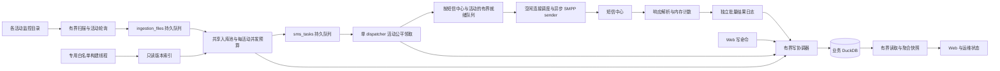

## 3. 目标架构与所有权

业务 DuckDB 由一个服务进程读写；Uvicorn workers 保持 1。入库/短信 worker 是该进程的线程资源。CLI 运行状态通过服务接口查询；服务活跃时 CLI 不另开进程直接读写业务数据库。服务停止后的维护工具才可独占数据库。

锁定运行时 DuckDB 版本及同版本同平台离线扩展。生产仍需检查实际 duckdb.__version__、扩展目录和 WAL 恢复；本次不升级 DuckDB 版本。数据库使用本地可靠磁盘，不能用多服务进程或网络共享文件充当高可用。

模块职责：
- 文件调度器只负责发现、过滤、注册与准入，解析匹配不在调度线程内执行。
- 入库 worker 负责行级业务计算；业务任务和 chunk 完成在同一短事务提交。
- dispatcher 只领取可执行且拥有发送信用的任务，不承担文件解析。
- SMPP sender 负责连接 pacing/socket；响应线程不得等待数据库。
- 写协调器负责短事务、类间公平、幂等命令和确定的提交结果。
- 结果日志负责数据库暂时不可用或进程退出后的发送结果恢复。
- 活动资源管理器负责准入、份额与局部暂停；全局安全水位仍然最高优先级。
## 4. DuckDB 写入方案：先原子提交，再公平排队

### 4.1 阶段 A：补齐短显式事务

必须采用“准备不可变输入 → 获取写入机会 → BEGIN → SQL → COMMIT → 释放”。CSV 读取、哈希、模板计算、SFTP、文件复制和退避在事务外完成。

需要审计并改造的提交点：
1. claim：领取状态、attempt/claim_token 和 claimed 事件同时成功或同时回滚。
2. submitted/failed/receipt：任务终态、批次统计、活动统计、message_id 映射和事件在短事务内提交。
3. ingestion：任务 INSERT、去重与对应 chunk 检查点统一提交，旧 file token 不得通过校验。
4. 控制转换：pause/cancel/retry 等命令有幂等键和条件更新；重复请求不能重复加计数。
5. 普通进度：继续合并/节流；不能覆盖完成状态，不能为展示失败重跑文件。

缓冲批次失败按错误类型处理。瞬态失败进入有界延迟队列；永久 SQL/数据错误定位毒记录，并保留可恢复证据。重试预算用尽不能把未落库事件当完成移除。拆分批次仅在前次整笔已回滚且业务语义可拆时进行，不能把多表业务命令拆到不同事务。

### 4.2 阶段 B：进程内有界写协调器

现有全局 RLock 只串行排斥，不保证哪个等待者先获得锁。新增一个专用业务写线程，持有线程自有连接，接收冻结 payload 的业务命令。先迁移短信结果/任务领取/入库，再逐项迁移 Web、归档和定时维护；迁移期保留旧写锁兜底，并统计绕行写入。

队列分类：租约与控制、发送结果、任务领取、任务创建、Web 修改、展示进度、维护归档。按最近实测执行时间收取调度成本，类间加权轮询并限制连续占用。临近到期租约按截止时间提升优先级，但不能让每个高优先请求永久抢占其余类别。各业务类别有最小服务机会。

命令合同至少包含 request_id、operation、campaign_type/id、attempt_token、幂等键、不可变 payload、截止时间、重试策略和 completion。
- 未开始的过期命令可取消；已经执行的 Web 命令客户端超时后返回结果待确认，不能直接声明未写入。
- Web 按 request_id 查询执行结果；重复请求回放已完成结果。
- SQL 事务完成前不公开业务成功。返回 503 时说明 retryable、request_id 和退避提示。
- 写线程内禁止再次入队并等待自身；内部函数使用现有连接，不自行 close/commit，不执行网络或文件 IO。
- 不跨线程共享 WrappedConnection；旧模式下也不能跨线程关闭持有线程 RLock 的连接。
- 进度按 file_id/token 仅保留最新快照；发送结果不能用“只保留最后事件”任意覆盖失败/分片结果。

初始事务执行软预算建议 50～200ms，批次用 100～1000 条范围根据耗时调整。这是待验证目标；不把 200ms 宣称为引擎硬执行超时。批次超预算时减小下一批，低于预算且无 Web/控制等待时才逐步增大。记录排队、执行、commit、重试各段耗时。

锁等待 5 秒只限制获取应用锁，不限制 SQL、磁盘或 WAL 操作的执行。长 SQL 使用专用连接的受控 interrupt 是否可用须在 DuckDB 1.2.0 实验后启用；发生不可中断卡点时停止新准入、保留发送日志、输出线程栈，由运维执行受控重启。不得宣称改成写线程后引擎永不阻塞。

### 4.3 持久发送结果日志

响应路径只在内存生成小事件，交给专用线程追加带长度、序号和校验的本地日志；批量 fsync，随后按批次落主库。磁盘日志是新增应用组件，不等同于 DuckDB WAL。

为降低“已发未记”的风险，发出前持久化 attempt intent（任务、token、内容版本/摘要、计划分片），intent 可成批提交；响应记录按 task/attempt/part 保存完成事实。写结果后的日志消费游标与业务状态放入同一 DuckDB 事务，恢复时先重放再决定 sending 的处置。

结果交接使用预留容量：开始一个 attempt 前为其最坏分片结果预留日志/内存额度，额度不足暂停新发送；释放条件是事件已持久落日志并完成规定消费阶段。响应线程不阻塞等待 DB 锁。日志线程失败时保留待交接事件并报警，禁止继续扩大 socket 输出；磁盘满进入全局暂停。

group fsync 有性能收益也有持久化等待；严谨地公开 durability_mode、未 fsync 事件数/年龄和故障窗口。结果从响应接收至持久化之间崩溃仍可能无法确认接收状态，不承诺零丢失或 exactly-once。intent 已持久且结果缺失的 attempt 进入 delivery_unknown，默认不自动重发，需人工/明确业务策略。相同事实重复重放必须幂等，不能重复累计 sent_count。

关闭服务采用第4.4节的接收截止与最终双屏障顺序；连接仍接收时的一次flush不代表已排空。超预算保留日志和unresolved intent，下次启动先对账，不能强制把sending全部重排发送。

### 4.4 停机、重放水位与日志损坏合同（阶段A必做）

停机依次执行：关闭新文件准入和新attempt派发 → 截止正在准备但尚未发送的命令 → 在有界时间内维持连接读线程和控制/ACK通道，接收在途响应及DLR → 截止接收并关闭连接 → 等待读线程及所有回调退出 → 最终日志持久屏障 → 最终主库消费屏障 → 关闭writer与日志线程。截止前已持久接收的回执正常确认；未达到持久接收点的不确认，允许对端按其协议策略重传。连接关闭之后确认命令不得落到新连接。超出停机期限时保存已持久日志、intent和未完成清单，下次恢复，不把未知任务重排为待发。

日志为分段append-only记录：version、stream、LSN、event_id、campaign/type、source_namespace、task/attempt/part、payload_length、CRC、received_at；持久水位只在fsync成功后推进。消费高水位必须连续：每个LSN只有在业务事务提交或“带原始事实的持久隔离记录”提交后才可settle；乱序和处理中事件不能被跨过。隔离可以解除毒记录阻塞，但flush仍返回隔离/失败数量而非纯成功。每事务保存唯一event_id和消费状态，重复日志重放不重复改变统计。

启动先校验日志段及水位、重放未消费事件、对账intent与活跃/未知状态；达到恢复门禁前不允许新发送。末尾不完整记录仅在确定未落持久水位时可移至隔离副本后修复；持久范围内CRC错误立即停止发送并报警，不猜测丢弃。清理仅删除已连续settle、已进入一致备份且满足迟到回执/恢复保留期的段；不删除未知和仍引用事件。运行升级与回退都要兼容日志schema；不兼容旧版不能直接恢复发送。
## 5. 每活动能力保障：以分片成本做公平调度

### 5.1 公平实体与容量准入

公平键为 (campaign_type,campaign_id,target_smpp_config_id)，包含批量和实时活动，避免大批量活动挤占实时任务。未指定短信中心的活动在调度时解析当前有效目标；故障切换重新绑定 route generation，迁移未发任务及配额，已发未知 attempt 不跨中心盲目重发。

业务界面可提供 weight、min_parts_tps、max_parts_tps、max_outstanding_parts、max_pending_tasks、max_ingest_files 等拟新增字段。默认等权、保底值自动按准入容量规划，不能按当前 configured TPS 当作已测能力。

对每个短信中心分别计算：
- C_send：同负载下 socket 实际分片发出速率；
- C_resp：稳定运行下分片响应完成能力；
- C_write_tasks：含当前事件/统计/回执模式的任务持久化能力；
- C_ingest_tasks：各活动实际匹配产出能力。
- a：每条任务平均分片数，仅用于规划；调度使用实际编码后的分片数。

可用分片预算 C_budget 不超过 min(C_send, C_resp, C_write_tasks×a) 的实测稳定容量，并预留建议 20% 余量。若系统只需小幅积压可另定预算，但必须写明积压时延。保证 r_i 的前提为 Σr_i ≤ C_budget，同时所有活动入库、CPU、内存、磁盘预算满足准入；不满足时拒绝硬保底承诺或按权重降级，并在界面列出原因。

举例只是计算示意：若稳定总能力实测为 400 分片/秒，预留 20% 后可分配 320。两个活动各保底 100，剩余 120 按权重分配；等权且持续满负荷时各约 160。若每条任务平均 5 片，则每个活动约 32 条任务/秒。活动闲置份额可立即借用，恢复活跃后在有限调度轮内归还。

### 5.2 任务领取与发送信用联动

保留单 dispatcher。对可执行活动轮询，从每个活动的 oldest due 任务中按 quota 领取，所有活动领取与事件尽量合成一次有界短事务；使用条件 UPDATE RETURNING 防止状态变化后误领。

不能只在总表上执行每活动窗口函数扫描全部历史任务；先获取有界活跃活动集合，再查询待发候选，必要时使用由同一事务维护的活动待发摘要。复合索引只在 EXPLAIN/实测支持后添加，不能声称添加索引必然解决 DuckDB UPDATE 性能。RETURNING 的输出顺序不作保证，调度结果必须显式排序。

领取前先扣除活动和短信中心的本地队列信用，容量不足不领取。已领任务多放在活动就绪队列，SMPP 连接公共队列保持浅水位。当前“队列满→失败→落库→retrying→重新领取”的循环会消耗写事务，应改成正常等待容量，尚未向 socket 发出的任务不按真实发送失败增加 attempts。

worker 数/claim_batch 保持兼容，但 dispatcher 新的公平单轮量不再与 workers 无限制相乘。建议活动每轮预取 10～30 条作为起点，同时限制总 ready 分片和预计排队秒数；不能把这些新配额直接写进 env 后当作现成能力。

### 5.3 DRR 与连接选择

使用按实际分片成本的 deficit round robin（DRR）：
1. 活跃活动每轮获得与 weight 成比例的分片信用。
2. 预先编码任务并缓存 parts；不足信用时保留 head，下一轮累积。
3. 信用足够、未超最大速率且存在连接/日志信用时，接收发送任务。
4. 同一活动内部保持 oldest due；为等待过久任务增加有界 aging。
5. 限制最大信用，活动暂停或闲置时不累计无限突发额度。

DRR 解决份额，token bucket 只在配置活动上限或硬保底/借用策略需要时使用。连接 pacing 保留现有 per-part throttle 作为物理上限，不再对同一 socket 重复串行 sleep。需要等待配额的活动挂到下一 eligible 时间，不能占用全局 worker sleep。

从有信用、连接健康、最小预计分片排队时间的连接中选择，负载相同再轮询。某活动所属短信中心拥塞时仅暂停该 route 的领取，其他中心可继续运行。连接的冷却、响应超时、队列容量必须独立监控。

当前每连接发送线程一次发送完整 multipart 任务，再处理下一任务。初期通过浅连接队列和按片收费限制其影响，不强行把同一 multipart 的各片跨连接分散。如果超长任务导致公平等待不达标，再单独验证同连接分片交替，不改变 UDH/编码/业务语义。

window 当前是任务 semaphore，inflight 是 PDU sequence 数，两者不可直接相除为利用率；50 个任务、每任务 5 片可对应约 250 个 PDU。新增 inflight_tasks/inflight_parts/window_unit。按 PDU 窗口改造属于单独优化：必须逐片 acquire、逐响应 release，并处理 early response/超时/断链恰好释放一次。不能先为整条长短信同时申请所有片而引入死锁。

### 5.4 全局准入、保底算法和不可抢占上限

route的物理上限与全局writer/log/磁盘预算同时校验，不能为每个短信中心重复分配同一份writer能力。按活动混合负载估算每秒成本向量：任务状态变更、part结果、DLR（含重传）、事件/统计、日志字节、实测writer占用秒；所有route的需求之和不得超过共享预算。C_write_tasks×a仅适用固定模板及回执模式组合的规划，混合或开启DLR必须重测/按成本预算准入。配置界面明确per-connection_tps和pool总和；如SMSC按账号总限额，另设account_parts_tps共享桶，不能错误乘连接数。

在离散调度周期内先为活跃活动建立保底服务债务 r_i×elapsed（有界），优先清偿到期保底；随后对剩余容量做按weight的DRR。最大速率桶同时限制总服务量，保底不高于最大速率。闲置活动不累积保底债务；借用仅在无到期保底债务时进行。一次服务同时扣活动、route、全局及日志信用。多route活动按campaign总账计份额，再按路由可用性分配，不让每route各获得完整活动保底。路由不可用时报告降级；不得把故障期算为无条件保证。

单任务的信用上限至少容纳允许的最大parts，并设置业务允许的max_task_parts；超长任务拒绝/隔离或另走慢通道，不能永久留在head。单次非抢占的发送时长上限包含全部分片pacing与socket写超时；只有其上限、保底积累时间和调度周期之和符合目标时，才承诺首次发出/借用归还≤5秒。否则展示根据负载推算的更长上界。对文件等待≤30秒的保证，chunk安全让出和受控读取/转换超时是必做门禁，不是可选优化；若XLSX/网络IO不可有界则该输入不承诺此SLO。纯DRR权重不等同硬保底。

