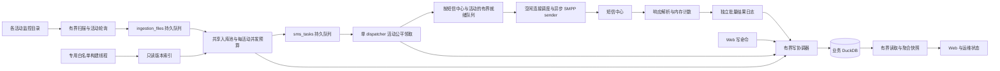

# DuckDB 多实时营销活动并发与吞吐保障方案

方案 ID：MC-DUCKDB-MULTI-20261009。版本：1.0。日期：2026-10-09。
状态：工程研究方案；本次交付为文档、证据和验收设计，业务代码尚未按此方案实施。
范围：当前本地工作区及已有部署观测；部署基线曾为 20261009-web-db-robustness，本次未重新远程采样。

## 1. 方案结论和可承诺的边界

保留单个服务进程管理业务 DuckDB，保留共享实时入库 worker、共享短信 worker 和异步 SMPP 连接池。先补齐短事务原子性和发送结果恢复，再用活动公平调度、容量准入、局部背压与低开销指标保障每个活动的处理机会。

目标是使容量充足时每个活动获得明确份额，容量不足时有明确的降级和排队原因。当前版本已经有文件级轮询和租约恢复，但没有完整的发送份额保障。不能仅用 worker 数量、线程 alive 或 HTTP ready 推断每个活动正在推进。

本方案不承诺固定达到 400 TPS，也不承诺短信 exactly-once 或 DuckDB 永不卡死。这里的 TPS 必须区分完整短信任务数/秒和 submit_sm 分片数/秒。发送端数据、数据库状态和短信中心接收之间不存在跨系统原子事务。

保底份额仅在以下条件同时满足时适用：活动在发送窗口内、白名单就绪、有有效待发送用户、连接可用、本机 CPU/内存/磁盘充足、实测容量准入通过。即使评估不考虑短信中心限速，也要保留网络中断、响应超时等故障路径。

### 1.1 需求与交付状态

| 需求 | 当前能力 | 拟实现能力 | 阶段 |
|---|---|---|---|
| REQ-001 多表写入和状态可靠性 | 部分路径有显式事务；领取/短信缓冲存在遗漏 | 所有业务原子提交点明确 BEGIN/COMMIT；失败结果不丢弃 | A |
| REQ-002 活动发送公平性 | 文件领取轮询；短信领取全局 FIFO | 分片成本加权调度、活动保底和闲置借用 | B |
| REQ-003 文件处理机会与资源隔离 | 共享池、campaign 文件数量上限 | 扫描配额、每活动并发约束、构建专用线程 | C |
| REQ-004 容量准入与背压 | 全局 task/write/disk 水位 | 活动行数/分片/字节预算与全局安全水位结合 | B/C |
| REQ-005 Web 操作与读取健壮性 | 重试、可识别 503、部分缓存降级 | 写操作预算、幂等重试、低成本容量读取 | A/D |
| REQ-006 活动级诊断与故障恢复 | config/slot transport 指标、文件错误指标 | 每活动实际发出/响应/落库、卡点年龄、恢复日志 | A/D |
| REQ-007 长时间运行和安全升级 | 租约恢复、worker 监督、版本回滚工具 | 受控排空、恢复对账、24 小时稳定性验证 | D |
| REQ-008 保留 DuckDB 与现有业务语义 | DuckDB、业务去重、日期窗口和索引版本 | 兼容性迁移与可回退发布，不引入数据库迁移 | 全程 |

目标能力均为 Proposed；现有保护不足以直接视为该目标已经完成。

## 2. 代码证据与需要先修复的问题

本节事实以当前磁盘源码为依据；行号仅用于本版本定位。历史采样证明曾出现故障，不用于推算本轮实际容量。

| ID | 位置 | 已确认事实及影响 |
|---|---|---|
| EVD-001 | backend/database.py：write_transaction、WrappedConnection | 显式事务帮助函数已有 BEGIN；全局应用写锁自首个写入持有到 commit/rollback/close。此锁是本程序策略，DuckDB 本身并非只能有一个线程写入 |
| EVD-002 | backend/services/sms_task_service.py：claim_next_tasks | 按 created_at,id 从全局队列领取；未显式 BEGIN。任务 UPDATE 与事件记录不是天然一个多语句事务 |
| EVD-003 | backend/services/task_worker.py：_claim_fetch_size、_claim_dispatch_loop | 一个全局 dispatcher；领取量 min(500, workers×claim_batch)。worker 数不会为每个活动创建独立配额 |
| EVD-004 | backend/services/sms_write_buffer.py：_commit、_run | _commit 未显式 BEGIN；三次失败后依然 done/task_done，wait=False 调用者没有等待该错误。存在批次部分提交/结果未可靠恢复的风险 |
| EVD-005 | backend/services/realtime_ingestion_worker.py：_claim_realtime_file、_run_maintenance | 文件按活动轮询；领取到整个文件完成才释放 worker；白名单维护/构建共用一个维护锁并占用入库 worker |
| EVD-006 | backend/services/realtime_campaign_service.py：sync_watch_dirs_to_inboxes、process_realtime_inboxes | campaign 顺序扫描，目录 enumerate/sort；注册没有轮次时间预算。长目录或慢复制会延迟后续活动 |
| EVD-007 | backend/services/realtime_whitelist_service.py：build_pending、build_version | 构建候选按 created_at,id 串行选择；索引按活动/版本保存在独立 DuckDB 文件。默认构建限制并不等于整个进程内存上限 |
| EVD-008 | backend/services/smpp_gateway.py：send_async、_connection_for、_send_windowed_async | 连接公共 FIFO，连接轮询；满队列产生可重试失败。window semaphore 按整条任务获取，状态 inflight 按 sequence 计数 |
| EVD-009 | backend/services/backpressure_service.py：reasons、snapshot | task_depth 包含 queued/retrying/sending；paused 状态在 reasons 更新，snapshot 返回已有状态；缓存快照不能当作实时调度决定 |
| EVD-010 | backend/services/sms_task_service.py：mark_submitted、_apply_disabled_submitted_batch、recover_stale_tasks | disabled 不存 message_id，成功响应仍产生 submitted 写入；accepted 同时填写 delivered_at；sending 超过 5 分钟会恢复为 retrying |
| EVD-011 | backend/services/metrics_service.py、smpp_service.py | 实际发出和响应按 config/slot 聚合，任务统计主要是全局；尚无完整 campaign 发送份额/等待时间指标 |
| EVD-012 | backend/services/realtime_ingestion_state.py | 文件 token fencing、独立心跳、进度合并节流已有。文件级 transaction 帮助函数需与统一重试接口对齐 |
| EVD-013 | Docs/duckdb-realtime-batches-implementation-20261008.md；Docs/duckdb-realtime-progress-study-20261008.md | 前期短事务、批量去重和扫描研究已存在，不能把旧设计描述当作当前未修复事实 |
| EVD-014 | 本地 DuckDB 1.2.0 实验与现有测试 | 未 BEGIN 的 INSERT 已提交，rollback 报无活动事务；显式 BEGIN 后 INSERT 可回滚。现有文件轮询和单所有者恢复两项测试通过 |
| EVD-015 | 历史用户日志/采样 | 曾有 write-write conflict、写锁超时、积压和零 TPS；多个不同配置和版本混在历史中，不是受控 A/B |
| EVD-016 | DuckDB 1.2 官方文档 | 单进程支持多个线程并发读写，同一行竞争可能失败；多语句业务原子性需显式事务 |
| EVD-017 | 独立代码审计：成功/失败回调、recover_stale_tasks、message-id映射和DLR路径 | claim_token未用于短信完成写回；部分分片成功后临时错误可重试整条；映射主键仅message-id；DLR先入内存队列即确认。审计报告含内存故障复现，不是线上容量测试 |

优先修复 EVD-002/EVD-004/EVD-010：状态持久化不可靠时不能继续扩大发送预取，避免“数据库还显示 sending、短信已发出、恢复又重发”的风险。

另一个容易误判的参数事实：当前 MC_SMS_WRITE_BATCH_SIZE 被限制到 100～1000，FLUSH_MS 被限制到 50～200ms；env 填 2000 不会使有效批次变为 2000。容量状态应同时显示 configured 和 effective。这两个参数属于当前已支持配置；后文新增策略字段均尚未实现。

## 3. 目标架构与所有权

业务 DuckDB 由一个服务进程读写；Uvicorn workers 保持 1。入库/短信 worker 是该进程的线程资源。CLI 运行状态通过服务接口查询；服务活跃时 CLI 不另开进程直接读写业务数据库。服务停止后的维护工具才可独占数据库。

锁定运行时 DuckDB 版本及同版本同平台离线扩展。生产仍需检查实际 duckdb.__version__、扩展目录和 WAL 恢复；本次不升级 DuckDB 版本。数据库使用本地可靠磁盘，不能用多服务进程或网络共享文件充当高可用。

模块职责：
- 文件调度器只负责发现、过滤、注册与准入，解析匹配不在调度线程内执行。
- 入库 worker 负责行级业务计算；业务任务和 chunk 完成在同一短事务提交。
- dispatcher 只领取可执行且拥有发送信用的任务，不承担文件解析。
- SMPP sender 负责连接 pacing/socket；响应线程不得等待数据库。
- 写协调器负责短事务、类间公平、幂等命令和确定的提交结果。
- 结果日志负责数据库暂时不可用或进程退出后的发送结果恢复。
- 活动资源管理器负责准入、份额与局部暂停；全局安全水位仍然最高优先级。

## 4. DuckDB 写入方案：先原子提交，再公平排队

### 4.1 阶段 A：补齐短显式事务

必须采用“准备不可变输入 → 获取写入机会 → BEGIN → SQL → COMMIT → 释放”。CSV 读取、哈希、模板计算、SFTP、文件复制和退避在事务外完成。

需要审计并改造的提交点：
1. claim：领取状态、attempt/claim_token 和 claimed 事件同时成功或同时回滚。
2. submitted/failed/receipt：任务终态、批次统计、活动统计、message_id 映射和事件在短事务内提交。
3. ingestion：任务 INSERT、去重与对应 chunk 检查点统一提交，旧 file token 不得通过校验。
4. 控制转换：pause/cancel/retry 等命令有幂等键和条件更新；重复请求不能重复加计数。
5. 普通进度：继续合并/节流；不能覆盖完成状态，不能为展示失败重跑文件。

缓冲批次失败按错误类型处理。瞬态失败进入有界延迟队列；永久 SQL/数据错误定位毒记录，并保留可恢复证据。重试预算用尽不能把未落库事件当完成移除。拆分批次仅在前次整笔已回滚且业务语义可拆时进行，不能把多表业务命令拆到不同事务。

### 4.2 阶段 B：进程内有界写协调器

现有全局 RLock 只串行排斥，不保证哪个等待者先获得锁。新增一个专用业务写线程，持有线程自有连接，接收冻结 payload 的业务命令。先迁移短信结果/任务领取/入库，再逐项迁移 Web、归档和定时维护；迁移期保留旧写锁兜底，并统计绕行写入。

队列分类：租约与控制、发送结果、任务领取、任务创建、Web 修改、展示进度、维护归档。按最近实测执行时间收取调度成本，类间加权轮询并限制连续占用。临近到期租约按截止时间提升优先级，但不能让每个高优先请求永久抢占其余类别。各业务类别有最小服务机会。

命令合同至少包含 request_id、operation、campaign_type/id、attempt_token、幂等键、不可变 payload、截止时间、重试策略和 completion。
- 未开始的过期命令可取消；已经执行的 Web 命令客户端超时后返回结果待确认，不能直接声明未写入。
- Web 按 request_id 查询执行结果；重复请求回放已完成结果。
- SQL 事务完成前不公开业务成功。返回 503 时说明 retryable、request_id 和退避提示。
- 写线程内禁止再次入队并等待自身；内部函数使用现有连接，不自行 close/commit，不执行网络或文件 IO。
- 不跨线程共享 WrappedConnection；旧模式下也不能跨线程关闭持有线程 RLock 的连接。
- 进度按 file_id/token 仅保留最新快照；发送结果不能用“只保留最后事件”任意覆盖失败/分片结果。

初始事务执行软预算建议 50～200ms，批次用 100～1000 条范围根据耗时调整。这是待验证目标；不把 200ms 宣称为引擎硬执行超时。批次超预算时减小下一批，低于预算且无 Web/控制等待时才逐步增大。记录排队、执行、commit、重试各段耗时。

锁等待 5 秒只限制获取应用锁，不限制 SQL、磁盘或 WAL 操作的执行。长 SQL 使用专用连接的受控 interrupt 是否可用须在 DuckDB 1.2.0 实验后启用；发生不可中断卡点时停止新准入、保留发送日志、输出线程栈，由运维执行受控重启。不得宣称改成写线程后引擎永不阻塞。

### 4.3 持久发送结果日志

响应路径只在内存生成小事件，交给专用线程追加带长度、序号和校验的本地日志；批量 fsync，随后按批次落主库。磁盘日志是新增应用组件，不等同于 DuckDB WAL。

为降低“已发未记”的风险，发出前持久化 attempt intent（任务、token、内容版本/摘要、计划分片），intent 可成批提交；响应记录按 task/attempt/part 保存完成事实。写结果后的日志消费游标与业务状态放入同一 DuckDB 事务，恢复时先重放再决定 sending 的处置。

结果交接使用预留容量：开始一个 attempt 前为其最坏分片结果预留日志/内存额度，额度不足暂停新发送；释放条件是事件已持久落日志并完成规定消费阶段。响应线程不阻塞等待 DB 锁。日志线程失败时保留待交接事件并报警，禁止继续扩大 socket 输出；磁盘满进入全局暂停。

group fsync 有性能收益也有持久化等待；严谨地公开 durability_mode、未 fsync 事件数/年龄和故障窗口。结果从响应接收至持久化之间崩溃仍可能无法确认接收状态，不承诺零丢失或 exactly-once。intent 已持久且结果缺失的 attempt 进入 delivery_unknown，默认不自动重发，需人工/明确业务策略。相同事实重复重放必须幂等，不能重复累计 sent_count。

关闭服务采用第4.4节的接收截止与最终双屏障顺序；连接仍接收时的一次flush不代表已排空。超预算保留日志和unresolved intent，下次启动先对账，不能强制把sending全部重排发送。

### 4.4 停机、重放水位与日志损坏合同（阶段A必做）

停机依次执行：关闭新文件准入和新attempt派发 → 截止正在准备但尚未发送的命令 → 在有界时间内维持连接读线程和控制/ACK通道，接收在途响应及DLR → 截止接收并关闭连接 → 等待读线程及所有回调退出 → 最终日志持久屏障 → 最终主库消费屏障 → 关闭writer与日志线程。截止前已持久接收的回执正常确认；未达到持久接收点的不确认，允许对端按其协议策略重传。连接关闭之后确认命令不得落到新连接。超出停机期限时保存已持久日志、intent和未完成清单，下次恢复，不把未知任务重排为待发。

日志为分段append-only记录：version、stream、LSN、event_id、campaign/type、source_namespace、task/attempt/part、payload_length、CRC、received_at；持久水位只在fsync成功后推进。消费高水位必须连续：每个LSN只有在业务事务提交或“带原始事实的持久隔离记录”提交后才可settle；乱序和处理中事件不能被跨过。隔离可以解除毒记录阻塞，但flush仍返回隔离/失败数量而非纯成功。每事务保存唯一event_id和消费状态，重复日志重放不重复改变统计。

启动先校验日志段及水位、重放未消费事件、对账intent与活跃/未知状态；达到恢复门禁前不允许新发送。末尾不完整记录仅在确定未落持久水位时可移至隔离副本后修复；持久范围内CRC错误立即停止发送并报警，不猜测丢弃。清理仅删除已连续settle、已进入一致备份且满足迟到回执/恢复保留期的段；不删除未知和仍引用事件。运行升级与回退都要兼容日志schema；不兼容旧版不能直接恢复发送。

## 5. 每活动能力保障：以分片成本做公平调度

### 5.1 公平实体与容量准入

公平键为 (campaign_type,campaign_id,target_smpp_config_id)，包含批量和实时活动，避免大批量活动挤占实时任务。未指定短信中心的活动在调度时解析当前有效目标；故障切换重新绑定 route generation，迁移未发任务及配额，已发未知 attempt 不跨中心盲目重发。

业务界面可提供 weight、min_parts_tps、max_parts_tps、max_outstanding_parts、max_pending_tasks、max_ingest_files 等拟新增字段。默认等权、保底值自动按准入容量规划，不能按当前 configured TPS 当作已测能力。

对每个短信中心分别计算：
- C_send：同负载下 socket 实际分片发出速率；
- C_resp：稳定运行下分片响应完成能力；
- C_write_tasks：含当前事件/统计/回执模式的任务持久化能力；
- C_ingest_tasks：各活动实际匹配产出能力。
- a：每条任务平均分片数，仅用于规划；调度使用实际编码后的分片数。

可用分片预算 C_budget 不超过 min(C_send, C_resp, C_write_tasks×a) 的实测稳定容量，并预留建议 20% 余量。若系统只需小幅积压可另定预算，但必须写明积压时延。保证 r_i 的前提为 Σr_i ≤ C_budget，同时所有活动入库、CPU、内存、磁盘预算满足准入；不满足时拒绝硬保底承诺或按权重降级，并在界面列出原因。

举例只是计算示意：若稳定总能力实测为 400 分片/秒，预留 20% 后可分配 320。两个活动各保底 100，剩余 120 按权重分配；等权且持续满负荷时各约 160。若每条任务平均 5 片，则每个活动约 32 条任务/秒。活动闲置份额可立即借用，恢复活跃后在有限调度轮内归还。

### 5.2 任务领取与发送信用联动

保留单 dispatcher。对可执行活动轮询，从每个活动的 oldest due 任务中按 quota 领取，所有活动领取与事件尽量合成一次有界短事务；使用条件 UPDATE RETURNING 防止状态变化后误领。

不能只在总表上执行每活动窗口函数扫描全部历史任务；先获取有界活跃活动集合，再查询待发候选，必要时使用由同一事务维护的活动待发摘要。复合索引只在 EXPLAIN/实测支持后添加，不能声称添加索引必然解决 DuckDB UPDATE 性能。RETURNING 的输出顺序不作保证，调度结果必须显式排序。

领取前先扣除活动和短信中心的本地队列信用，容量不足不领取。已领任务多放在活动就绪队列，SMPP 连接公共队列保持浅水位。当前“队列满→失败→落库→retrying→重新领取”的循环会消耗写事务，应改成正常等待容量，尚未向 socket 发出的任务不按真实发送失败增加 attempts。

worker 数/claim_batch 保持兼容，但 dispatcher 新的公平单轮量不再与 workers 无限制相乘。建议活动每轮预取 10～30 条作为起点，同时限制总 ready 分片和预计排队秒数；不能把这些新配额直接写进 env 后当作现成能力。

### 5.3 DRR 与连接选择

使用按实际分片成本的 deficit round robin（DRR）：
1. 活跃活动每轮获得与 weight 成比例的分片信用。
2. 预先编码任务并缓存 parts；不足信用时保留 head，下一轮累积。
3. 信用足够、未超最大速率且存在连接/日志信用时，接收发送任务。
4. 同一活动内部保持 oldest due；为等待过久任务增加有界 aging。
5. 限制最大信用，活动暂停或闲置时不累计无限突发额度。

DRR 解决份额，token bucket 只在配置活动上限或硬保底/借用策略需要时使用。连接 pacing 保留现有 per-part throttle 作为物理上限，不再对同一 socket 重复串行 sleep。需要等待配额的活动挂到下一 eligible 时间，不能占用全局 worker sleep。

从有信用、连接健康、最小预计分片排队时间的连接中选择，负载相同再轮询。某活动所属短信中心拥塞时仅暂停该 route 的领取，其他中心可继续运行。连接的冷却、响应超时、队列容量必须独立监控。

当前每连接发送线程一次发送完整 multipart 任务，再处理下一任务。初期通过浅连接队列和按片收费限制其影响，不强行把同一 multipart 的各片跨连接分散。如果超长任务导致公平等待不达标，再单独验证同连接分片交替，不改变 UDH/编码/业务语义。

window 当前是任务 semaphore，inflight 是 PDU sequence 数，两者不可直接相除为利用率；50 个任务、每任务 5 片可对应约 250 个 PDU。新增 inflight_tasks/inflight_parts/window_unit。按 PDU 窗口改造属于单独优化：必须逐片 acquire、逐响应 release，并处理 early response/超时/断链恰好释放一次。不能先为整条长短信同时申请所有片而引入死锁。

### 5.4 全局准入、保底算法和不可抢占上限

route的物理上限与全局writer/log/磁盘预算同时校验，不能为每个短信中心重复分配同一份writer能力。按活动混合负载估算每秒成本向量：任务状态变更、part结果、DLR（含重传）、事件/统计、日志字节、实测writer占用秒；所有route的需求之和不得超过共享预算。C_write_tasks×a仅适用固定模板及回执模式组合的规划，混合或开启DLR必须重测/按成本预算准入。配置界面明确per-connection_tps和pool总和；如SMSC按账号总限额，另设account_parts_tps共享桶，不能错误乘连接数。

在离散调度周期内先为活跃活动建立保底服务债务 r_i×elapsed（有界），优先清偿到期保底；随后对剩余容量做按weight的DRR。最大速率桶同时限制总服务量，保底不高于最大速率。闲置活动不累积保底债务；借用仅在无到期保底债务时进行。一次服务同时扣活动、route、全局及日志信用。多route活动按campaign总账计份额，再按路由可用性分配，不让每route各获得完整活动保底。路由不可用时报告降级；不得把故障期算为无条件保证。

单任务的信用上限至少容纳允许的最大parts，并设置业务允许的max_task_parts；超长任务拒绝/隔离或另走慢通道，不能永久留在head。单次非抢占的发送时长上限包含全部分片pacing与socket写超时；只有其上限、保底积累时间和调度周期之和符合目标时，才承诺首次发出/借用归还≤5秒。否则展示根据负载推算的更长上界。对文件等待≤30秒的保证，chunk安全让出和受控读取/转换超时是必做门禁，不是可选优化；若XLSX/网络IO不可有界则该输入不承诺此SLO。纯DRR权重不等同硬保底。

## 6. 文件扫描、入库和白名单资源公平

### 6.1 扫描公平与一致准入

扫描每活动一轮分配候选数、复制字节、elapsed 时间预算，活动集合轮转；建议初始 100 个候选或 100ms 元数据扫描预算，复制 IO 另受字节预算和超时控制。这些是试验值，不意味着完整目录枚举/排序本身能被该预算打断。

对于大目录，持有有界扫描游标/候选堆，分片 enumerate，并周期完整对账。目录事件仅作提示。文件可能迟到，禁止仅按最大文件名水位跳过较小文件。历史日期继续按文件名业务时间过滤，当前日旧小时是否过期仍按已有活动窗口规则。

本地/SFTP/手工上传统一使用原子容量 reservation。现有快照先查再注册不能作为全局严格配额，process_realtime_inboxes 重新注册也需要走同一准入入口。预留登记失败/复制失败释放额度，启动对账修复遗留 reservation。原始输入未成功入库前保留在源或可恢复位置。

SFTP 是独立 poller，但多个 SFTP campaign 仍串行，应限制每活动单轮下载量并用有界 IO 池隔离网络超时；预算同时限制总连接数和临时文件字节。单个活动扫描异常只记录该活动并继续后续轮次。

### 6.2 入库并发与大文件

继续共享 MC_REALTIME_INGEST_WORKERS，当前建议实验保持 4。活动争用时限制一个活动同时处理文件数；只有该活动有工作时允许借用空闲 worker，不把每个活动固定划分线程造成闲置。

文件轮询并不等于处理时间公平：四个大文件可占住全部 worker，小活动新文件只能等待。初期限制每活动并发；需要有界最大等待时，再加可恢复 chunk quantum。仅在持久检查点安全边界让出 worker，保存文件偏移/行序和去重状态，不能把已有 pandas iterator 随意丢弃后假设可无成本续读。

CSV 继续分块和现有批量去重；每 chunk 检查 token、活动状态、日期/窗口和局部背压。零匹配文件正常完成，不能将旧零命中观测用于跳过新文件。XLSX 全文件读取的内存成本单独限制，必要时后台转换为可流式内部格式，转换输出有校验/生命周期，不让大 XLSX 占满所有资源。

### 6.3 白名单构建

将 migrate/repair/build 从实时入库 _run_maintenance 移到专用维护/构建线程；默认全局构建并发保持 1，每活动最多一个版本构建。构建队列按活动轮询，连续失败版本有退避上限，避免总是选择最老 building 记录。

已就绪且未变化的索引继续复用；暂时主库写竞争不标为索引损坏。新版本成功后原子切换绑定。文件保留已固定 whitelist_version_id；旧索引清理需要确认没有文件/reader 引用，不能把正在使用的版本删除。长构建设置截止时间/进度；仅在内存、磁盘和查询竞争测试通过后提高到 2，并计入所有独立 DuckDB index 实例的总资源。

## 7. 局部背压、总容量与不会被“零写队列”掩盖的阻塞

按活动控制 pending 文件数、文件字节、待发任务数、待发分片、在途分片、结果日志未提交量和最老年龄。默认文件 pending=100 可保留，但 100 个小文件与 100 个大文件资源完全不同，应增加每活动字节/行数预算。

局部超限暂停该活动新 intake/任务创建，允许其已创建任务继续排空。其他活动有信用时继续处理。全局磁盘/内存/结果日志硬上限优先，必要时暂停全局新发送以保住恢复信息，但响应处理、租约必要控制和结果落库继续运行。持有写锁时不得 wait_for_ingestion。

全局 task_depth 必须拆解为 queued、ready_memory、socket_inflight、response_received_uncommitted、unknown，显示 durable/source timestamps。sending 很大不等于所有任务正在网络发送。write_depth 应包含队列、当前执行批次、延迟重试和磁盘日志待重放；当前从队列取走的大批次不可从“总未完成工作”中消失。

采用高/低水位滞回和周期主动更新；状态 API 展示 calculated_at、paused_reason、恢复条件。普通状态读取不能改变调度状态。所有低频统计以 1～5 秒聚合缓存供多个页面复用，避免每个 Web 刷新都全表 COUNT 多次。

按资源估算积压变化：
- 每活动任务队列净变化 = 任务创建速率 - 任务领取/终止速率。
- 结果积压净变化 = 已接收需持久化结果速率 - 持久化完成速率。
- 队列排空时间约为 backlog / 该活动实际服务能力；分片和任务单位必须一致。
- 当到达速率持续大于服务速率，任何有限队列最终都会满；需要限制准入或增加实际容量。

因此“writes_paused=false”“message_id=0”不能证明数据库不再是瓶颈，也不能证明系统一定在正常发送。

## 8. 短信状态与“不请求回执”的处理

disabled 只关闭 DLR 请求和无用途 message_id 映射；submit_sm_resp 仍需消费，用于释放窗口、明确拒绝、响应超时和状态统计。

推荐状态合同：
- queued/ready：尚未向 socket 发送；取消可直接终止。
- sending：带 attempt_token；可能含已发送片，必须查 attempt evidence 才能恢复。
- accepted：收到完整任务所有分片的成功 submit_sm_resp，表示短信中心接收，不代表用户送达。
- failed/retrying：明确拒绝或确认没有任何发送；临时拒绝按策略退避。
- delivery_unknown：部分发出、断链、超时或崩溃后无法证实接收状态，禁止自动跨中心重发。
- delivered：真实 DLR 或明确人工确认；disabled 模式不能凭本地 socket write 标记 delivered。

当前数据库在 disabled 成功时填 delivered_at，部分统计把 accepted 与 delivered 合并；兼容阶段先将 UI 标为“短信中心接收”，分别暴露 accepted_count/delivered_count。后续是否修正历史 delivered_at 需单独制定数据迁移策略，不依据旧时间猜真实送达。

stale recovery 不能只根据 sending 超过 5 分钟重发。必须先判断 attempt 日志、进程代际、活跃内存记录、已收响应待提交与队列租约；健康排队任务延续租约，已确认成功只补库，未知状态隔离，旧 attempt 的晚响应不能覆盖新 attempt 的状态。变更恢复策略前先补齐 token 条件更新与结果日志。

### 8.1 attempt fencing、分片恢复与回执隔离

claim_token 不能只在领取时写入。发送命令、分片上下文、响应/超时/失败回调以及日志必须携带同一 attempt_token；完成状态更新使用 WHERE task_id=? AND attempt_token=?，旧token记录进入审计但不得覆盖新attempt。领取令牌与发送attempt若分别建模，持久保存其关联；只靠当前status检查不足。

明确区分 queued、准备中、已向socket发出、部分接受、全部接受、明确拒绝和未知。任何分片已经接受后，不允许因另一片临时拒绝自动重发整条任务。优先保存part-level事实，只有能确定未接受的片且SMSC/业务重组语义验证通过时才允许分片重试；其余按 partial/unknown 隔离并请求业务处理。普通网络发送无法提供跨系统exactly-once。

sending租约由活跃attempt续租；恢复先核对内存发送上下文、持久intent、结果日志及消费游标。固定5分钟超时只能触发核查，不能独立成为重发依据。进程重启无法证明无message-id即未发送；disabled模式同样不能盲目重发。

DLR映射以来源命名空间关联，至少包含config_id与smsc_message_id；message-id在同一账号重用时，还要结合有效保留期、连接/中心epoch及可验证时间关联，遇到多个候选转为歧义事件，不以最新记录覆盖。回执入口必须携带来源config，迁移历史无来源记录时不能猜测绑定；旧表迁移和迟到回执采用兼容双读及明确回退边界。

DLR也写入独立持久事件日志。协议确认应在持久接收点之后；同步fsync可能拖慢读线程，应使用有界接收队列和顺序持久线程，由持久完成回调再发送deliver_sm_resp。容量不足停止新业务准入，并按对端允许的拒绝/重发策略处理；不能先确认后丢弃。持久确认延迟和SMSC重发行为需用模拟器/对端实测，重复DLR用幂等键去重。

### 8.2 flush与毒记录的可靠性合同

flush/barrier返回成功必须代表其之前已接收事件全部持久提交或明确进入可查询的隔离终态，而不是队列task_done计数归零。它携带接收序号水位和失败汇总；毒记录可以隔离让其他活动继续，但不得被算作成功写入。采用批次拆分定位毒记录时保持事务原子性及事件幂等，不重复追加业务事件/计数。失效attempt和歧义回执需保留恢复证据，按权限人工决策。

### 8.3 表结构及状态转换约束（拟新增/迁移）

| 对象 | 关键字段/唯一性 | 约束与责任 |
| --- | --- | --- |
| sms_tasks | task_id、current_attempt_token、status、recovery_state、lease_until | unknown/partial隔离由所有claim/retry入口统一排除；发送前验证owner和可发送状态 |
| sms_send_attempts | attempt_token主键；task_id、claim_token、content_hash、source_namespace、planned_parts、intent_lsn、state、lease_until | 同一task仅一个有效发送owner；持久intent完成后才socket输出 |
| sms_send_parts | (attempt_token,part_no)唯一；sequence、connection_generation、sent_at、resp_status、smsc_message_id、state | 已接受片不退回未发送；late/重复结果幂等且保留事实 |
| smpp_message_id_bindings | binding_id主键；source_namespace、message_id、attempt_token、part_no、有效时间 | 不以message-id单独唯一覆盖；保留重用候选，歧义DLR隔离 |
| sms_result_events/consumer_state | event_id唯一；stream/LSN；处理状态、隔离原因、连续水位 | 业务变更、事件幂等记录和settle水位同事务提交 |
| writer_commands | request_id/幂等键、状态、result、expires_at | Web超时查询真实结果；权限继承原业务操作 |

source_namespace是稳定的短信中心/账号命名空间，不随普通重连改变；config_id只有在禁止删除重建复用和审计配置变更时才可充当它。连接generation/epoch用于防旧socket回调，不能独自归属跨重连迟到DLR。来源账号配置改变采用新namespace或明确迁移。

条件更新同时校验token和合法前置状态，RETURNING命中后才做相应计数/事件；重复事件只读已有处理结果。queued→准备中→sending/partial→accepted/failed/unknown由attempt事实驱动，unknown/partial不直接回到queued。尚未socket发出的过期内存任务在发送前检查token/取消状态后安全撤销；已经发出的取消只阻止未发片，不伪装网络撤回。

submit结果信用与DLR信用分开：attempt预留其最坏part结果空间，持久消费后释放；DLR配置独立保留接收字节/事件和迟到窗口配额，重复/中间状态按有界去重处理。日志总体还有控制/重传保留区，满时停止新attempt，不能因尚有submit空间就无限接收DLR。

持久完成仅向连接所属有序控制发送器投递ACK命令，不由日志线程直接写socket。ACK包含连接generation和sequence，失效连接则不发送到新连接。确认延迟目标必须小于对端约定的响应时限并留余量，需先验证当前SMPP客户端允许延迟ACK、线程安全send及重传行为；若不支持，必须改客户端控制路径或明确接受的故障风险，不声称当前库天然支持。

## 9. 指标、Web 保护与运维判断

新增指标以内存聚合为主，按 campaign/type/config 限定标签；禁止手机号、filename、task_id 成为常驻标签。分片高频计数使用固定秒桶/有界直方图，避免为每个事件保存长 deque 后每次查询遍历全部样本。老活动时间桶到期释放，历史存入低频汇总。

| 层次 | 关键指标 | 判断 |
|---|---|---|
| 扫描 | last_success、enumerated/candidates/copied、scan_seconds、oldest_candidate_age | 有源文件但长期未复制是 intake 问题 |
| 文件 | pending/processing/retrying、rows/matched/tasks、stage p50/p95、oldest_wait_age | 识别零匹配、依赖等待、大文件或缺少 worker |
| 活动任务 | enqueue/claim/ready/oldest_due_age、share/borrowed_share、no_progress_reason | 验证新活动能获得处理机会 |
| 物理发送 | send_message_parts_total、send_tps、inflight_tasks/parts、queue_credit | 独立于主库统计 |
| 响应 | resp_total/status、resp_tps、p95 latency、timeout、unknown | 判断窗口是否被等待占据 |
| 持久化 | uncommitted/in_progress/retry/log_age、queue/execute/commit p95、class占用时间 | 判断发送结果是否跟不上 |
| Web | endpoint p95、retry/503/timeout、snapshot_age、command_status | 监测是否牺牲交互响应 |
| 系统 | CPU、RSS、disk latency/queue、temp/log/WAL字节 | 验证资源准入假设 |

建议 API：GET /api/capacity/campaigns（策略、份额、各层积压与暂停原因）、GET /api/operations/commands/{request_id}（写结果），POST /api/campaigns/{type}/{id}/capacity-policy（管理员/营销权限和审计）。这些为拟新增接口，不是当前可调用 API。既有 metrics/stats 保持兼容，增加 fields 而非替换计数口径。

有 due 队列但 60 秒无实际发出：先核对活动窗口/白名单/局部限额，再看 claimed 增量、ready、连接 queue/window、结果提交推进，最后按具体卡点报警。一个活动静止但其他活动推进记为局部停滞；所有活动静止且 writer/current_command_age 增长记为疑似共享写入链路阻塞，结合线程栈、SQL执行和IO状态确认。线程 heartbeat 与 last_success 分开，纯循环轮询不能刷新成功推进时间。

Web 写操作只重试确认为瞬态且幂等的事务；超时不等于未提交。重读命令结果优先于重复创建。Web 大导入、导出和历史统计移入有界后台任务；读重试次数不能放大为几十秒同步请求。页面降级显示最后成功快照及时间，不能用空数据伪装正常。

## 10. 部署、权限、备份和回退

本次没有同步远端、重启或更改 env。新能力实施后采用逐阶段开关；现有参数保持对照基线，先默认等权，再在压测后配置保底。worker 数根据 sender/计算供给决定，不按活动数线性增加。

已有配置实验基线可沿用最近确认值 MC_TASK_WORKERS=24、MC_CLAIM_BATCH=30、MC_REALTIME_INGEST_WORKERS=4、MC_SMS_WRITE_BATCH_SIZE=1000、MC_SMS_WRITE_FLUSH_MS=100；这是实验起点，非本次重新确认的远端实际配置。保留窗口/连接/TPS设置做可比较试验，不同时改五个变量。

新增策略建议先存 app_settings 或独立 campaign_capacity_policies 表；兼容旧行自动等权。attempt/result_ack/command_status 采用可增量迁移的新表；主表原状态保持兼容，unknown 可先用附属状态字段表达。migration 有版本标记，所有约束和索引在目标 1.2.0 副本库验证。

结果日志与临时文件限制路径、权限、容量和保留时间；尽量只保存 task_id/token/状态/摘要，业务号码/内容按实际恢复需要最小化，继承现有认证授权，日志不得输出密码/token/完整清单。磁盘故障时不依赖另一个位于同一满磁盘的“紧急日志”无限兜底。

升级前停止新准入并排空已发结果，制作一致备份，验证恢复副本可打开和离线扩展齐全。数据库/WAL/结果日志要作为相关恢复材料；禁止删除 WAL 绕过启动错误。备份时使用服务协调的 checkpoint/backup 流程或停止服务后完整复制，不能复制正在变化的单个 .duckdb 后宣称一致。

回退应用代码时先重放新结果日志并停止新调度；旧版本若不认识新恢复协议不得直接接管新 sending 任务。不可简单恢复旧数据库备份后继续发送，因为备份后已发送任务可能重新出现。关键恢复协议启用后必须提供前向恢复兼容版本；普通开关回退不删除任务/日志。

历史 terminal 数据按已验证归档策略移出热路径，未完成任务不归档。去重 tombstone 在业务去重期限内保留，不能删除 terminal 后让同一天同用户再次建任务。归档、清理、checkpoint 与索引构建使用维护时间预算；大范围 DELETE、全表 backfill 不在正常 startup/web 请求中运行。

运维责任：应用团队负责事务/状态/幂等；运营配置份额与窗口；部署维护者负责运行时、扩展、备份/回滚；性能结论必须有同负载观测记录与批准的降级策略。

## 11. 分阶段实施与文件级改动

| 阶段 | 改动 | 主文件/新组件 | 通过后才进入下一阶段 |
|---|---|---|---|
| A | claim/缓冲显式事务、失败保留、attempt fencing、独立指标和结果恢复原型 | database.py、sms_task_service.py、sms_write_buffer.py、smpp_gateway.py；拟新增 result_journal_service.py | 回滚/重放/未知状态测试通过；低负载 Web/发送无回归 |
| B | 公平领取、发送信用、按片 DRR、每 route 配额；逐步写协调 | task_worker.py、sms_task_service.py、smpp_gateway.py、backpressure_service.py；拟新增 campaign_capacity_service.py、db_write_coordinator.py | 大小活动/混合活动/双中心公平测试通过，吞吐不劣化 |
| C | 扫描轮询时间预算、统一容量 reservation、活动入库并发、构建独立线程 | activity_scheduler.py、realtime_campaign_service.py、realtime_ingestion_worker.py、ingestion_job_service.py、realtime_whitelist_service.py | 大目录/大文件/索引构建不饿死其他活动 |
| D | Web后台任务/命令结果、秒桶指标、低频聚合、受控关闭与72小时扩展观测 | metrics_service.py、smpp_service.py、routers/metrics.py、相关Web服务、deploy | 24小时门禁通过再延长验证；升级/恢复可追溯 |

预计工作量依赖验收发现，不预设“只改一个参数就完成”。A 的发送结果持久化是正确性需求，需单独测量 fsync/批量提交成本。公平策略默认可开关灰度，但幂等/恢复修复不能以关闭开关重启旧危险恢复流程作为普通回退。

## 12. 验收矩阵与发布门禁

以下为拟定目标与测试，除 TST-000 本地基础验证外未执行。固定同版本 DuckDB、同模板分片、同活动日期/窗口、同源负载；先使用 SMSC 模拟器与脱敏数据库副本，真实营销短信不用于故障注入。

| ID | 场景 | 验收条件 |
|---|---|---|
| TST-001 | claim或结果批次第二步失败 | 所有同一逻辑事务更新回滚；整笔重放后统计只加一次；应用写锁释放 |
| TST-002 | 临时锁忙/永久毒记录/三次失败 | 结果仍在重试或持久日志；无静默丢弃；毒记录不阻塞全部活动；恢复后无重复计数 |
| TST-003 | 100:1 大小活动、2/4/8活动持续有任务 | 在准入通过时，新活动首次发出目标≤5秒；120秒窗口分片份额偏差≤10%（排除启动、无工作、故障段并记录原因） |
| TST-004 | 同权活动1片与5片；长片任务 | 按分片份额公平，业务任务数不同属预期；没有长期饿死；不改变编码/UDH |
| TST-005 | 单活动单中心拥塞、另一个中心健康 | 拥塞route领取停止，健康route持续发出；queue full正常容量等待不循环重试写库 |
| TST-006 | 一个目录海量历史文件/迟到当天文件、local+SFTP+上传竞争 | 历史先过滤、迟到文件不漏；reservation严格有界；小目录单轮服务目标≤5秒或明确IO超时原因 |
| TST-007 | 4个长文件后小活动到达、白名单构建/失败/切换 | worker机会有界；受控chunk让出后小文件等待目标≤30秒；索引版本不串活动、在用版本不删 |
| TST-008 | 局部任务/文件超额与全局磁盘满 | 局部暂停仅影响该活动；全局危险停止新准入/新发但控制/已发结果处理继续；界面说明原因与恢复条件 |
| TST-009 | intent/部分分片/resp/落日志/主库commit各边界崩溃 | 已确认成功只补库；未知状态隔离；重放幂等；旧token/晚响应不覆盖新attempt；不宣称exactly-once |
| TST-010 | 满负载同时编辑活动/上传/读取运营页面 | Web轻读写目标p95≤2秒，超时/503比例≤0.1%；导入显示后台进度；超时命令结果可查询 |
| TST-011 | 24小时并发持续负载与周期爆发 | 准入负载下无持续增长积压；最老等待满足策略；内存不持续增长；未知/错误可解释；再执行72小时扩展观察 |
| TST-012 | 启动WAL/扩展离线、优雅停机超预算和升级回退 | 副本恢复通过；未落库日志可重放；旧版本不会盲目重发；健康检查覆盖恢复/写线程就绪 |
| TST-013 | 优化前后同负载A/B，供给始终充足 | 实际socket分片吞吐不低于基线95%；p95公平等待与Web改善；低队列时不要求达到上限；3×30分钟交替测量 |
| TST-014 | 资源准入配置、借用、暂停/恢复和权限 | 超额保底拒绝或明确降级；借用归还≤5秒目标；非授权请求拒绝，审计记录无秘密 |
| TST-015 | 旧token回调、仍活跃attempt超5分钟、部分成功后0x58 | 旧回调不改新attempt；活跃不回收；已接受片不自动重发；partial/unknown证据可追踪 |
| TST-016 | 两中心相同message-id、同中心ID重用、迟到/重复DLR | 来源隔离；歧义隔离而非覆盖；幂等且无串任务；持久接收前不确认DLR |
| TST-017 | 历史失败后flush、毒记录隔离、持久日志磁盘满 | barrier包含前序失败；无静默成功；容量不足保护已发结果，接收确认边界可验证 |
| TST-018 | flush后迟到DLR、乱序日志、段CRC损坏、恢复未完成 | 接收截止后再最终屏障；不跨未settle水位；损坏隔离停止发送；恢复门禁前零新attempt |
| TST-019 | 两route分别准入但共享writer合计超载、不同保底和多route活动 | 全局拒绝超额；先保底再DRR；活动份额不重复；最长合法multipart能获得信用 |
| TST-020 | DLR延迟/重复/旧连接generation、大任务/不可中断文件 | submit与DLR额度独立；ACK串行且不写新连接；不可抢占超过SLO则明确降级，不假报≤5/30秒 |

这些阈值是建议发布标准，需在基线确认后锁定；不是当前系统已有性能。吞吐、公平和响应分别验收，不能用瞬时320 TPS替代24小时稳定性。公平偏差比较的是DRR调度分片和实际socket发出；响应只在测试SMSC无拒绝/稳定延迟时另比较。

每轮报告同时记录：输入/命中/创建任务、socket发出分片、resp成功/失败/超时、accepted持久化、最老等待、队列及处理中批次、Web延迟、CPU/RSS/磁盘、实际env/config与release/hash。采样取同时间段累计计数增量；一分钟滚动值只作趋势，重启要标记epoch不能直接相减。

发布阻断：事务部分提交、结果静默丢失、未知任务自动重发、饥饿、无界内存/日志、持续积压、Web回归、升级后不能恢复。writer硬卡点需要明确诊断/受控恢复，不以重复重启掩盖。

## 13. 决策、假设与实测缺口

DEC-001：保留单进程共享资源，采用公平调度而非每活动一套进程/写库。理由是现有DuckDB文件与资源共享；代价是共享引擎故障域仍存在。
DEC-002：先补短事务和结果恢复，再集中写协调。直接一次替换全部写接口风险较大；迁移期绕行路径必须有指标。
DEC-003：用分片成本DRR，限速/保底按实测预算。平均每任务一票会让长短信多占容量；过多固定限速会浪费闲置份额。
DEC-004：白名单专用线程默认串行。并行2为未来有条件选项，不能把多库memory_limit相加后仍称内存有界。
DEC-005：保留真实成功resp作为accepted依据，并增加日志。仅“默认成功、失败回写”会使超时/崩溃的不确定状态混入成功统计。
DEC-006：同一DuckDB热库保留业务去重约束，先减少历史扫描/小事务和重试循环。拆campaign独立业务库暂缓，避免跨活动配置/清单/报表迁移。

ASM-001：当前业务时间仍按服务统一时区、文件名权威日期及已有活动窗口；改变业务时区/当天迟到有效性须另定规则。
ASM-002：允许共享总能力而非每活动独占连接；默认等权，硬保底需运营配置与准入批准。
ASM-003：本次没有当前远端硬件、fsync性能、各活动真实到达率、模板片数分布及最大并行活动数，不能确定精确TPS/活动数量上限。
ASM-004：新日志/调度/写协调器方案尚未实现或线上压测；测试通过只证明已有文件轮询/租约基础行为。
Q-001：上线前采集每活动有效任务到达率、最大文件行数/字节和允许端到端延迟。
Q-002：恢复时未知短信是否允许人工重发，需运营明确；默认隔离。
Q-003：明确各活动权重与保底规则，拒绝超过实测总容量的保底承诺。

下一步的工程起点是阶段A及其验收；任何吞吐优化需以可靠状态和可比较计数为前提。本方案所提新参数/表/API均不得在当前线上配置后直接当作已经生效。

## 14. 官方依据及审计附录

DuckDB原生支持同一进程内多线程读写；本程序单写门禁是减少竞争的工程选择。相同数据更新可能冲突，事务重试必须围绕整个原子操作。[DuckDB 1.2 并发文档](https://duckdb.org/docs/1.2/connect/concurrency)

需要原子执行的多语句操作使用显式事务。本地1.2.0实验已核实自动提交与rollback的区别；当前新版本文档不替代部署运行时测试。[DuckDB 1.2 事务文档](https://duckdb.org/docs/1.2/sql/statements/transactions)

批量操作、查询执行计划和适量线程有利于设计容量；许多小查询和过多线程并非DuckDB优势场景。[DuckDB 官方工作负载调优](https://duckdb.org/docs/current/guides/performance/how_to_tune_workloads)

证据范围：只处理本任务相关实现、两份前期研究和用户历史观测，没有声称审计全仓库或当次远端。未附秘密/手机号/业务清单。机器账本位于 model/；00～13 为材料、证据、需求、覆盖、决策、风险、实施和验收视图；Solution_Final.md 是标准事实源。

本地验证：DuckDB 1.2.0显式事务回滚实验完成；test_realtime_file_claims_round_robin_across_campaigns 和 test_realtime_file_lease_is_single_owner_and_recovers 两项现有测试通过。初次测试环境缺少依赖或目录访问受限，已使用仓库现有测试环境完成这两项验证。未执行目标架构的业务压测。

独立评审与门禁状态见 10_Solution_Critic_Report.md、13_Quality_Gate_Report.md；设计门禁通过不代表业务实现验收通过。
