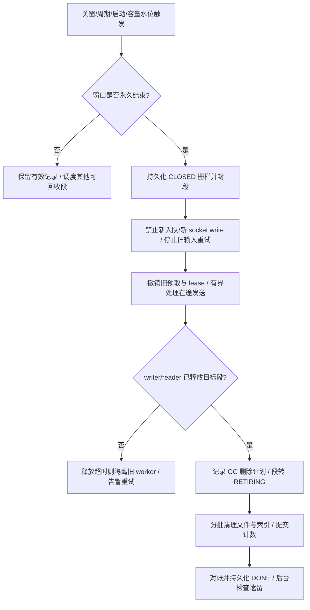

# VNext Spool 生命周期与长期运行解决方案

方案 ID：MC-VNEXT-SPOOL-LIFECYCLE-20261103

版本：1.0；日期：2026-11-03；方向：ENGINEERING；领域：software_system。
状态：工程设计，待实现与验收。本文不代表已修复、已部署或已证明性能无回退。

## 1. 设计结论与业务边界

采用“活动窗口结束立即失效、后台持续回收、每日全量对账、启动自动补偿”的机制。所有活动共享一个回收执行器，按已封存且不再被读写的段释放空间。避免每个活动单独重写混合 JSONL，也避免只靠午夜定时任务或服务重启清理。

用户确认的业务规则：某次发送时间窗口结束后，该窗口遗留的未完成、失败重试、孤立记录均允许清除，不跨窗口补发。次日新窗口的数据独立入队；暂停期间仍在有效窗口内的数据不属于可丢弃数据。

这里清除的是已失效的发送 payload 和恢复/调度元数据；活动配置、白名单、短信模板、有效窗口的数据以及按既有保留策略保存的发送结果不在此次无条件清除范围。已写往 SMSC 的短信不能撤回；没有响应的发送记为 unknown，不能在清理后制造“成功”或“重新发送”。

性能不回退必须经过真实负载对照验收。有限磁盘不能保证承载无限的有效数据或无限长的外部故障；本方案保证在已验证的容量、输入峰值与故障恢复范围内，历史死数据不会持续累积并耗尽发送空间。超出范围须明确背压并告警，不能通过删除仍有效的数据伪装业务正常。

## 2. 现状、证据与需要纠正的认识

线上证据是本次会话 2026-11-03 对 sms 服务器的只读快照，源代码证据是当前工作区。线上安装版本与工作区源码未做完整哈希比对；上线前必须补齐。以下计数不能视为持续刷新的监控数据。

| 证据 | 已确认现象 | 对方案的约束 |
|---|---|---|
| EVD-001 | 配置上限 4,294,967,296 bytes；日志 `spool byte budget exhausted`；manifest total_bytes=4,294,864,997 | 必须修复预算与回收，扩大上限仅能应急 |
| EVD-002 | manifest 4,000,791 条、5,118 个段；其中 2026-10-21 的 1,264 个段物理缺失，账面 1,081,269,808 bytes | 账面容量不能直接当作实际磁盘占用；需修复失配，缺失原因未确定 |
| EVD-003 | 167 个未列入 manifest 的文件共 303,984 bytes、279 条完整 JSON；186 条属 11-02、93 条属 11-03 | GC 必须覆盖孤立文件；“孤立”本身不等于“已过期” |
| EVD-004 | recovery index 共 4,001,007 条；11-02 有 123 条；index 与 manifest 不完全一致 | 不能只删文件或只更新一个计数 |
| EVD-005 | recovery-index.sqlite3=1,178,554,368 bytes；WAL=336,179,672 bytes | payload 预算和总磁盘预算分开；索引删除后还要控制物理文件增长 |
| EVD-006 | `rollover_if_needed` 只封日和递增 epoch；`runtime.stop()` 才调用 `cleanup_closed_days()`，异常被捕获后忽略 | 有清理函数和停机触发点，但缺少可靠的常态回收闭环 |
| EVD-007 | 默认 expires_at 为业务日次日零点；生产 enqueue 路径未传活动截止时间；VNext 下调度器跳过 legacy finalize | 需把窗口截止接入 VNext 入队和最终 socket fence；legacy SQL 不能代替 |
| EVD-008 | `_active_segment` 用 `len(entries)+1` 命名；reclaim 先删除文件，后更新索引/manifest；SQLite 无 segment_path 索引定义 | 回收后有文件名复用风险、崩溃中间态和大表删除代价，需要一并治理 |
| EVD-009 | `append_many` 逐条检查容量，循环完成后才提交 manifest/index | 容量异常可能留下部分追加；与线上孤立现象相容，但尚未证明其唯一原因 |

应纠正前面讨论中的两点：pending=0 表示调度游标状态，不代表送达成功，也不是现有 reclaim 的自动安全检查；当前约 4 GiB 是账面 payload 预算，不能全部当作仍存在的 JSONL。此次快照现存 JSONL 约 3.214 GB，另有索引及 WAL 占用。

业务时区沿用服务器已核实的 Africa/Addis_Ababa（UTC+3），所有入口、worker、GC、展示和测试使用同一时区规则。

## 3. 需求与范围

| 需求 | 目标行为 | 当前状态 | 目标元素 | 验收 |
|---|---|---|---|---|
| REQ-001 | 窗口结束不再发旧数据，清除未完成及孤立 payload | PARTIAL | ELM-001 窗口栅栏 | TST-001/002/003 |
| REQ-002 | 历史数据持续释放空间，日终和重启补偿 | PARTIAL | ELM-002 GC | TST-004/005/006 |
| REQ-003 | 文件、manifest、索引、游标与计数一致，崩溃可恢复 | PARTIAL | ELM-003 一致性协议 | TST-007/008/009 |
| REQ-004 | 有界索引、WAL、journal、审计、临时文件，防止其他存储再次撑满 | PARTIAL | ELM-004 存储治理 | TST-010/011 |
| REQ-005 | 清理不拖慢其他活动和有效发送，维持吞吐、公平性 | UNKNOWN | ELM-005 资源调度 | TST-012/013 |
| REQ-006 | 能提前发现容量风险、自动补偿并提供恢复操作 | PARTIAL | ELM-006 可观测与运维 | TST-005/014 |

六项均为 PROPOSED_TARGET；当前交付是本文设计，产品实现为下一阶段。复用现有 BusinessClock、单 spool writer、业务控制通道、progress journal、ProjectionWriter 和 StageCredit；不引入新的数据库引擎、消息中间件或独立 GC 服务。

## 4. 目标架构与所有权

ELM-001 由 VNext 控制层生成窗口状态，入口和 worker 共同执行。ELM-002/003 的控制状态由现有 spool owner 独占写入；维护调度可独立线程处理准备工作，但不能另启一个 TaskSpool 实例与线上 writer 抢写 manifest。ELM-004 的 projection 清理由 ProjectionWriter 自己执行。ELM-005 限制 GC 每次工作量。ELM-006 复用现有 metrics/status/CLI 和运维告警通道。

新增概念是一个“窗口实例”：`campaign_type + campaign_id + window_start_at + generation`。使用绝对开始/截止时间，不能仅用日期或字符串 HH:MM 比较。明确支持跨午夜窗口及夏令时边界；没有结束时间的窗口使用既有业务日截止，不猜测其他时间。

跨午夜窗口的有效数据必须保留到实际截止时间。实现需统一现有 business_day 路由与窗口实例语义，避免午夜 rollover 先行使它失效；迁移前必须验证当前活动是否存在这种配置。若现有业务定义禁止跨日，则配置校验应明确拒绝，不能一边允许配置一边午夜误清。

## 5. 窗口到期与清理决策

### 5.1 活动窗口结束时

在入队时写入该次窗口标识与绝对 `expires_at`，截止取窗口实际结束和活动总结束的较早值。entry、SMPP 写前均校验；批量入队前和提交前都要处理边界竞争，不能把前一窗口数据重新标成今天或新窗口。

到截止即持久化 CLOSED，优先切断该窗口的新入队、ingestion 重试、文件复制注册和新 socket write。人工修改结束时间或恢复活动不能复活已 CLOSED 的同一窗口；需显式产生新 generation，并继续拒绝旧来源事件。

未开始发送的 queued/retrying/部分入队及孤立记录可直接按过期丢弃规则进入回收，不要求每条先成功发送，也不等待它们 pending 自然变为零。处理中的文件/chunk 必须先通过 lease/generation 撤销阻止继续追加。

已经写往 socket 的数据不补发。仅等待有限的本地发送/响应收尾；超过协议配置期限，把未知结果持久化到独立结果账本，再释放 payload 引用。晚到响应可更新结果，但不得依赖已删除 spool 正文。远端送达回执不作为无限保留 payload 的条件。

窗口状态仅作用于指定窗口，不能将“当日关窗”等同于永久取消整个活动，影响次日开窗。

### 5.2 物理回收粒度

保留按分区组织、按业务窗口时间归属的现有段结构，优先删除整段，不在繁忙时逐行重写混合段。关窗和午夜均可封存当前活动段，并启动新的、编号唯一的段，使后续活动继续追加。

只要段中全部记录均已过期，且读写引用已释放，就可删除，不要求所有活动同时结束。混合了有效记录的段保留到最后一个窗口到期；首版不引入在线混合段 compaction，用完整窗口峰值容量覆盖这部分暂存。若真实容量验算不满足，上线门禁必须失败，并选择扩容到验证值或另行验收 compaction，不能忽略这一限制。

日终全局扫尾只删除已到期数据，不是无条件删除“全部活动”目录。全天/跨午夜活动继续运行。GC 在服务常驻时运行，不要求每日停服或重启。

### 5.3 孤立、缺失、损坏与未完成记录

回收输入是 manifest、recovery index 与实际文件清单的并集。不能只从 manifest 列出候选，否则此次 167 个孤立文件会永久遗留。

| 类别 | 决策 |
|---|---|
| 过期窗口的正常段、未完成段、可归属的孤立文件 | 同一 GC 协议回收，计入 discarded 数，不重新发送 |
| 有效窗口的孤立记录 | 进入受限一致性修复，不把孤立自动当作过期；保持原 ID 和过期时间，不直接重放 |
| manifest 指向缺失文件 | 检查删除计划和文件清单；过期数据清除悬挂元数据并重算；有效数据缺失单独报警 |
| 无法解析/CRC 不符/部分尾部 | 若由独立可信的段/目录归属证明整个窗口已关闭，可清除；否则隔离，禁止发送 |
| 无法确认归属的隔离文件 | 在受管 spool 内隔离并计入总预算；取得可信截止时间，或证明超过系统强制限制的最大有效窗口期限后方可删除；单凭隔离时长不足以证明过期 |
| 路径越界、符号链接或非受管文件 | 拒绝自动删除，作为路径安全错误报警，不跟随链接触碰外部目录 |

隔离目录、删除暂存目录和失败备份都必须有字节上限与保留策略；隔离数据删除始终以已证明过期为前提，目录 TTL 不覆盖该条件。不能通过换目录长期保存垃圾。原始外部 watch_dir、白名单与业务配置不在 GC 删除域。

新段必须同时在独立受校验的段注册表中记录所属窗口及最大有效截止时间，即使 payload 尾部损坏，也可由外部归属证据确认何时全部失效。系统校验允许的最大窗口期限，注册表与 CLOSED 栅栏共同防止无限延期。历史未知文件需要首轮治理取得可信截止归属；确实无法证明的不能擅自删除，隔离区达到上限须背压并告警，由运维作出具体数据处置决定。不得把仍有效的暂停窗口按隔离 TTL 删除。未知文件的积压属于可观测故障，不能计为已实现长期回收闭环。

## 6. 一致性与崩溃恢复协议

### 6.1 先修复部分追加

在现有单 writer 锁内，对去重后的整批记录完成规范化、分配 ordinal、CRC 编码和精确字节预检，再打开段；复用编码结果写入，不能重复渲染或对每条遍历全目录。容量不足整批拒绝，避免循环中途命中 4 GiB 留下无账 payload。

磁盘 I/O 错误或进程崩溃仍可能产生部分追加，因此需要每批持久化提交边界/尾部偏移与幂等恢复协议。worker 只读已提交边界；恢复仅扫描受影响尾部，而非每次启动重扫历史。返回未 accepted 的批次不应产生可发送记录；“已提交但响应未返回”的重试通过稳定 event_id 去重。

### 6.2 GC 状态机

`PLANNED → RETIRING → FILES_REMOVED → INDEX_COMMITTED → DONE`，每阶段可幂等重试。

1. spool owner 封存段，持久化 CLOSED/RETIRING 和待删段 ID、所属窗口、字节、记录数、计划版本。fsync 计划及必要目录。worker 不再打开 RETIRING 段。
2. 等待持有该段的 writer/预取 reader 确认释放；新窗口可以继续使用新段。不以固定 sleep 代替释放确认。
3. 删除文件；已有计划且文件不存在按已完成处理。未删除成功不能减少物理占用计数。
4. 使用索引按段 ID/segment_path 分批删除恢复记录；更新 manifest 和内存去重缓存并保持读者 generation 一致。跨文件/SQLite 的提交用删除计划完成恢复，不假称跨存储原子事务。
5. 提交回收计数和 DONE；短期保留有界完成凭证，随后按过期政策清除。启动先恢复未完成计划，再开放旧数据扫描。

过期未完成记录可以丢弃，但会生成有界的窗口汇总与必要的 unknown 发送证据；不能为了丢弃数百万条过期记录，再制造数百万条包含完整正文的 GC 日志。

### 6.3 必修的相关缺陷

- 文件编号持久化单调递增，不以剩余段数量命名；采用独占创建，发现已有路径即拒绝覆盖。GC 后继续写入也不能复用 ordinal/cursor 空间。
- 对 `spool_recovery_records.segment_path` 建索引，或引入等价的稳定段 ID 索引。新增索引在受控迁移阶段完成，避免业务高峰全表建索引。
- 当前大 `IN (...)` 查询改为固定上限的批次，按目标 SQLite 参数上限校验；不要一次加载数百万 event_id 来更新内存。
- owner 广播索引/manifest generation，worker 在批次边界刷新或清除旧缓存；进程本地 RLock 不能充当跨进程维护锁。
- 段移除后的 cursor 缺口需要显式的 retired ordinal 范围，使有效记录 checkpoint 能继续推进；不把剩余记录重编号。
- stop/GC 的异常必须记录失败阶段与重试状态，不能 `except: pass` 后宣称清理成功。
- CLOSED 栅栏、当前高水位、next_segment_id、next_ordinal 需要可恢复持久化；仅保持很小的近期状态，历史 CLOSED 明细和 GC 凭证也要老化。对过早业务日和过期绝对时间的拒绝规则长期有效，不能依赖无限保存全部事件 ID。

## 7. 存储全生命周期和容量

| 存储 | 正常用途 | 清理与上限 |
|---|---|---|
| spool JSONL | 已接收的待调度 payload | 窗口失效后整段回收；有效混合段暂存至全部失效 |
| recovery SQLite / 内存 event IDs | 定位、去重、重启恢复 | 同步清理已退休段的索引/缓存；页复用、WAL checkpoint；必要时低峰离线 compact |
| cursors/taken/manifest/GC 凭证 | 调度进度与一致性恢复 | 清理退休范围、修复悬挂条目、过期汇总老化；保留活跃高水位 |
| progress journal | 真实发送/响应证据 | 只有 projection 已提交且持久化 offset 确认的非活动段可删；不能按窗口到期粗暴删除未提交结果 |
| projection / task index | 历史结果、查询、统计 | 沿用明确 retention，按时间/条数受限删除；观测主文件/WAL与可复用页；不与 spool GC 共持长锁 |
| ingestion inbox/chunk/临时文件 | 解析、匹配与恢复 | 撤销过期 lease 后释放受管副本及过期任务元数据；保留有界窗口结果与防重复注册标记 |
| 日志、备份、隔离文件 | 审计与短期恢复 | 按天和总字节双限制，轮转/删除；不无限归档已回收 payload |

4 GiB 现有门限只约束 manifest 维护的 JSONL payload；总磁盘实际还包含 SQLite、WAL、journal、projection 等。因此建立两个口径：payload admission budget 与全部受管存储总预算，均报告真实值、账面值和差值。

容量设计基于峰值窗口总写入量，不以 pending 数量替代：即使当天消息都已发送，payload 仍可能保留到窗口结束。

`B_payload ≥ V_open_window_peak + V_mixed_segment_retained + R_peak × T_GC_recovery + B_next_window_reserve`

`B_disk ≥ B_payload + B_index + B_WAL + B_journal + B_projection + B_temp + B_maintenance_reserve`

其中输入率使用实际序列化字节/秒；R_peak 为峰值写入率，T_GC_recovery 为已验证的最长回收故障恢复时长。另验算 GC 有效释放速率大于长期过期数据生成速率。无实际峰值与维护耗时前，不能把 16/32 GiB 宣布成最终配置。

建议初始触发值：70% 提示并加速过期段 GC，85% 紧急 GC/预测告警，95% 预警式 admission 背压；均为待压测调优值，不替代现有更严格的 StageCredit 门限。不删除有效数据来降低水位，不做无界容量重试。为健康检查、GC 计划、结果落盘预留磁盘；强制 OS 物理磁盘压力检查在硬门限前起作用。

若当天有效窗口峰值已超过预算，应先调整容量或生产者受控背压；每日清理不能弥补同日容量不足。一个活动超额时优先限制该活动的入队份额，同时保留全局硬上限，不能拖死其他活动的发送与控制面。

## 8. 性能和调度约束

采用一个共享 GC 调度器，建议周期 60 秒，并接受关窗、业务日切换、启动和水位事件；周期及预算为待校准默认值。若一次执行未完成，持久化进度，下次续做。恢复/容量事件加速执行有界批次，不开启第二个并发执行器。

发送热路径只增加窗口/段 generation 的内存判断，采用现有控制刷新机制批量更新。不会每条短信查询 SQLite、扫描目录、重写文件或等待 GC。全量文件对账低峰分批进行，正常分钟巡检使用增量段元数据；GC 删除无需解码已有归属元数据的完整 JSONL。

建议首轮 GC 工作预算为每轮最多 32 段、每个 owner 写锁持有目标不超过 10 ms，实际按压测调整。每轮耗时超预算则让出；SQL 批次也按实际记录数/耗时限制，不能认为“只有 32 个文件”就天然短事务。限速同时应保证回收能力和恢复窗口，不能一直因繁忙让出导致永远清不完。

SQLite 删除优先复用空闲页；短周期后台 checkpoint 观察 busy 和耗时，不在高峰做全库 VACUUM。首次治理后可在一次维护窗口 compact；若索引峰值仍不满足预算，再单独评审按业务日分库/轮换索引，不首版重构所有存储。Linux 删除后要检查已打开文件引用是否仍占用磁盘，Windows 文件锁兼容性单独验证。

回收与 projection 写入争用存储 I/O，需要资源预算和实测，不能仅因独立线程便宣称零影响。定期维护可以推迟，但当可用空间不足以撑到下次低峰时必须告警和执行容量保护。

## 9. 监控、自动补偿与操作合同

新增/补齐 payload_used_bytes、actual_spool_bytes、index_bytes、WAL_bytes、journal_backlog_bytes、projection_bytes、reclaimable_bytes、oldest_expired_age、orphan_count、missing_count、manifest_bytes_drift、gc_last_success、gc_failures_by_stage、gc_pending_plans、gc_lock_hold_ms、gc_reclaimed_bytes、expired_discarded、discarded_unknown、next_window_capacity_margin。

容量预测使用近期有效峰值和下一窗口预计写入量，报告剩余时间。健康检查区分服务存活、可接收业务、清理退化；容量为零不能仍只报“进程正常”。目标告警链路使用现有运维平台，实际接收人/路由上线前绑定。

建议告警：关窗后 5 分钟仍有可回收 payload、连续 3 轮 GC 失败、账面/实际差异、下次窗口空间不足、结果 journal 接近硬上限。数字是目标默认值，需负载和运维验收；周末/无输入也持续执行 GC。

维护接口先支持只读 `gc plan/status`，执行命令 `gc run/reconcile` 通过现有管理员鉴权和单 owner 通道；本方案中的命令是待新增接口，不是当前可执行命令。返回 `GC_BUSY`、`WINDOW_OPEN`、`REFERENCES_ACTIVE`、`DISK_PRESSURE`、`RECONCILIATION_REQUIRED` 等稳定错误及可重试标志。应用服务用户只管理明确的 state/spool 目录，在线 GC 不依赖 sudo。

自动重试应有退避和最大间隔，成功后自动解除容量背压；单个损坏历史段只阻止其自身回收，不能让所有后续段永远不执行。超时未释放的旧 worker 在持久化关窗后按现有监督机制隔离并替换，保持“不重发”；真实结果证据继续由 journal 恢复。

## 10. 实施、首轮治理与回退

### P0：停止本次容量事故持续影响

先生成当前只读 GC 计划，重新核实业务时间、在途发送和 projection offset。不得在有效窗口内把前述 93 条当作过期。确认过去窗口不会补发后，安排一次维护窗口：停止 intake，持久化关窗并让 worker/projection 结束本地工作，取得排他 owner；对现存缺失文件、孤立文件、index/manifest 逐项归类。

在释放物理 payload 前保存有界的恢复材料与清理计划（含 SQLite 一致性备份，不能只复制活动 WAL 主文件），再回收已确认过期的 payload，修复悬挂元数据、孤立文件与预算；关闭连接后按需要 compact 索引。核实真实可用空间、次日容量余量和新数据入队。备份设总字节上限与短 TTL，不把生产手机号/正文复制进 Git 或部署包。

现有正常停止路径本身会删除 closed-day payload，因此恢复材料应在触发这条清理路径之前完成一致性快照，或由兼容维护模式明确抑制旧清理钩子后取得排他快照。不能先让旧 stop 清理、再声称备份覆盖清理前状态；使用哪条维护入口需在 P0 执行计划中核实。

不能把当前 `runtime.stop()` 无条件当作可靠的一键修复：它可能先删文件后失败，且异常不报告；重启前必须核实清理结果。是否临时提高预算取决于修复后的实际占用与当天峰值，不能只改环境变量掩盖账面失配。

### P1：可靠性闭环，必须一同交付

实现窗口实例截止与最终发送栅栏、批次提交边界、唯一段编号、可恢复 GC 计划、后台增量 GC、启动补偿、孤立/缺失对账、索引与缓存同步、过期 ingestion 终止和关键告警。所有入口（实时、批量、测试 canary）要显式说明窗口语义，不能留绕过路径。

### P2：容量与性能上线验收

完成全栈存储保留/上限，跑容量/崩溃/长期测试与同负载 AB/BA；确定 GC 预算、payload 和物理磁盘预留。先在独立 state 目录与 loopback SMSC 验证，再发布离线部署包，最后单活动小流量观察至少一次真实关窗、一次午夜及次日开窗。

P0 治理只能恢复空间；P1/P2 全部通过才可标记长期运行问题关闭。首轮维护可能需要短暂停服；稳态 GC 不以每日停服为前提。

回退保留新版本读取旧状态的兼容性和格式版本标记。GC 尚未执行时可关闭新维护功能回退代码；GC 执行后不得恢复旧 spool/旧游标重新对接真实 SMSC，也不能用全库回滚恢复已过期 payload。保留 CLOSED/GC 凭证，回退版本必须认识 retired 范围；否则退到兼容版本或在维护模式修复，禁止直接启动不兼容旧版。恢复发送结果不等于恢复发送资格。

## 11. 验收合同

所有下述测试为计划，尚未执行。性能/数据库 I/O/稳定性正式验收在目标原生 Linux 文件系统运行；记录 `df -T .`、Python 版本、依赖 freeze、代码/包哈希、配置、负载和原始观测，不能使用 `/mnt/<drive>` 数字作为性能基线。SLES12SP5 本机兼容性和 Windows 文件锁分别测试。

| 测试 | 必须证明的结果 |
|---|---|
| TST-001 窗口边界 | 截止后新 socket write 为 0；边界前后并发入队不串窗；下一窗口正常 |
| TST-002 多活动/跨午夜/暂停/配置变更 | 一个活动结束不影响另一个；跨午夜不误删；暂停有效数据保留；改时间不复活 CLOSED 窗口 |
| TST-003 未完成/孤立/在途 | 到期 queued/retrying/processing/部分尾部可回收；保留开放窗口数据；已写 unknown 不补发，晚响应结果可更新 |
| TST-004 容量释放 | 用低预算复现硬满；到期 GC 后实际文件和索引状态下降/复用，自动恢复入队，不依赖重启 |
| TST-005 丢失定时器/周末/GC 失败 | 启动补偿、周期重试和无活动日均推进；读者不释放超时可恢复并告警 |
| TST-006 长期保留 | 至少 30 个模拟业务窗口和 72 小时原生持续负载；同时具有过期丢弃与正常发送，存储峰值有界，旧数据无持续净增长 |
| TST-007 崩溃注入 | 每个 GC 持久化阶段及文件/索引更新间 kill；恢复后无有效数据误删、重复发送或重复减账；GC 可继续 |
| TST-008 入队边界 | 批末超预算整批拒绝，无可发送残片；fsync/manifest/index 间崩溃恢复保持稳定 event_id 与 accepted 边界 |
| TST-009 存储一致性 | 复现此次 1,264 缺失段、167 孤立文件和悬挂索引模式；不手改计数即收敛；GC 后编号不复用、游标缺口可推进 |
| TST-010 索引/元数据增长 | 删除分批、WAL 回收、空闲页复用，closed_days/内存 IDs/计划/日志也有界；大量段不超 SQL 参数上限 |
| TST-011 journal/projection/磁盘故障 | 未投影结果不误删；超时不妨碍过期 payload 回收；磁盘满/只读/权限不足具有明确恢复路径和告警 |
| TST-012 AB/BA 稳态性能 | 同硬件、同负载和同 SMPP 配置，基线/新版本各至少 3 轮；总 socket PDU TPS、匹配耗时、入队/发送 p95/p99、CPU/RSS/I/O/锁等待均对照 |
| TST-013 高峰 GC 与活动公平性 | 有效活动运行时持续删大量旧段，任何活动无饥饿；清理速度满足容量公式，不因限速无限延期 |
| TST-014 安全/回退/可观测 | symlink/路径越界拒绝；CLI/接口角色正确；清理后安全回退不重发；告警和自动解除背压真实可观测 |

性能发布要求：在未被 SMPP 限速掩盖的同负载试验下，不接受超出测量不确定性的可重复 TPS 下降、入队/发送 p95/p99 增加或匹配变慢，同时满足既有业务绝对 SLO。试验前固定负载、指标、统计方法、业务可感知分辨率与至少 95% 置信区间，采用配对 AB/BA 验证；结果不足以排除回退则为 INCONCLUSIVE，补测或优化，不能标记通过。禁止将 2% TPS 下降或 5% 延迟增加作为默认允许回退；只有用户明确放宽目标才能另立非劣效界值。

GC lock p99 不超过 10 ms、每次关窗后 5 分钟内回收可删段为建议 TARGET，需实测校准；异常段须具有已告警的明确故障。后台线程仍有 CPU/I/O 成本，本方案以热路径隔离、资源预算及真实对照试验验证业务效率，不能在测试前承诺物理零开销。

还须报告逻辑消息数与 PDU 数、accepted 与实际 socket 写入数，不能混为吞吐。30 个模拟窗口用于时间正确性，72 小时用于真实 I/O 和资源趋势；两者都不能单独证明无限运行。已有可靠性/性能门禁不得回退。

## 12. 架构决策与追溯

| 决策 | 备选 | 选择及原因 | 重新评审条件 |
|---|---|---|---|
| DEC-001 清理触发 | 活动逐条物理清理 / 仅午夜 / 增量 GC + 日终补偿 | 选择第三项，及时回收且不频繁重写混合段 | 混合段滞留超过容量预算 |
| DEC-002 存储形态 | 新消息队列/按活动分库 / 复用现有 spool+段 GC | 复用并补齐协议，保持发送分片和部署依赖 | 索引/文件数量经优化仍超性能门禁 |
| DEC-003 过期处理 | 等待全部发送成功 / 按用户规则到期丢弃 | 到期丢弃未完成 payload，unknown 证据独立保存 | 用户改变跨窗补发规则 |
| DEC-004 一致性 | 直接 rm/改计数 / 持久计划与幂等恢复 | 选择后者，跨文件和 SQLite 不假设原子性 | 存储事务边界改变 |
| DEC-005 性能治理 | 按条扫描/在线全量 VACUUM / 整段分批后台处理 | 选择第三项，减少锁和 I/O；低峰 compact 单独安排 | 有效窗口写入量超过可提供容量 |

源码定位与实现范围：

| 元素 | 现有能力/缺口 | 拟修改位置 | 对应需求/测试 |
|---|---|---|---|
| ELM-001 | CAP-001 PARTIALLY_SUPPORTED：已有 business-day/socket fence，缺窗口闭环 | `backend/vnext/business_day.py`、`ingress.py`、`worker.py`；`backend/services/vnext_service.py`、活动服务与 scheduler | REQ-001；TST-001/002/003 |
| ELM-002 | CAP-002 PARTIALLY_SUPPORTED：已有显式 reclaim，缺在线常态触发/孤立扫描 | `backend/vnext/spool.py`、`runtime.py` | REQ-002；TST-004/005/006 |
| ELM-003 | CAP-003 PROPOSED：批次提交与可恢复 GC、一致编号/缓存 | `spool.py`、`worker.py`、现有 control/supervisor | REQ-003；TST-007/008/009 |
| ELM-004 | CAP-004 PARTIALLY_SUPPORTED：已有 journal reclaim/projection retention，整体物理有界待证明 | `projection_writer.py`、ingestion 服务、日志轮转/CLI | REQ-004；TST-010/011 |
| ELM-005 | CAP-005 PROPOSED：维护资源预算与验证 | `runtime.py`、压力控制、现有真实入口 acceptance harness | REQ-005；TST-012/013 |
| ELM-006 | CAP-006 PARTIALLY_SUPPORTED：现有 metrics/CLI，缺维护和漂移指标 | `backend/tools/vnext_stats.py`、metrics/status 与既有管理员接口 | REQ-006；TST-005/014 |

材料处理回执：MAT-001 用户规则与会话排查结果已处理（MPR-001）；MAT-002 上述源码实际方法已处理（MPR-002）；MAT-003 项目 AGENTS 验收规范已处理（MPR-003）；MAT-004 历史 Stage Independence/Backpressure 文档已处理（MPR-004），仅作历史架构约束，不采用其过时的“整批预检已实现”作为当前事实。未把手机号、短信正文或凭据写入方案。

NFR-001 性能、NFR-002 故障恢复/不重发、NFR-003 存储有界、NFR-004 隐私与路径安全、NFR-005 维护可观测，对应第 6–11 节的明确协议和测试。

未决证据：Q-001 线上源码/包身份；Q-002 实际跨午夜活动配置；Q-003 峰值窗口序列化量和目标硬件 GC 实测；Q-004 现有结果保留/告警路由；Q-005 文件缺失/孤立的历史来源。以上是实施/发布前验证项，不妨碍采用本生命周期设计。不能用设计文档取代这些验证。
