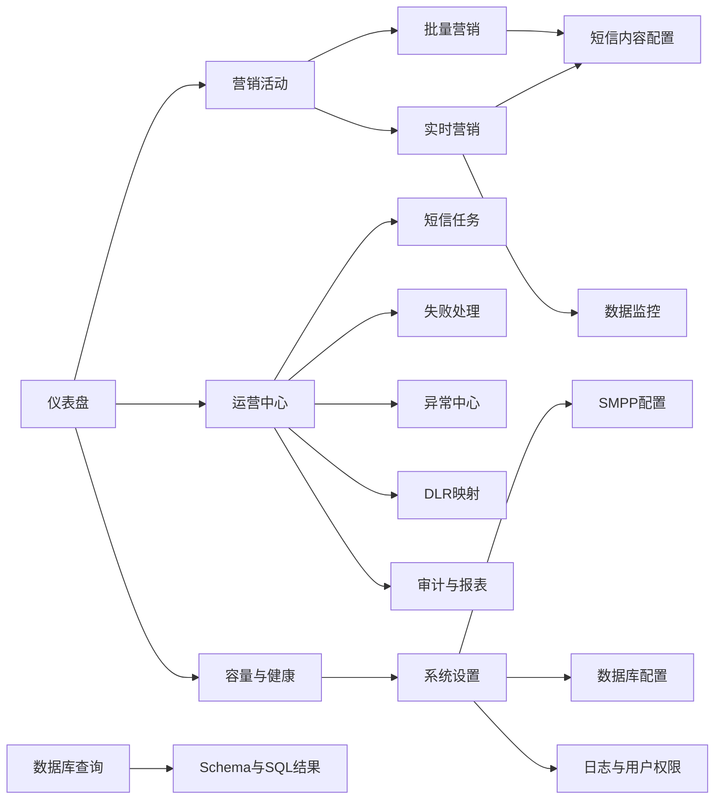

# 报表方案和功能设计报告

## 1. 项目概述

| 项目 | 内容 |
| --- | --- |
| 项目名称 | Marketing Copilot 营销运营报表与活动管理系统 |
| 文档版本 | V1.0 |
| 编制日期 | 2026-09-01 |
| 报表对象 | 营销活动、短信任务、文件接入、系统运行状态 |
| 现行实现形态 | Vue 3 + TypeScript + Element Plus 自研管理界面 |
| 数据服务 | FastAPI + DuckDB + 本地活动目录；RabbitMQ 为可选数据入口 |
| 设计基准 | 当前代码实现、当前数据库模型、`截屏`目录下的界面截图 |

本方案面向营销运营人员、系统管理员和项目负责人，形成从活动配置、数据接入、短信内容管理、任务执行到运行监控的一体化报表与操作界面。

## 2. 建设目标

1. 以仪表盘集中呈现活动数量、发送状态、实时匹配规模和异常情况。
2. 以批量营销和实时营销两个业务入口承载不同的数据接入方式。
3. 统一管理短信内容、语言模板、发送方、SMPP 配置和活动时间窗口。
4. 将文件、用户、活动、任务、回执和异常关联起来，支持从汇总指标下钻到明细。
5. 为数据监控、运营处理、容量检查、数据库查询和系统设置提供统一入口。
6. 保持现状实现与后续增强的边界清晰：当前指标来自业务数据库记录，规划中的外部 BI 数据集成不改变当前口径。

## 3. 需求分析

### 3.1 业务需求清单

| 编号 | 需求 | 主要用户 | 当前设计状态 | 结果形态 |
| --- | --- | --- | --- | --- |
| REQ-001 | 查看营销运营总览 | 运营人员、项目负责人 | 当前实现 | KPI 卡片、发送趋势、异常面板、快捷入口 |
| REQ-002 | 创建和维护批量营销活动 | 运营人员 | 当前实现 | 活动表格、活动详情、名单上传、批次管理 |
| REQ-003 | 创建和维护实时营销活动 | 运营人员 | 当前实现 | 活动表格、白名单、监听目录、事件文件接收 |
| REQ-004 | 按文件和名单生成营销目标 | 运营人员 | 当前实现 | 文件记录、行数、匹配用户数、输出文件 |
| REQ-005 | 管理多语言短信内容 | 运营人员 | 当前实现 | 短信内容列表、语言模板、变量预览、版本记录 |
| REQ-006 | 查看发送任务状态 | 运营人员、运维人员 | 当前实现 | 任务列表、状态统计、错误信息、任务时间线 |
| REQ-007 | 处理失败任务和异常 | 运维人员 | 当前实现 | 失败重试、失败归档、异常检查、异常解决 |
| REQ-008 | 查看发送回执及状态映射 | 运维人员 | 当前实现 | DLR 状态码、任务状态、可重试性 |
| REQ-009 | 检查容量与依赖服务 | 运维人员 | 当前实现 | Worker、SMPP、目录及容量状态 |
| REQ-010 | 管理数据源和数据库连接 | 系统管理员 | 当前实现 | 数据库 Schema、SQL 查询、连接测试 |
| REQ-011 | 管理运行参数和目录 | 系统管理员 | 当前实现 | 系统模式、目录、日志级别、保留天数 |
| REQ-012 | 支撑安装、调测和运行恢复 | 实施人员、运维人员 | 当前实现 | 健康检查、配置测试、日志、备份与恢复机制 |

### 3.2 角色与使用场景

| 角色 | 关注内容 | 典型操作 |
| --- | --- | --- |
| 项目负责人 | 项目整体状态和展示结果 | 查看仪表盘、活动数量、发送趋势、异常数量 |
| 运营人员 | 活动配置和营销执行 | 创建活动、上传名单、配置模板、启动或结束活动 |
| 数据管理员 | 数据文件和用户范围 | 查看 Schema、扫描文件、检查行数、确认匹配结果 |
| 运维人员 | 任务、链路和容量 | 查看任务状态、重试失败、检查 SMPP、查看 DLR 和审计 |
| 系统管理员 | 系统连接和运行参数 | 配置数据库、SMPP、RabbitMQ、日志及目录 |

## 4. 报表信息架构

### 4.1 页面清单

| 页面 | 页面目的 | 核心内容 | 关键动作 |
| --- | --- | --- | --- |
| 仪表盘 | 运营总览 | 今日发送、进行中、实时匹配用户、异常、7日趋势 | 刷新、创建批量活动、管理实时活动、查看失败任务、检查容量 |
| 批量营销 | 文件批量下发 | 活动、时间、星期、名单、批次、状态、准备度 | 新增、编辑、上传名单、配置短信、启动、结束、复制、删除 |
| 实时营销 | 事件触发营销 | 活动、事件文件、匹配用户、监听目录、文件前缀、准备度 | 新增、上传白名单、配置短信、启动、结束、复制、删除 |
| 短信内容配置 | 模板管理 | 营销类型、活动、语言、短信正文、版本 | 新增、编辑、删除、查看版本、预览变量 |
| 数据监控 | 文件接入观察 | 监听目录、目录状态、当前文件、处理判断、文件大小、行数 | 扫描、刷新、按活动筛选 |
| 运营中心 | 运行操作台 | 活动进度、短信任务、失败处理、异常、容量、DLR、审计 | 刷新、重试、归档、健康检查、解决异常、导出 |
| 数据库查询 | 数据结构与查询 | Schema、表搜索、SQL 编辑器、查询结果 | 查表、执行 SQL、清空输入 |
| 系统设置 | 系统参数 | 活动目录、系统模式、日志级别、保留天数、SMPP、数据库、用户权限 | 保存、测试连接、查看日志、更新配置 |

## 5. 指标与维度设计

### 5.1 仪表盘核心指标

| KPI 编号 | 指标 | 业务定义 | 计算逻辑 | 数据粒度 | 数据来源 |
| --- | --- | --- | --- | --- | --- |
| KPI-001 | 今日发送 | 当日已完成投递状态的短信任务数 | `COUNT(sms_tasks)`，条件为 `status='delivered'`、`delivered_at` 非空且日期为当天 | 任务 | `sms_tasks` |
| KPI-002 | 进行中活动 | 当前状态为 `in_progress` 的批量和实时活动数 | `COUNT(batch_campaigns where status='in_progress') + COUNT(realtime_campaigns where status='in_progress')` | 活动 | 两类活动表 |
| KPI-003 | 实时匹配用户 | 实时事件文件与活动名单匹配的用户总量 | `SUM(realtime_campaign_files.matched_count)` | 活动文件 | `realtime_campaign_files` |
| KPI-004 | 未解决异常 | 当前仍未解决的系统事件数 | `COUNT(system_events where resolved=0)` | 系统事件 | `system_events` |
| KPI-005 | 7 日发送趋势 | 最近 7 个自然日的已投递短信数量 | 按 `CAST(delivered_at AS DATE)` 分组统计 `COUNT(*)` | 日期 | `sms_tasks` |
| KPI-006 | 任务完成率 | 活动任务中已完成任务占比 | `finished / total × 100%`，其中完成包含已投递及其他终态任务 | 活动 | `sms_tasks`、运营服务聚合结果 |
| KPI-007 | 文件处理完成度 | 已完成文件数占文件总数的比例 | `finished_files / total_files × 100%` | 活动文件 | `processed_files` 或实时文件聚合结果 |
| KPI-008 | 活动准备度 | 活动满足执行前置条件的项目数 | 批量为名单、模板、SMPP、时间窗口四项；实时另加白名单、监听目录、文件前缀等配置 | 活动 | 活动表、模板表、SMPP配置 |

### 5.2 维度定义

| 维度 | 取值或示例 | 用途 |
| --- | --- | --- |
| 活动类型 | `batch`、`realtime` | 区分批量营销和实时营销 |
| 活动状态 | `not_started`、`in_progress`、`paused`、`completed`、`ended`、`cancelled` | 活动生命周期过滤 |
| 任务状态 | `queued`、`sending`、`submitted`、`accepted`、`delivered`、`retrying`、`failed`、`expired` | 发送任务统计和重试处理 |
| 语言 | English、Amharic、Tigrigna、Somali、Oromign 等 | 模板匹配和内容展示 |
| 时间 | 创建时间、任务日期、提交时间、投递时间、事件接收时间 | 趋势、时效和审计 |
| 文件 | 文件名、目录、文件大小、行数、哈希、处理状态 | 接入质量和重复识别 |
| 用户 | MSISDN、语言、事件字段、活动关联 | 目标用户明细和去重 |
| 通道 | SMPP 配置、Host、Port、优先级、连接池 | 通道状态和发送路由 |
| 异常 | 类别、严重级别、错误码、解决状态 | 运行健康和运维处置 |

## 6. 功能设计

### 6.1 活动配置

活动统一使用名称、起止日期、每日发送时间、发送星期和 SMPP 配置作为基础属性。批量活动增加批次大小和目标名单；实时活动增加白名单、监听目录、监听文件名前缀和手机号前缀。

活动启动前执行准备度检查：

- 批量活动：目标名单、短信模板、SMPP 配置、时间窗口。
- 实时活动：白名单、短信模板、SMPP 配置、时间窗口、监听目录、监听文件名前缀。

活动进入 `in_progress` 后，调度器按活动时间窗口处理批次或实时输入文件。活动结束后不再创建新的发送任务。

### 6.2 数据接入

批量活动通过 CSV/Excel 客户名单生成批次；实时活动通过白名单和事件文件进行交集匹配。文件进入系统后登记文件名、路径、大小、行数、哈希和处理状态，重复文件按活动类型、活动 ID 和文件名进行识别。

### 6.3 短信内容

短信内容以营销类型和营销活动 ID 关联业务活动。一个内容活动可维护多种语言模板，每条模板包括语言、正文、发送方和启用状态。正文支持事件字段、用户字段等变量替换，生成发送任务前完成渲染，避免将 `{variable}` 直接发送到短信通道。

### 6.4 运行报表

运营中心按照“活动进度—短信任务—失败处理—异常中心—容量与高可用—DLR 映射—审计与报表”组织信息。活动进度显示任务完成数、文件完成数和批次完成数；失败处理显示失败分类、错误信息和任务时间线；审计与报表提供操作记录与 CSV 导出。

## 7. 数据刷新与交互策略

| 场景 | 刷新方式 | 设计说明 |
| --- | --- | --- |
| 仪表盘 | 首次加载 + 手动刷新 | 汇总指标以一次 API 返回，趋势和异常同屏展示 |
| 活动列表 | 首次加载 + 手动刷新/分页 | 页面按活动维度分页，详情页承载用户和文件明细 |
| 数据监控 | 手动扫描 + 刷新 | 当前页面提供目录扫描能力，扫描结果可回查 |
| 短信任务 | 定时刷新任务统计和明细 | 任务状态区分已提交、已投递、重试和失败 |
| 运营中心 | 按页签加载 | 避免一次加载全部操作数据 |
| 数据库查询 | 用户触发 SQL | 查询结果与 Schema 结构在同一页面呈现 |
| 系统配置 | 保存后重新读取 | 连接测试与保存动作分离，减少错误配置影响 |

## 8. 当前实现边界

### 8.1 当前已形成的能力

- 已形成统一左侧导航、顶部面包屑、语言切换和管理用户入口。
- 已形成仪表盘、活动、短信内容、数据监控、运营中心、数据库查询和系统设置页面。
- 已形成 DuckDB 业务数据模型，包含活动、文件、任务、回执、异常、审计和用户等实体。
- 已形成活动调度、任务 Worker、SMPP 网关、回执处理、失败重试和过期恢复逻辑。
- 已形成当前截图所示的桌面端展示基线：深青色侧栏、白色卡片、金黄色主色、浅色工作区。

### 8.2 规划增强项

- 将仪表盘指标沉淀为独立的报表数据集或 DataCube，支持跨周期、跨活动和跨通道分析。
- 增加指标口径版本、数据质量结果和指标血缘展示。
- 将监控扫描结果进一步接入告警通知和可配置 SLA。
- 对 SQL 查询、目录路径、凭据和角色权限实施更严格的生产安全策略。
- 在保持当前页面结构不变的前提下，增加导出模板、对比分析和历史趋势。

## 9. 设计结论

本报表方案以“运营总览—活动管理—数据接入—任务执行—运行运维—系统配置”为主线，统一了业务指标、数据维度和页面功能。仪表盘承担汇总观察，活动详情承担业务下钻，运营中心承担状态处理，数据库查询和系统设置承担数据与运行支撑，能够覆盖当前项目的报表展示与营销管理场景。

