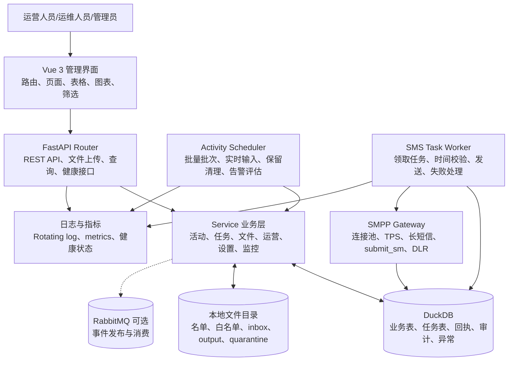
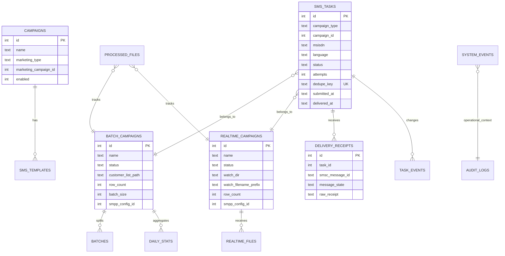
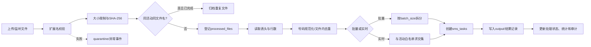
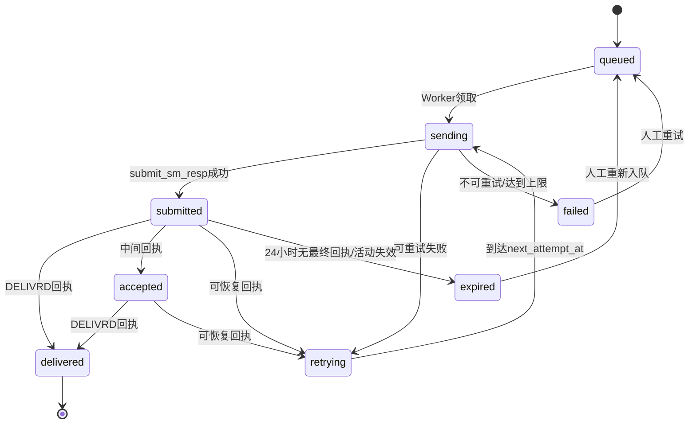
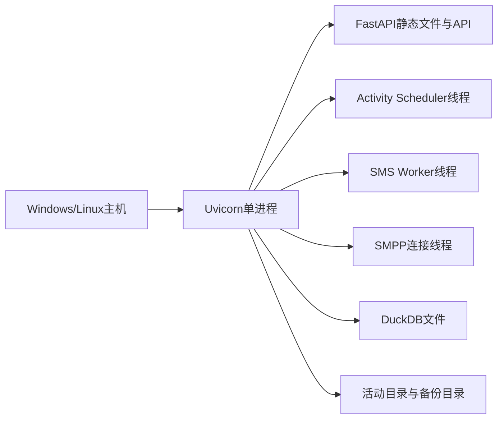

# 数据逻辑及底层架构设计

## 1. 设计概述

| 项目 | 内容 |
| --- | --- |
| 项目名称 | Marketing Copilot 营销运营报表与活动管理系统 |
| 文档版本 | V1.0 |
| 编制日期 | 2026-09-01 |
| 数据库 | DuckDB |
| 后端 | FastAPI + Service 分层 |
| 前端 | Vue 3 + TypeScript + Element Plus |
| 文件数据 | CSV/Excel、本地活动目录、输入/输出/隔离目录 |
| 消息能力 | RabbitMQ 可选；短信通道采用 SMPP 网关 |

## 2. 总体架构

### 2.1 分层职责

| 层 | 组件 | 职责 |
| --- | --- | --- |
| 展示层 | Vue 3、Vue Router、Element Plus、Axios | 页面呈现、表格分页、筛选、操作反馈、国际化 |
| 接口层 | FastAPI Router | 参数校验、文件接收、资源路由、HTTP 错误映射 |
| 业务层 | `*_service.py` | 活动生命周期、文件处理、任务状态、模板渲染、运维操作 |
| 调度层 | `activity_scheduler.py` | 每 3 秒处理批量和实时输入，执行日清理和健康评估 |
| 任务层 | `task_worker.py` | 持久化任务领取、活动窗口校验、开发/生产发送、失败处理 |
| 数据层 | DuckDB | 活动主数据、文件记录、任务、回执、异常、审计和设置 |
| 文件层 | 活动目录 | 输入名单、监听 inbox、输出结果、重复文件和隔离文件 |
| 通道层 | `smpp_gateway.py`、RabbitMQ | SMPP 发送与回执；消息队列作为可选事件入口 |
| 运维层 | 日志、指标、健康检查、备份 | 连接状态、Worker、SMPP、异常与数据库运行保障 |

## 3. 数据实体模型

## 4. 主要数据表与用途

| 数据域 | 表 | 关键字段 | 用途 |
| --- | --- | --- | --- |
| 内容域 | `campaigns` | `marketing_type`、`marketing_campaign_id`、`enabled` | 短信内容活动主表 |
| 内容域 | `sms_templates` | `campaign_id`、`language`、`content`、`source_addr` | 多语言短信模板 |
| 活动域 | `batch_campaigns` | 时间窗口、`batch_size`、名单路径、SMPP ID | 批量活动主数据 |
| 活动域 | `batch_campaign_batches` | 活动 ID、批次序号、行范围、状态 | 批量拆分与批次进度 |
| 活动域 | `realtime_campaigns` | 白名单、监听目录、文件前缀、时间窗口 | 实时活动主数据 |
| 文件域 | `realtime_campaign_files` | 文件名、事件用户数、匹配数 | 实时事件接收与匹配统计 |
| 文件域 | `processed_files` | 文件哈希、大小、总行数、创建任务数、状态 | 文件幂等与处理追踪 |
| 任务域 | `sms_tasks` | 目标号码、正文、状态、尝试次数、去重键 | 持久化发送任务 |
| 任务域 | `delivery_receipts` | 任务 ID、SMSC ID、回执状态、原文 | 投递回执记录 |
| 任务域 | `task_events` | 任务 ID、前后状态、事件消息 | 任务时间线 |
| 运维域 | `system_events` | 分类、级别、错误码、解决状态 | 异常面板和健康告警 |
| 运维域 | `audit_logs` | 用户、动作、资源、资源 ID、详情 | 操作追踪与导出 |
| 配置域 | `smpp_configs` | Host、Port、账号、连接池、TPS、优先级 | SMSC 连接和发送参数 |
| 配置域 | `app_settings` | key/value | 系统模式、日志、保留期等运行参数 |
| 安全域 | `users`、`exclusion_users` | 用户角色、启用状态、号码、原因 | 用户管理与排除名单 |

## 5. 数据来源与接入逻辑

### 5.1 数据来源

| 来源 | 数据内容 | 接入方式 | 目标表/目录 |
| --- | --- | --- | --- |
| 批量客户文件 | MSISDN、用户属性、语言及活动字段 | 页面上传 CSV/Excel | 批量活动名单路径、`processed_files` |
| 实时白名单 | 可参与实时活动的目标号码和语言 | 页面上传 CSV/Excel | 实时活动客户名单路径 |
| 实时事件文件 | 事件号码、事件过滤 ID、Cell、Offer 等 | 页面接收或 inbox 目录 | `realtime_campaign_files`、输出文件、任务表 |
| 短信模板 | 多语言正文、变量和发送方 | 页面维护 | `campaigns`、`sms_templates` |
| SMPP 回执 | SMSC message ID、message state、原始回执 | SMPP `deliver_sm` | `delivery_receipts`、`sms_tasks` |
| 运行状态 | Worker、SMPP、目录、容量、异常 | 服务状态检查 | 运营中心和仪表盘 |

### 5.2 文件处理链路

## 6. 指标计算逻辑

### 6.1 仪表盘指标

| 指标 | 公式/SQL 逻辑 | 时间口径 | 空值口径 |
| --- | --- | --- | --- |
| 今日发送 | `COUNT(*) FROM sms_tasks WHERE status='delivered' AND delivered_at IS NOT NULL AND CAST(delivered_at AS DATE)=CURRENT_DATE` | 投递时间 | 无数据返回 0 |
| 进行中活动 | 批量 `status='in_progress'` 数 + 实时 `status='in_progress'` 数 | 当前状态快照 | 无活动返回 0 |
| 实时匹配用户 | `SUM(matched_count)` | 当前已登记的实时文件 | 无文件返回 0 |
| 未解决异常 | `COUNT(*) FROM system_events WHERE resolved=0` | 当前异常快照 | 无异常返回 0 |
| 7 日趋势 | 最近 7 日按投递日期分组，缺失日期补 0 | 投递时间 | 每个日期都返回一行 |
| 任务完成率 | `finished / total × 100` | 当前活动/批次 | `total=0` 时显示 0% |
| 实时匹配率 | `matched_count / total_msisdn × 100` | 单个事件文件 | 分母为 0 时显示 0% |
| 批量批次完成率 | `sent_or_skipped / total_batches × 100` | 当日批次 | 分母为 0 时显示 0% |

### 6.2 任务状态逻辑

任务使用 `dedupe_key` 实现幂等控制，关键组成是活动类型、活动 ID、目标号码和任务日期。同一活动同一天同一号码不会重复创建任务。多分片短信记录多个 SMSC message ID，只有所有分片收到成功回执时才转为 `delivered`。

## 7. 批量与实时数据逻辑

### 7.1 批量活动

1. 活动状态为 `in_progress` 且存在有效目标文件。
2. 调度器生成 `batch_campaign_batches`，每批按 `batch_size` 保存起止行号和总数。
3. 批次处理时读取对应行，执行号码清洗、活动日去重、排除名单过滤和模板渲染。
4. 为有效目标创建 `sms_tasks`，批次状态由 `pending` 进入处理中或完成状态。
5. Worker 从任务表领取任务，校验活动时间、星期和当日发送窗口后进入 SMPP 发送。
6. 任务状态、批次状态、活动每日统计和输出文件同步更新。

### 7.2 实时活动

1. 活动必须具备有效白名单、监听目录、监听文件名前缀、短信模板、SMPP 配置和时间窗口。
2. 调度器扫描或同步活动 inbox，等待文件稳定后登记处理记录。
3. 读取事件文件中的号码和事件字段，进行号码规范化与文件内去重。
4. 事件号码与活动白名单求交集，计算总事件用户数和匹配用户数。
5. 根据白名单用户语言选择模板，替换 `event_filter_id`、`cell_id`、`msisdn`、`offer_code` 等变量。
6. 以活动、号码和日期构造去重键，创建持久化任务并写入输出记录。
7. 处理成功文件，重复文件移入 duplicates，格式或数据异常文件移入 quarantine，并生成系统事件。

## 8. SMPP 与发送通道逻辑

SMPP 网关从启用配置中按优先级选择通道，支持连接池、轮询、TPS 限制、重连冷却和备用配置切换。单条任务发送时执行：

1. 建立或复用 `transceiver` 连接。
2. 使用 `smpplib.gsm.make_parts()` 进行 GSM/Unicode 长短信拆分。
3. 按配置的 `source_addr`、TON/NPI、data coding 和 registered delivery 发送。
4. 保存 `submit_sm_resp` 返回的 SMSC message ID。
5. 监听 `deliver_sm`，写入原始回执并映射任务状态。
6. 传输失败按尝试次数和错误类型决定 `retrying` 或 `failed`。

开发模式使用模拟成功回执，生产模式连接实际配置的 SMSC。系统设置、SMPP 配置和运行模式共同决定通道行为。

## 9. 数据质量与一致性

| 控制项 | 实现逻辑 | 结果 |
| --- | --- | --- |
| 文件格式 | 仅允许 CSV/XLSX/XLS 等配置允许的扩展名 | 非法格式进入错误路径 |
| 文件大小 | 使用配置的最大文件字节数限制 | 防止超大文件占用资源 |
| 文件幂等 | 活动类型 + 活动 ID + 文件名唯一；保存哈希 | 重复输入不重复建任务 |
| 号码清洗 | 去除格式噪声并按活动前缀规则处理 | 统一目标号码 |
| 文件内去重 | 按号码去重 | 同一文件不重复创建任务 |
| 任务幂等 | `dedupe_key` 唯一约束 | 同活动同日同号码只保留一条 |
| 模板渲染 | 创建任务前替换变量，保留渲染结果 | 发送正文可追溯 |
| 回执幂等 | 按任务、SMSC ID、状态去重 | 重复回执不重复累计 |
| 状态恢复 | 过期 `sending` 恢复为 retrying；超时提交任务进入 expired | Worker 或回执异常可恢复 |
| 保留清理 | 非活动终态按配置保留天数清理 | 控制 DuckDB 和日志体量 |

## 10. API 与数据服务边界

| API 分组 | 代表接口 | 服务责任 |
| --- | --- | --- |
| Dashboard | `GET /api/dashboard/stats` | 汇总 KPI、趋势和未解决异常 |
| 批量活动 | `/api/batch-campaigns` | 活动 CRUD、上传名单、生成批次、批次处理 |
| 实时活动 | `/api/realtime-campaigns` | 活动 CRUD、上传白名单、接收文件、统计 |
| 短信任务 | `/api/sms-tasks` | 任务列表、状态统计、重试、投递确认、排除名单 |
| 运营中心 | `/api/operations` | 进度、失败、异常、容量、DLR、审计和导出 |
| 文件监控 | `/api/monitor` | 目录扫描、文件登记、文件处理状态 |
| 配置 | `/api/settings`、`/api/smpp`、`/api/db-config` | 运行参数、SMPP、数据库连接 |
| 查询 | `/api/db-query` | Schema 浏览和 SQL 查询 |

## 11. 部署与运行设计

- 前端通过 Vite 构建为静态资源，生产环境由后端或网关提供。
- 后端启动时初始化 DuckDB、日志、实例锁、调度器和 Worker。
- 当前应用进程内包含调度、任务 Worker 和 SMPP 长连接，建议单 Uvicorn Worker 运行。
- DuckDB 通过 `CHECKPOINT` 和备份服务生成备份文件，备份保留数量由环境变量控制。
- 健康检查区分应用就绪、数据库连接、Worker、SMPP 和目录状态。
- 生产环境需要使用环境变量或安全配置注入数据库路径、日志路径、实例锁和发送参数。

## 12. 架构决策

| 编号 | 决策 | 选择 | 原因 |
| --- | --- | --- | --- |
| DEC-001 | 主数据存储 | DuckDB | 单节点部署轻量、SQL 能力完整、适合当前活动和任务型报表 |
| DEC-002 | 后端分层 | Router → Service → Database/File | 保持接口、业务逻辑和存储职责分离 |
| DEC-003 | 任务持久化 | `sms_tasks` 作为发送事实表 | 任务状态、重试和回执需要跨进程重启保存 |
| DEC-004 | 异步执行 | Scheduler + Worker | 文件接入、批次生成和 SMSP 发送不阻塞页面请求 |
| DEC-005 | 回执语义 | `submitted` 与 `delivered` 分离 | SMSC 接收提交不等同于最终投递成功 |
| DEC-006 | 文件幂等 | 文件记录 + 唯一约束 + 哈希 | 防止重复扫描和重复发送 |
| DEC-007 | 消息队列 | RabbitMQ 可选 | 保留扩展入口，同时不让当前系统依赖外部消息中间件才能运行 |

## 13. 后续数据平台增强

1. 建立按日、活动、通道和语言的发送事实 DataCube，避免大型趋势查询直接扫描明细任务表。
2. 增加指标字典和数据血缘，记录每个 KPI 的表、字段、过滤条件、聚合方式和刷新时间。
3. 增加数据质量表，保存文件行数、有效号码数、去重数、匹配数、创建任务数和异常数。
4. 将实时监控从手动扫描增强为事件驱动接入，并保留文件哈希和处理回执。
5. 对数据库查询实施只读角色、SQL 类型白名单和审计记录。

