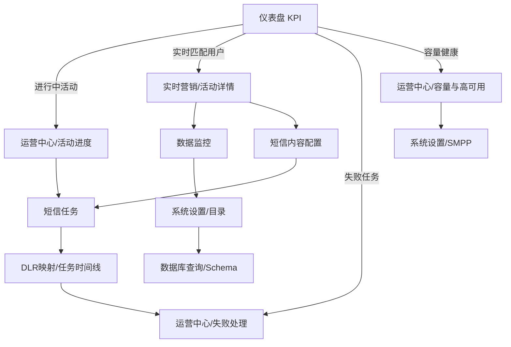

# Dashboard 设计效果图及功能说明

## 1. 设计基准

| 项目 | 内容 |
| --- | --- |
| 项目名称 | Marketing Copilot 营销运营报表与活动管理系统 |
| 文档版本 | V1.0 |
| 编制日期 | 2026-09-01 |
| 设计对象 | 仪表盘、营销活动、数据接入、运营运维和系统设置 |
| 图片来源 | 项目目录 `截屏` |
| 主色 | 金黄色，用于主按钮、激活线、重点数字和状态提示 |
| 辅色 | 深青绿色侧栏、浅灰绿色工作区、白色卡片 |
| 布局 | 左侧固定导航 + 顶部面包屑 + 内容卡片/表格 |

## 2. 全局界面规范

### 2.1 页面骨架

### 2.2 视觉组件

| 组件 | 设计表现 | 功能意义 |
| --- | --- | --- |
| 侧栏导航 | 深青色背景、白色文字、激活项白色圆角底 | 识别当前业务模块 |
| 顶部栏 | 白色背景、面包屑、admin 头像、语言下拉 | 定位页面和管理用户上下文 |
| 主按钮 | 金黄色填充、白色文字、圆角 | 新增、启动、执行、保存等主操作 |
| 次按钮 | 白色底、浅灰边框 | 刷新、取消、清空和辅助动作 |
| 内容卡片 | 白底、圆角、轻阴影 | 分隔 KPI、图表、空态和功能区域 |
| 状态标签 | 绿色表示完成/健康，黄色表示待处理，红色表示异常 | 快速识别运行状态 |
| 表格 | 浅色表头、分隔线、右侧固定操作 | 支持明细阅读和行级操作 |
| 分页 | 右下角总数、上一页、页码、下一页 | 长列表浏览 |
| 空态 | 图标 + 状态文字 + 简短说明 | 无异常或无数据时保持信息完整 |

## 3. 页面效果图与功能说明

### 3.1 仪表盘

| 区域 | 显示内容 | 功能说明 |
| --- | --- | --- |
| KPI 区 | 今日发送、进行中、实时匹配用户、未解决异常 | 展示当前营销运行快照 |
| 趋势区 | 最近 7 日发送趋势柱状图 | 以日期为横轴、已投递任务数为纵向度量 |
| 异常区 | 异常数量、异常列表或健康空态 | 点击查看运营中心异常页签 |
| 快捷操作 | 创建批量活动、管理实时活动、查看失败任务、检查容量 | 将高频动作前置到总览页 |
| 页面操作 | 刷新 | 重新读取仪表盘汇总数据 |

当前截图展示的样例值为：今日发送 0、进行中 3、实时匹配用户 29、未解决异常 0；趋势日期显示 08-26 至 09-01。数值随数据库任务和活动状态变化。

### 3.2 批量营销

| 区域 | 显示内容 | 功能说明 |
| --- | --- | --- |
| 页面标题 | 批量营销、功能说明 | 说明当前页面以数据文件批量下发短信 |
| 新增入口 | 新增活动 | 创建活动并设置时间窗口、批次大小和发送配置 |
| 活动表格 | ID、活动名称、开始/结束时间、每日时间、发送日、活动状态、准备度 | 查看活动执行条件和生命周期 |
| 准备度 | 绿色标签 + `n/n` | 表示名单、模板、SMPP、时间窗口等前置项完成度 |
| 行操作 | 详情、开始活动、更多 | 进入详情、启动或执行编辑/上传/配置/复制/删除 |
| 分页 | 总条数和页码 | 浏览批量活动列表 |

批量活动的数据链路为“客户名单 → 批次拆分 → 持久化任务 → Worker 发送 → 回执更新”。

### 3.3 实时营销

| 区域 | 显示内容 | 功能说明 |
| --- | --- | --- |
| 页面标题 | 实时营销、功能说明 | 说明当前页面以事件文件触发实时短信营销 |
| 活动表格 | ID、活动名称、接收文件数、匹配用户数、事件用户数、起止时间、每日时间、发送日 | 查看实时活动的输入规模和发送时间 |
| 准备度 | 绿色/黄色状态标签 + `n/n` | 查看白名单、模板、SMPP、时间窗口、监听目录和前缀配置 |
| 行操作 | 详情、开始活动、更多 | 进入详情、接收文件、配置短信、复制、删除 |
| 新增入口 | 新增活动 | 创建实时活动并设置监听目录和文件名前缀 |

实时活动的数据链路为“事件文件 → 号码提取与去重 → 白名单交集 → 语言模板渲染 → 持久化任务 → SMPP 回执”。

### 3.4 数据监控

| 区域 | 显示内容 | 功能说明 |
| --- | --- | --- |
| 任务级监听目录 | 实时营销活动筛选、目录路径、目录状态、文件名前缀 | 观察当前实时活动的数据入口 |
| 运行中的活动 | 运行活动数量、扫描全部活动、自动刷新 | 触发或周期性获取目录状态 |
| 当前文件表 | 文件名、监听目录、处理判断、原因、文件大小、行数 | 判断文件是否正在处理及其规模 |
| 状态反馈 | 成功标签、监听中标签 | 区分目录健康和文件处理状态 |

当前页面强调文件入口和处理状态，不直接承担活动配置；活动配置从实时营销页面进入。

### 3.5 运营中心

| 页签 | 内容 | 功能说明 |
| --- | --- | --- |
| 活动与进度 | 类型、活动、状态、任务进度、文件、批次、操作 | 查看批量/实时活动执行进度并进行启动、暂停、恢复、完成或取消 |
| 短信任务 | 任务统计、筛选、明细 | 查看任务状态、目标号码、正文、错误和尝试次数 |
| 失败处理 | 失败任务、失败分类、错误信息、失败归档 | 批量重试、归档和下载失败清单 |
| 异常中心 | 健康检查、异常分类、严重级别、错误码、处理状态 | 检查 SMPP、Worker、目录和系统事件 |
| 容量与高可用 | Worker、SMPP、连接池、容量告警 | 评估运行承载和通道健康 |
| DLR 映射 | 回执状态码、任务状态、是否可重试 | 统一解释 SMSC 状态 |
| 审计与报表 | 时间、用户、动作、资源、资源 ID、详情 | 查询操作追踪并导出报表 |

### 3.6 短信内容配置

| 区域 | 显示内容 | 功能说明 |
| --- | --- | --- |
| 内容列表 | ID、营销类型、活动名称、语言、短信内容、操作 | 统一查看批量和实时营销模板 |
| 多语言行 | 同一内容活动下按语言展开 | 支持 English、Amharic 等语言模板并列维护 |
| 操作区 | 编辑、删除、版本 | 修改正文、删除模板或查看版本历史 |
| 新增入口 | 新增活动 | 创建短信内容活动并关联营销活动 |
| 分页 | 总条数和页码 | 管理多条短信内容 |

模板正文支持变量预览，变量在任务创建时根据事件、用户和活动数据替换。

### 3.7 数据库查询

| 区域 | 显示内容 | 功能说明 |
| --- | --- | --- |
| Schema 标题区 | 数据库 Schema、SQL 查询、表搜索、刷新 | 查看当前数据库结构并定位表 |
| SQL 编辑器 | 多行 SQL 输入区 | 执行数据查询或按权限允许的数据库操作 |
| 操作确认 | 确认写操作 | 为有副作用的 SQL 增加显式确认 |
| 结果区 | 查询结果表格或加载状态 | 返回列名、行数据和执行结果 |

### 3.8 系统设置

| 页签 | 内容 | 功能说明 |
| --- | --- | --- |
| 基础设置 | 批量营销根目录、实时营销根目录、系统模式、日志级别、任务保留天数、输入/输出文件保留天数、明细日志 | 管理活动目录和运行行为 |
| SMPP 配置 | Host、Port、账号、Bind、编码、连接池、TPS、重连参数 | 管理短信发送通道 |
| 数据库配置 | 数据库路径和连接测试 | 切换或检查 DuckDB 数据文件 |
| 日志查看 | 日志级别、日志内容和下载 | 定位运行异常 |
| 系统更新 | 版本、上传、校验、应用和回滚 | 管理应用更新 |
| 用户与权限 | 用户、角色、启用状态 | 管理系统操作人员 |

截图展示的基础设置包含生产模式、INFO 日志、短信任务保留 3 天、实时输入文件保留 1 天、实时输出文件保留 30 天和明细日志开关。

## 4. 页面之间的交互关系

## 5. 组件与报表指标映射

| 页面组件 | 对应指标/数据 | 交互动作 |
| --- | --- | --- |
| 仪表盘 KPI 卡片 | KPI-001～KPI-004 | 点击快捷入口进入相应操作页 |
| 7 日柱状图 | KPI-005 | 以日期维度展示投递量趋势 |
| 活动准备度标签 | KPI-008 | 打开活动配置补齐缺失项 |
| 活动任务进度条 | KPI-006 | 查看任务完成数和总数 |
| 文件/批次计数 | KPI-007 | 进入活动详情或数据监控 |
| 实时匹配用户 | KPI-003 | 进入实时活动文件明细 |
| 状态标签 | 活动状态、任务状态、文件状态 | 依据状态显示启动、暂停、重试、解决等动作 |
| 异常列表 | KPI-004、`system_events` | 跳转异常中心并处理 |
| DLR 表 | 回执状态映射 | 判断任务是否可重试 |
| 审计表 | `audit_logs` | 过滤动作并导出 CSV |

## 6. 响应式与状态设计

### 6.1 页面状态

| 状态 | 展示方式 |
| --- | --- |
| 加载中 | 表格或数据区域显示加载状态，保留页面结构 |
| 有数据 | 卡片、趋势、表格和操作入口正常显示 |
| 无数据 | 使用图标、标题和说明形成完整空态 |
| 健康 | 绿色标签、成功提示或“暂无异常”空态 |
| 警告 | 黄色标签、待完善准备度或可重试提示 |
| 错误 | 红色错误标签、错误码、原因和重试动作 |
| 部分数据 | 保留已加载内容并显示刷新/重试入口 |

### 6.2 屏幕适配

- 桌面端保持左侧导航与宽表格布局，适合运营中心和数据库查询。
- 中等宽度下仪表盘 KPI 由四列切换为两列，内容区域由双栏切换为单栏。
- 小屏幕下 KPI 保持两列，快捷操作按钮纵向排列，宽表格通过横向滚动保留字段完整性。
- 目录、文件名、SQL 和短信正文使用可换行或横向滚动，避免内容被截断。

## 7. Dashboard 页面设计结果

当前界面已形成完整的管理后台视觉体系：

1. 页面层级统一，用户能够通过侧栏、面包屑和标题快速定位业务模块。
2. 运营总览以 KPI、趋势、异常和快捷操作组成闭环。
3. 活动管理以表格为核心，保留时间、状态、准备度和行级操作。
4. 数据监控和运营中心分别承担输入文件观察和运行状态处理。
5. 短信内容、数据库查询和系统设置覆盖模板、数据和运行参数三个支撑面。
6. 金黄色主色贯穿新增、启动、执行、保存和重点数据，绿色/黄色/红色用于运行状态识别。

